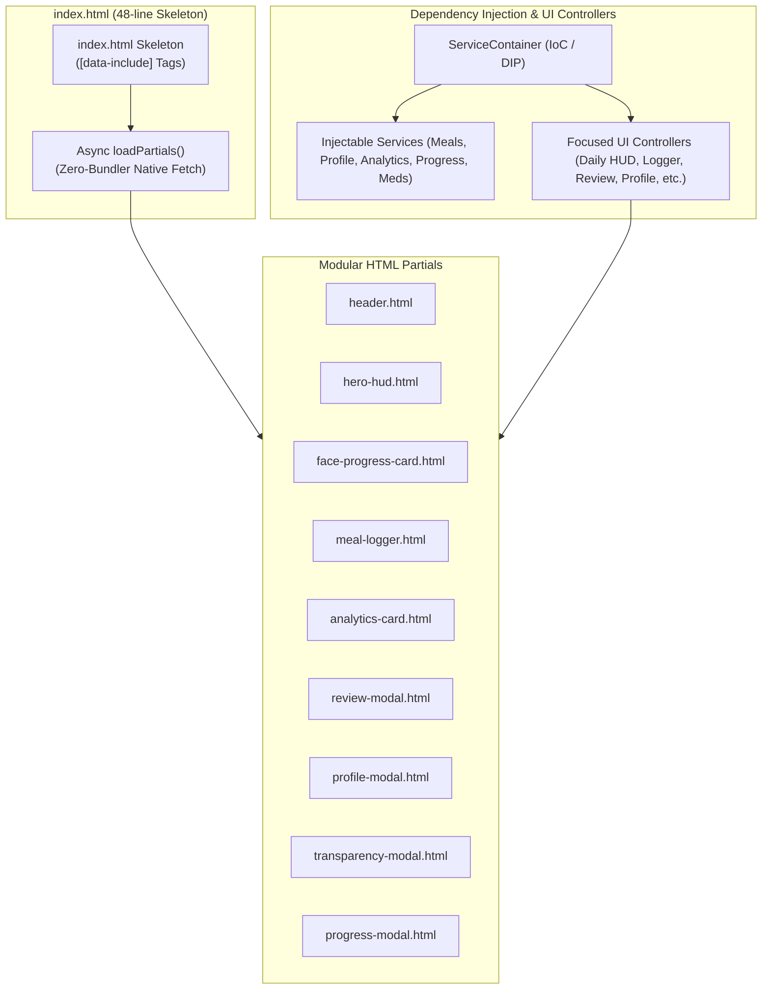
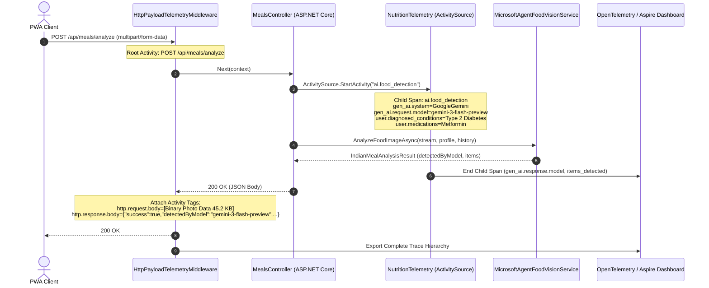
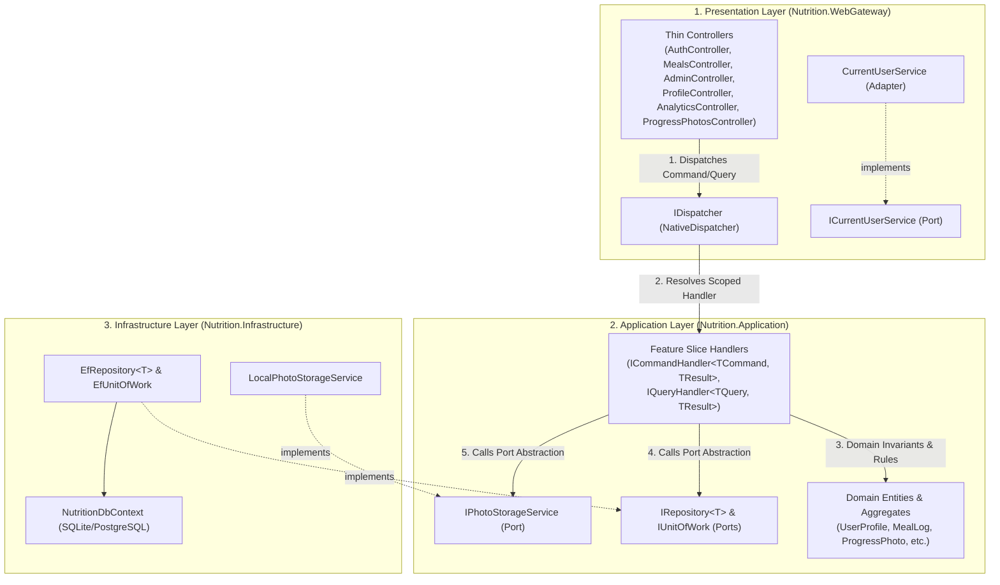
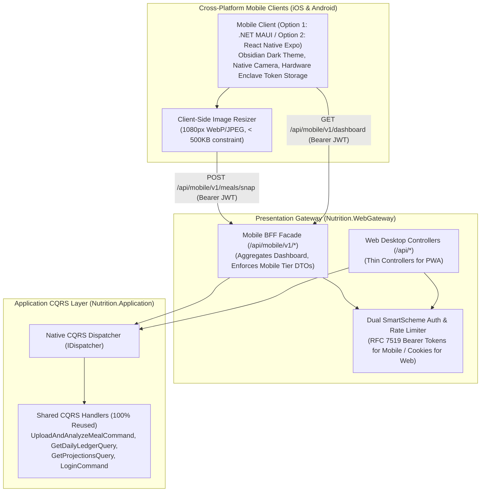
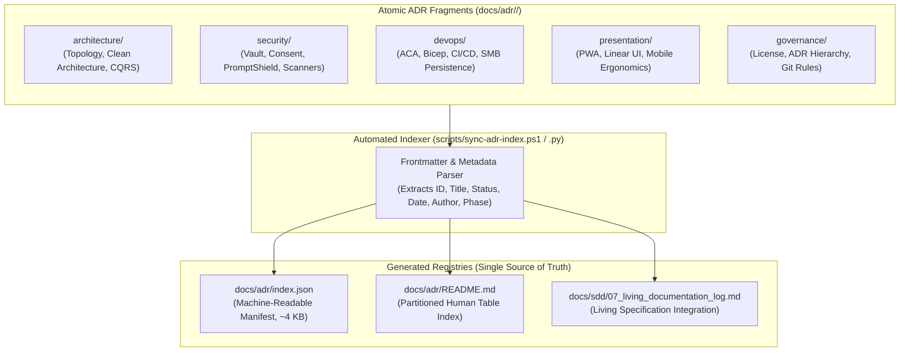

<!--
  Copyright (c) 2026 diet-dost and/or its contributors.
  Licensed under the "GNU Affero General Public License v3.0 only" and
  the "Server Side Public License, v 1"; you may not use this file except
  in compliance with, at your election, the "GNU Affero General Public
  License v3.0 only" or the "Server Side Public License, v 1".
-->

# Master Solution Architecture & Multi-Dimensional Diagrams
> **Specification Version**: `v1.4.0 (Production & Living SDD)`  
> **Architecture Topology**: Distributed Clean Architecture, .NET 11 Aspire AppHost, Azure Container Apps & Key Vault  
> **Key Dimensions**: Design System, Application Microservices, Security Boundary, DevOps, Functional Engine, Subsystem ADR Hierarchy  

---

## 1. Master Solution Architecture Blueprint

The solution architecture integrates core architectural dimensions into a cohesive, decoupled topology:

```mermaid
graph TB
%%
%% Copyright (c) 2026 diet-dost and/or its contributors.
%% Licensed under the "GNU Affero General Public License v3.0 only" and
%% the "Server Side Public License, v 1"; you may not use this file except
%% in compliance with, at your election, the "GNU Affero General Public
%% License v3.0 only" or the "Server Side Public License, v 1".
%%

    %% =========================================================================
    %% MASTER SOLUTION ARCHITECTURE: DIET DOST (.NET 11 & ASPIRE)
    %% Clean Architecture, Native CQRS, Azure Container Apps, SQLite SMB Mount, Key Vault
    %% =========================================================================

    subgraph LAYER_CICD ["0. CI/CD & PRE-DEPLOYMENT SECURITY GATE (Zero Deployment on Failure)"]
        direction TB
        GATE_Scanners["Security & Code Scanning Pipeline (security-scan.yml)<br/>Gitleaks | ESLint | Roslyn, DevSkim & CodeQL (All 7 .csproj) | Trivy | Checkov | actionlint | AI Defense"]
        GATE_Summary["Security Gate Summary Table & PR Comment Publisher<br/>Blocks Azure Deployment if Any Scanner Fails"]
        GATE_Deploy["Two-Stage Automated Deployment Workflows<br/>Stage 1: azure-infra-deploy.yml (Bicep IaC) | Stage 2: azure-app-deploy.yml (ACA & Custom Domain TLS)"]
        GATE_Scanners --> GATE_Summary
        GATE_Summary -->|100% Green PASS| GATE_Deploy
    end

    subgraph LAYER_DESIGN ["1. PRESENTATION LAYER (Linear.app Glassmorphic PWA Client)"]
        direction TB
        UI_Linear["Linear Design System<br/>(Obsidian #08090a, Linear Violet #5e6ad2, Emerald #27c380)<br/>Geist Sans & Tabular Numbers"]
        UI_AuthGate["Obsidian Dark Auth Gate<br/>(Dual DPDPA 2023 Forensic Consent & Tier Engine)"]
        UI_PWA["PWA Web Client & Mobile Ergonomics<br/>(Camera Capture, Habit Streak HUD, Macro Gauges, Mobile Bottom Nav)"]
        UI_Tiers["Dynamic Tier Status Badges<br/>(Free, Basic, ⚡ Premium, 👑 SuperAdmin)"]
        UI_Diary["Food Diary & History<br/>(1D/7D/30D/90D Filter, Card/Grid Toggle, Excel Export)"]
        UI_DeleteModal["Custom Obsidian Delete Modal<br/>(Danger Pulse & Deficit Recalculation Advisory)"]
        UI_Fallback["Static Vector Fallback Armor<br/>(placeholder-meal.svg & placeholder-progress.svg)"]
        UI_Offline["Client-Side Offline Engine<br/>(WASM SQLite with OPFS / IndexedDB Dexie.js & ServiceWorker)"]
        
        UI_Linear --- UI_AuthGate
        UI_AuthGate --- UI_PWA
        UI_PWA --- UI_Tiers
        UI_PWA --- UI_Diary
        UI_Diary --- UI_DeleteModal
        UI_PWA --- UI_Fallback
        UI_PWA <-->|Offline Caching & Background Sync| UI_Offline
    end

    subgraph LAYER_SECURITY ["2. SECURITY & BOUNDARY DEFENSE LAYER (OWASP ASVS & LLM Defenses)"]
        direction TB
        SEC_Perimeter["Perimeter & Transport Security<br/>(TLS 1.3, Strict CSP, Minimal CORS, Secure HTTPOnly Cookies)"]
        SEC_DualAuth["Dual SmartScheme Authentication<br/>(RFC 7519 JWT Bearer + Secure HttpOnly Cookie)"]
        SEC_DebugGuard["Debug-Only Demo User Security Isolation<br/>(#if DEBUG & IAppEnvironment.AllowsDemoUsers)<br/>Release Mode Seeding Suppression & Auto-Deactivation"]
        SEC_RateLimit["ASP.NET Core RateLimiter<br/>(Polly Sliding Window per User IP / Bearer Token)"]
        SEC_FileArmor["File Ingestion Armor<br/>(Magic Byte Check: JPEG/PNG/WEBP, Max 8MB, EXIF GPS Stripper)"]
        SEC_AIGuard["PromptShieldValidator & Content Safety<br/>(Harmful, Violent, Sexual, Communal & Self-Learning Injection Shields)"]
        SEC_GoogleSafety["Google AI StrictSafetySettings<br/>(BLOCK_LOW_AND_ABOVE Harassment, Hate Speech, Sex, Dangerous)"]
        SEC_DataFilter["Data Isolation Guardrails<br/>(EF Core Global Query Filters: UserId == CurrentUser.Id)"]
        SEC_VaultAuth["Sole Authority Secret Governance (@nikunjbanker)<br/>Azure Key Vault with Purge Protection & Passwordless Managed Identity"]
    end

    subgraph LAYER_GATEWAY ["3. PRESENTATION GATEWAY & BACKEND-FOR-FRONTEND (Nutrition.WebGateway)"]
        direction TB
        CONTROLLERS["Thin REST Controllers (.NET 11)<br/>(AuthController, MealsController, ProfileController, AnalyticsController, AdminController, NotificationsController)"]
        HUB_Notification["NotificationHub (/hubs/notifications)<br/>Real-Time SignalR WebSockets, CSWSH Shield & Applicant Groups"]
        BFF_Composite["Web BFF Composite Hydration (/api/web/v1/dashboard)<br/>Parallel Task.WhenAll CQRS Execution & Sub-50ms Payload"]
        BFF_Mobile["Mobile BFF Facade (/api/mobile/v1/*)<br/>Compact Cellular DTOs & Hardware Token Handshake"]
        MW_Pipeline["HTTP Middleware Pipeline<br/>(Authentication, Rate Limiting, Exception Handling RFC 7807, HttpPayloadTelemetry)"]
        CONFIG_DB["Configuration Architecture<br/>(Strongly-Typed Options Pattern + FluentValidation + Azure Key Vault Provider)"]
    end

    subgraph LAYER_APPLICATION ["4. APPLICATION LAYER (Nutrition.Application - Clean Architecture)"]
        direction TB
        CQRS_Engine["Native CQRS Pipeline (Zero MediatR Dependency)<br/>(Pure Microsoft.Extensions.DependencyInjection Handlers)"]
        
        subgraph USECASES_AUTH ["Identity & Security Use Cases"]
            CMD_Login["LoginCommandHandler<br/>(Debug-Only Demo Guard, Alpha Approval Check & JWT Generation)"]
            CMD_Register["RegisterUserCommandHandler<br/>(Alpha Owner Review Gate & SuperAdmin Notification Dispatch)"]
            CMD_Reset["ResetPasswordCommandHandler<br/>(Active User Check & Policy)"]
            SVC_Notification["IInAppNotificationService<br/>(Realtime SignalR Dispatch & AppNotification Persistence)"]
        end

        subgraph USECASES_VISION ["Meal Vision Use Cases"]
            CMD_MealUpload["UploadMealCommandHandler<br/>(Tier Quota Check & Cascade Vision)"]
            CMD_MealReview["ReviewMealCommandHandler<br/>(Macro Recalculation)"]
        end

        subgraph USECASES_PROFILE ["Clinical Profile Use Cases"]
            CMD_SaveProfile["SaveProfileCommandHandler<br/>(Mifflin-St Jeor & ICMR-NIN Safeguards)"]
            QRY_GetProfile["GetProfileQueryHandler<br/>(TDEE & Target Budget Calculation)"]
        end

        subgraph USECASES_ANALYTICS ["Analytics & Ledger Use Cases"]
            QRY_Ledger["GetTodayLedgerQueryHandler<br/>(6-Macro Balances & Daily Deficit)"]
            QRY_History["GetMealHistoryQueryHandler<br/>(Multi-Period Trend Filtering)"]
        end

        PORTS["Application Ports & Abstractions<br/>(ISecretStore, IAppEnvironment, IPhotoStorageService, ISqliteStorageVaultSyncService, IRepository, IUnitOfWork)"]
    end

    subgraph LAYER_DOMAIN ["5. DOMAIN CORE LAYER (Nutrition.Domain - DDD)"]
        direction TB
        subgraph AGGREGATES ["Domain Aggregates & Entities"]
            AGG_User["ApplicationUser (Aggregate Root)<br/>(DPDPA Consent Timestamps, SecurityStamp, DemoEmails, Tier, Role)"]
            AGG_Profile["UserProfile (Aggregate Root)<br/>(Height, Weight, Pace, Dietary Preference, IANA Timezone)"]
            AGG_Meal["MealLog (Aggregate Root)<br/>(MealType, PhotoUri, Status: Uploaded->Analyzed->Verified)"]
            AGG_Ledger["DailyCalorieLedger (Aggregate Root)<br/>(Date, Consumed, Budget, Pending Deficit)"]
            ENT_Secret["AppSecret Entity<br/>(Key, Value, Description, CreatedAtUtc, UpdatedAtUtc)"]
            ENT_TierConfig["TierFeatureConfiguration<br/>(DailyAiLimit: 1, 7, 30, -1; PhotoCompare; DataExport)"]
            ENT_Notification["AppNotification Entity<br/>(RecipientRole, RecipientUserId, Type, IsRead, MetadataJson)"]
        end

        subgraph CLINICAL ["Clinical Dietetics Safeguards (ICMR-NIN 2024 & WHO)"]
            CALC_BMR["Mifflin-St Jeor BMR & TDEE Multipliers"]
            CLIN_Floors["Starvation Floors (1200 kcal F / 1500 kcal M)"]
            CLIN_Rules["Clinical Matrix (Diabetes, HTN, Thyroid, NAFLD Adjustments)"]
            CLIN_WHO["WHO Asian-Indian Cutoffs & 3:1 Cereal:Pulse Ratio"]
        end
    end

    subgraph LAYER_INFRASTRUCTURE ["6. INFRASTRUCTURE & ZERO-TRUST CLOUD (Nutrition.Infrastructure & Azure)"]
        direction TB
        ADAPTER_Secrets["KeyVault & DatabaseSecretStore Adapters<br/>(ConcurrentDictionary In-Memory Cache)"]
        ADAPTER_Env["AppEnvironment Adapter<br/>(#if DEBUG Preprocessor & IHostEnvironment)"]
        ADAPTER_Repo["EfRepository & EfUnitOfWork<br/>(Generic EF Core Data Access)"]
        ADAPTER_Photo["LocalPhotoStorageService<br/>(Cryptographic SHA-256 Hashed File Storage)"]
        ADAPTER_Jwt["JwtTokenService<br/>(HMAC-SHA256 Token Issuer via ISecretStore)"]
        ADAPTER_Agent["Microsoft Agent Framework Vision Agent<br/>(Multi-Model Cascade: 3-Flash -> 2.5-Flash -> 2.5-Pro)"]
        ADAPTER_Vault["SqliteStorageVaultSyncService<br/>(Local Ephemeral /tmp Active SQLite + Azure Files Vault Sync)"]
        
        DB_Context["DietTrackerDbContext<br/>(Universal UTC ValueConverter, Schema-Aware PRAGMA, Collection ValueComparers)"]
        AZURE_NSG["Network Security Group: nsg-dietdost-dev<br/>Stateful Zero-Trust Firewall (Checkov CKV_AZURE_9 & CKV_AZURE_160)<br/>HTTPS Inbound 443 | Port 445 Storage | 443 Cloud & Gemini AI"]
        AZURE_ACA["Azure Container Apps (Serverless MicroVM)<br/>Single Revision Mode & Single Replica (min:1, max:1)<br/>Custom Domain: dev.dietdost.app with Free Managed TLS"]
        AZURE_SMB[("Azure Files Persistent SMB Share<br/>Durable Vault: /app/data/diet_dost.db<br/>Active Cache: /tmp/diet_dost.db (WAL Mode)<br/>SMB 3.1.1 AES-128/256-GCM Wire Encryption")]
        AZURE_AKV[("Azure Key Vault (Purge Protection Enabled)<br/>Sole Authority: @nikunjbanker<br/>Managed Identity Access & AuditEvent Diagnostics")]
        AZURE_ACR[("Azure Container Registry (ACR)<br/>Passwordless Image Pull (acrPullRole)")]
        AZURE_ALERT["Azure Monitor Threat Metric Alert<br/>Key Vault 401/403 Unauthorized Spikes (>5 in 5m)"]
    end

    subgraph LAYER_ORCHESTRATION ["7. DEVOPS, GOVERNANCE & OBSERVABILITY (.NET Aspire 13.5.4)"]
        direction TB
        ASPIRE_Host[".NET Aspire AppHost (net11.0 / Sdk 13.5.4)<br/>(Distributed Orchestration & Typed Topology)"]
        ASPIRE_Dash["Aspire Developer Dashboard (:18888)<br/>(Live Resources, Distributed Traces, GenAI Semantic Spans)"]
        OTEL_Collector["OpenTelemetry (OTel) Pipeline<br/>(NutritionTelemetry ActivitySource 'Nutrition.DietDost')"]
        TEST_Harness["Validation Harnesses<br/>(259 Automated Tests across 7 Projects + validate_e2e_tiers.ps1 Across 5 Demo User Tiers)"]
        ADR_Registry["Subsystem Domain ADR Architecture (docs/adr/)<br/>(architecture, security, devops, presentation, governance)<br/>docs/adr/index.json Machine-Readable Registry (~4 KB)"]
    end

    %% Flow Connections
    GATE_Deploy -.->|Deploys Infrastructure & Container| AZURE_ACA
    UI_PWA -->|HTTPS / WSS| SEC_Perimeter
    SEC_Perimeter --> SEC_RateLimit
    SEC_RateLimit --> SEC_DualAuth
    SEC_DualAuth --> CONTROLLERS
    
    CONTROLLERS --> MW_Pipeline
    CONTROLLERS --> CQRS_Engine
    CONFIG_DB -.->|Injects Options & Secrets| CONTROLLERS
    
    CQRS_Engine --> CMD_Login
    CQRS_Engine --> CMD_Register
    CQRS_Engine --> CMD_MealUpload
    CQRS_Engine --> CMD_SaveProfile
    CQRS_Engine --> QRY_Ledger

    CMD_Login --> SEC_DebugGuard
    CMD_Login --> PORTS
    CMD_MealUpload --> SEC_AIGuard
    SEC_AIGuard --> SEC_GoogleSafety
    CMD_MealUpload --> PORTS
    CMD_SaveProfile --> PORTS
    QRY_Ledger --> PORTS

    PORTS -.->|Implements| ADAPTER_Secrets
    PORTS -.->|Implements| ADAPTER_Env
    PORTS -.->|Implements| ADAPTER_Repo
    PORTS -.->|Implements| ADAPTER_Photo

    ADAPTER_Repo --> DB_Context
    ADAPTER_Secrets --> DB_Context
    DB_Context --> AZURE_SMB
    ADAPTER_Secrets -.->|Runtime Secrets| AZURE_AKV
    AZURE_NSG --- AZURE_ACA
    AZURE_ACA -->|Volume Mount (SMB 3.1.1)| AZURE_SMB
    AZURE_ACA -.->|Pulls Image| AZURE_ACR
    AZURE_AKV -.->|Diagnostic Audit Logs| OTEL_Collector
    AZURE_AKV -.->|Monitored By| AZURE_ALERT
    ADAPTER_Agent --> CLOUD_AI["Google Gemini Multimodal Vision API"]

    CMD_SaveProfile --> CLINICAL
    CLINICAL --> AGG_Profile
    CMD_Login --> AGG_User

    %% Telemetry & Observability
    MW_Pipeline -.->|Payload Telemetry| OTEL_Collector
    CQRS_Engine -.->|GenAI Semantic Spans| OTEL_Collector
    OTEL_Collector --> ASPIRE_Dash
    ASPIRE_Host -->|Orchestrates| CONTROLLERS
    ASPIRE_Host -->|Orchestrates| ASPIRE_Dash
    TEST_Harness -.->|Validates Solution| CONTROLLERS
```


---

## 2. Specialized Flow & Security Sub-Diagrams

### 2.1 Functional Meal Ingestion & Confidence Gating Flow
Refer to standalone source: [`functional_meal_flow.mermaid`](file:///c:/Users/nikunj.banker/source/repos/diet-dost/docs/architecture/diagrams/functional_meal_flow.mermaid).

### 2.2 Security Perimeter & Data Isolation Boundary
Refer to standalone source: [`security_boundary.mermaid`](file:///c:/Users/nikunj.banker/source/repos/diet-dost/docs/architecture/diagrams/security_boundary.mermaid).

### 2.3 DevOps & Observability Topology (.NET Aspire & Azure Container Apps)
Refer to standalone source: [`devops_observability.mermaid`](file:///c:/Users/nikunj.banker/source/repos/diet-dost/docs/architecture/diagrams/devops_observability.mermaid).

### 2.4 Presentation Layer: Native ES Modules & HTML Partials Architecture
Refer to standalone source: [`frontend_modular_architecture.mermaid`](file:///c:/Users/nikunj.banker/source/repos/diet-dost/docs/architecture/diagrams/frontend_modular_architecture.mermaid).



---

### 2.5 End-to-End Trace & Observability Hierarchy

To achieve transparent observability in the .NET Aspire Dashboard without compromising clinical privacy or PII, the request and detection pipeline is instrumented with hierarchical OpenTelemetry spans:



---

### 2.6 Native .NET 11 Clean Architecture & Zero-Dependency CQRS Specification

To enforce strict separation of concerns, eliminate fat presentation controllers, and completely eliminate commercial licensing risks associated with MediatR v13+ (Lucky Penny Software LLC RPL-1.5 / commercial dual licensing), the application utilizes a **Native .NET 11 Zero-Dependency CQRS & Clean Architecture Engine**.

#### 2.6.1 Layer Inversion & Port/Adapter Topology



#### 2.6.2 Key Architectural Tenets
1. **Zero External CQRS Package**: No MediatR or Third-Party Dispatcher dependencies. Uses pure `Microsoft.Extensions.DependencyInjection` with reflection-cached handler invocation.
2. **Thin Controllers**: Controllers contain 0 business logic, 0 direct EF Core queries, 0 direct file system manipulation. They simply extract user claims, bind request objects, dispatch via `_dispatcher.SendAsync(...)` or `_dispatcher.QueryAsync(...)`, and map `Result<T>` envelopes into HTTP responses.
3. **Decoupled Ports & Adapters**: File storage is abstracted behind `IPhotoStorageService` (allowing transparent swaps between local disk, Azure Blob, AWS S3, or Google Cloud Storage). Identity is abstracted behind `ICurrentUserService`.
4. **Universal Result Envelope**: `Result<T>` and `Result` encapsulate operation outcome, typed data payloads, error messages, and HTTP status codes, decoupling application use cases from ASP.NET Core presentation contracts.

---

### 2.7 Cross-Platform Mobile Backend for Frontend (BFF) Topology

To extend Diet-Dost to cross-platform mobile devices (iOS & Android) without duplicating business logic or burdening cellular clients with chatty desktop payloads, the architecture introduces a **Mobile Backend for Frontend (Mobile BFF)** facade:



#### 2.7.1 Key Mobile BFF Tenets
1. **Single-Roundtrip Aggregation**: Mobile dashboard queries combine user profile, daily calorie ledger, remaining AI detection quota, and tier projection history into a single compact JSON response (`/api/mobile/v1/dashboard`), avoiding battery and latency drain on 4G/5G connections.
2. **Client-Side Image Guardrail**: Mobile clients must resize photos to a maximum width of 1080px and compress to under 500KB before transmission, reducing network transit time from ~10s to <1s.
3. **Hardware Enclave Token Storage**: Mobile clients persist the RFC 7519 JWT in native secure storage (iOS Keychain and Android Keystore) rather than unencrypted browser local storage.

---

### 2.8 Subsystem Domain ADR Architecture & Automated Indexing

To eliminate git merge conflicts across stacked PRs, comply with agent tool buffer limits (<46 KB), and save ~87% in context token consumption, architectural decision records are organized into a **Subsystem Domain ADR Hierarchy**:



#### 2.8.1 Key Architectural Benefits
1. **Merge Conflict Immunity**: Each PR writes an isolated file (`docs/adr/<domain>/ADR-YYYYMMDD-NNN-slug.md`). Git rebases succeed deterministically with 0 table merge conflicts.
2. **Agentic Token Efficiency**: Agents read the ~4 KB `index.json` instead of loading a monolithic markdown log, slashing context overhead from ~145,000 tokens to ~18,500 tokens over a 10-PR roadmap.
3. **Automated Dual Indexing**: Executing `pwsh -File scripts/sync-adr-index.ps1` regenerates both `index.json` and human-facing `README.md` automatically.

---

### 2.9 Autonomous Root SuperAdmin Bootstrapping & Entitlement Reconciliation

To guarantee that production administrators can securely access the platform while adhering strictly to ADR-069's prohibition of demo accounts in released environments, the SuperAdmin lifecycle is decoupled from demo fixtures:

1. **Autonomous Startup Bootstrapping**: `EnsureSuperAdminAccountAsync` executes on every application startup inside `InitializeAndSeedDatabaseAsync`, operating independently of `AllowsDemoUsers` or `AllowsAdminDemoUsers`.
2. **Entity Isolation (`superadmin-root`)**: Uses immutable ID `superadmin-root`, guaranteeing immunity from demo account deactivation sweeps (`DeactivatePrivilegedDemoUsersAsync`).
3. **Strongly-Typed Options & Secrets Ingestion**: Consumes `AuthOptions.SuperAdminEmail` and `AuthOptions.SuperAdminPassword` directly from Azure Key Vault (`Auth--SuperAdminPassword`) or environment variables with safe defaults.

---

### 2.10 SQLite Azure Files SMB Mount Persistence & Connection String Precedence (ADR-112)

To prevent SQLite database loss during Container App restarts, image updates, or scale-to-zero wakeups, the solution enforces a strict connection string precedence contract:

1. **Persistent SMB Volume Path**: In deployed environments, the durable volume `dietdoststorage` (backed by Azure Files SMB share `dietdost-data-${environment}`) is mounted to `/app/data`, with the live database located at `/app/data/diet_dost.db`.
2. **Authoritative Precedence**: `StorageInfrastructureExtensions.AddStorageInfrastructure` and `DietDostConfiguration.DefaultConnection` strictly prioritize `ConnectionStrings:DefaultConnection` over `DatabaseOptions.ConnectionString` defaults. This eliminates fallback masking and guarantees that container environment variables (`ConnectionStrings__DefaultConnection`) route all EF Core transactions directly to the persistent SMB volume mount.
3. **Dual Normalization**: `ConfigurationExtensions.AddDietDostAppConfiguration` synchronizes both `ConnectionStrings:DefaultConnection` and `Database:ConnectionString` in the normalized configuration map, ensuring unified path resolution across direct DI, options validation, and health checks.


---

### 2.11 OpenTelemetry GenAI Observability & Semantic Conventions

Per ADR-113 and CNCF OpenTelemetry GenAI standards, `NutritionTelemetry.cs` exports standardized GenAI tracing attributes for all multimodal meal analysis operations:
- `gen_ai.system`: Provider engine (`google_gemini`, `azure_openai`, `local_clinical_engine`).
- `gen_ai.request.model` & `gen_ai.response.model`: Primary and active fallback inference models.
- `gen_ai.usage.input_tokens` & `gen_ai.usage.output_tokens`: Real-time prompt and completion token accounting.
- `gen_ai.usage.total_tokens`: Total token consumption for cost attribution and quota enforcement.
- `gen_ai.response.finish_reasons`: Execution completion state (`STOP`, `MAX_TOKENS`, `SAFETY`).

---

### 2.12 User-Scoped Upload Architecture, Root-Relative Paths & Soft-Delete Governance (ADR-135)

To streamline troubleshooting, preserve multi-tenant asset isolation, and enforce strict regulatory data retention:
1. **User-Scoped Directory Structure**: Media uploads are dynamically routed into user-isolated directories (`uploads/users/{userId}/meals/` and `uploads/users/{userId}/progress/`), replacing flat folder sprawl while maintaining backward compatibility with legacy assets.
2. **Root-Relative URI Invariant**: Inbound photo paths are defensively sanitized against path traversal (`PhotoPathSanitizer.SanitizeUserId`) and normalized to root-relative paths (`/uploads/...`), eliminating host binding and enabling seamless CDN/custom domain migration.
3. **Logical Soft-Delete Contract (`ISoftDeletable`)**: Implemented across domain entities (`MealLog`, `ProgressPhoto`, `ApplicationUser`, `UserProfile`, `UserCorrectionRecord`, `DailyCalorieLedger`, `AiDetectionFeedbackRecord`). Physical image files are strictly preserved on disk for clinical auditability and dispute resolution.
4. **EF Core Global Query Filters**: Transparently applied at `DbContext` level (`HasQueryFilter(e => !e.IsDeleted)`), ensuring soft-deleted entities are completely excluded from user queries, ledger totals, and UI views.
5. **SuperAdmin Audit Mode**: SuperAdmin operators can inspect, search, and audit soft-deleted assets across all entities via `GetDeletedRecordsQuery` (`IgnoreQueryFilters()`) and the dedicated `🗑️ Deleted Audit` tab in the governance console.

---

### 2.13 Cross-Device QR Authentication & Zero-PII Anonymous Disaster Recovery (ADR-136)

Per ADR-136 and NIST SP 800-63B AAL3, Diet-Dost provides an ephemeral QR pairing and Zero-PII anonymous onboarding flow that eliminates emails, phone numbers, and centralized password vulnerability:

1. **Dual-Token Ephemeral Memory Handshake**:
   - The desktop browser generates a 256-bit cryptographic random secret in `sessionStorage` (`BrowserSecretToken`). Only its SHA-256 hash (`BrowserSecretHash`) is transmitted to the server when creating a session via `InitiateQrSessionCommand`.
   - The QR code contains an ephemeral `SessionId` (90s TTL) and a 128-bit `SessionPublicKey`.
   - Upon scanning via authenticated mobile app, `ApproveQrSessionCommand` validates the user and transitions the session state to `Approved`, issuing a single-use `ExchangeTicket`.
   - `ExchangeQrTicketCommand` requires the initiating browser to present both `ExchangeTicket` and raw `BrowserSecretToken`. If `SHA256(BrowserSecretToken) != BrowserSecretHash`, exchange fails with `401 Unauthorized`, neutralizing shoulder-surfing and photo-replay attacks.

2. **Visual 2-Digit Match Code HUD**:
   - Every session generates a deterministic 2-digit confirmation code (`00-99`) paired with a localized color/animal glyph (e.g. `[ 73 ] 🟢 Emerald Falcon`).
   - The desktop displays this code; the mobile scanning app prompts the user to verify the exact matching code before approving the delegation, preventing accidental or coerced authorization.

3. **BIP-39 Mnemonic Disaster Recovery Kit ($O(1)$ RFC 5869 HKDF-Expand)**:
   - Anonymous zero-PII users register without email/phone via `RegisterAnonymousCommand`, generating 128 bits of CSPRNG entropy encoded as 12 BIP-39 words with a 4-bit SHA-256 checksum.
   - **$O(1)$ Recovery Lookup**: To prevent computational DoS during recovery over PBKDF2 iterations, an $O(1)$ public identifier `RecoveryLookupId` (24 hex characters) is derived via RFC 5869 HKDF-Expand:
     $$\text{RecoveryLookupId} = \text{Hex}(\text{HKDF-Expand}(\text{Entropy}, \text{"diet-dost-recovery-lookup-v1"}, 12))$$
     The server indexes `RecoveryLookupId` with a unique index.
   - **PBKDF2-HMAC-SHA512 Password Hash**:
     $$\text{MasterKey} = \text{HKDF-Expand}(\text{Entropy}, \text{"diet-dost-recovery-master-key-v1"}, 32)$$
     $$\text{RecoveryKeyHash} = \text{PBKDF2-HMAC-SHA512}(\text{MasterKey}, \text{Salt}, 250\,000, 32)$$
   - Zero master entropy is stored on the server. `RecoverAccountCommand` validates the BIP-39 checksum, derives the lookup ID, and verifies the PBKDF2 hash. In standard login mode (`RotateKey = false`), recovery credentials (`RecoveryLookupId`, `RecoveryKeyHash`, `RecoverySalt`) are non-destructively preserved to ensure idempotent multi-session sign-ins with the user's permanent 12-word phrase or JSON key. When `RotateKey = true`, credentials rotate with forward secrecy (ADR-141).
   - Startup health checks and Polly resilience pipelines intercept Azure SQL Error 42119 (`freeLimitExhaustionBehavior: AutoPause`), emitting actionable mitigation diagnostics for administrators (ADR-141).

4. **Zero-Allocation SAST Logging Guardrails (Roslyn CA1873 Compliance)**:
   - All structured logging invocations across `RegisterAnonymousCommandHandler`, `InitiateQrSessionCommandHandler`, `ApproveQrSessionCommandHandler`, `ExchangeQrTicketCommandHandler`, and `RecoverAccountCommandHandler` are strictly guarded by `if (_logger.IsEnabled(LogLevel.*))`.
   - Prevents `params object[]` array creation and heap boxing allocations when diagnostic logging levels are disabled in high-throughput cloud environments.
   - `Bip39EnglishWordList` is maintained as a public immutable dictionary mapping to ensure consistent client, domain, and unit test verification.

---

### 2.14 Standards-Compliant ISO/IEC 18004 QR Generation & Universal Mobile Web Approval (ADR-138)

Per ADR-138 and industry standard cross-device authentication:

1. **Mathematical ISO/IEC 18004 Vector Encoder**:
   - Replaced mock SVG generators with a pure JavaScript ISO/IEC 18004 QR matrix encoder implementing Galois Field GF(256) Reed-Solomon error correction, alignment patterns, and optimal masking patterns (0-7).
   - Generates compact SVG `<path>` vectors without HTML canvas dependencies, guaranteeing 100% scannability across native Android Camera, Google Lens, and iOS Camera apps.

2. **Universal HTTPS Approval URLs**:
   - Encodes universal web URL `https://dev.diet-dost.in/qr-approve.html?sid=...&nonce=...&code=...&glyph=...` as primary `QrPayloadUri`, while preserving `DeepLinkUri` (`dietdost://auth/qr?...`) for native applications.
   - Native camera viewfinders immediately prompt users to open the mobile approval view without requiring a pre-installed app.

3. **Simulated Mobile Approval & Rejection Commands (Native CQRS)**:
   - Implemented `SimulateQrApprovalCommand` and `SimulateQrApprovalCommandHandler` enabling preview testing and demo verification with `basic@dietdost.app`.
   - Implemented `RejectQrSessionCommand` and `RejectQrSessionCommandHandler` enabling mobile users to explicitly decline pending sessions.

---

### 2.15 QRCoder Server-Side Camera Detection, Dual-Casing JSON Recovery, and Zero-PII UX (ADR-140)

Per ADR-140 and Issue #115:
1. **Standards-Compliant Server-Side QRCoder Integration**:
   - Replaced hand-rolled C# polynomial arithmetic in `QrCodeGenerator.cs` with vetted, MIT-licensed `QRCoder` 1.8.1 (admitted to the vetted package allowlist in Vector 1).
   - Generates standards-compliant ISO/IEC 18004 vector SVGs at 240px with `QRCodeGenerator.ECCLevel.M` (15% error recovery), `drawQuietZones: true`, and pure black `#000000` on `#FFFFFF` crisp edges.
   - Tested and verified optically via `pyzbar` in Python: instant detection and 100% URL payload decoding.
2. **Dual-Casing Disaster Recovery JSON Parsing**:
   - `qr-auth-controller.js` parses both camelCase (`mnemonicPhrase`, `recoveryKey`) and snake_case properties from exported recovery files.
   - Enables instant 1-click account restoration on file upload/drop.
3. **Zero-PII Onboarding & Free Tier Governance**:
   - Renamed recovery tab to `🔑 Phrase / Key` and embedded explicit Zero-PII sign-in helper links on the password tab.
   - Zero-PII accounts strictly enforce `UserTier.Free` quotas: 1 AI meal detection/day, 7-day history, and gated photo comparison/export.

## 14. Adversarial Architecture Hardening & Identity Lifecycle (`ADR-147`)

* **Application Layer Security Defenses**:
  - `PhotoPathSanitizer.cs`: Iterative loop normalization for nested directory traversals (`....//`) and slash collapsing (GAP-33).
  - `InitiateQrSessionCommandHandler`: Sanitizes `BaseUrl` against allowlisted domains to prevent host header poisoning (GAP-45).
  - `SimulateQrApprovalCommandHandler`: Gated behind `IAppEnvironment.AllowsDemoUsers` with strict prohibition against SuperAdmin elevation (GAP-39).
  - `DeleteAccountCommandHandler`: Security stamp rotation and identifier anonymization (`_DELETED_{id}`) under DPDPA 2023 (GAP-22, GAP-24).
  - `AdminUserCommands`: Restricts `UserTier.SuperAdmin` promotion solely to callers with root SuperAdmin role (GAP-11).
  - `AdminDeleteUserCommandHandler`: Enforces 5-stage defensive guardrails (self-deletion guard, root SuperAdmin protection for `nikunj_banker@hotmail.com`, and tier-hierarchy enforcement preventing lower tiers from deleting upper tiers), executing logical soft-delete with session revocation and cascade profile deletion (ADR-148).
* **Infrastructure Layer Persistence & Media**:
  - `EfRepository<T>.DeleteAsync`: Enforces soft-delete across all `ISoftDeletable` entities (GAP-23, GAP-34).
  - `ImageSanitizer.cs`: Defensive SkiaSharp image header probing and EXIF stripping (GAP-10, GAP-35).
  - `MediaController.cs`: User-scoped authorized media streaming (`GET /api/media/progress/{id}`) (GAP-05).
  - `QrSessionCleanupService.cs`: Background worker for ephemeral session retention lifecycle (GAP-41).


==================================================================
    %% MASTER SOLUTION ARCHITECTURE: DIET DOST (.NET 11 & ASPIRE)
    %% Clean Architecture, Native CQRS, Azure Container Apps, SQLite SMB Mount, Key Vault
    %% =========================================================================

    subgraph LAYER_CICD ["0. CI/CD & PRE-DEPLOYMENT SECURITY GATE (Zero Deployment on Failure)"]
        direction TB
        GATE_Scanners["Security & Code Scanning Pipeline (security-scan.yml)<br/>Gitleaks | ESLint | Roslyn, DevSkim & CodeQL (All 7 .csproj) | Trivy | Checkov | actionlint | AI Defense"]
        GATE_Summary["Security Gate Summary Table & PR Comment Publisher<br/>Blocks Azure Deployment if Any Scanner Fails"]
        GATE_Deploy["Two-Stage Automated Deployment Workflows<br/>Stage 1: azure-infra-deploy.yml (Bicep IaC) | Stage 2: azure-app-deploy.yml (ACA & Custom Domain TLS)"]
        GATE_Scanners --> GATE_Summary
        GATE_Summary -->|100% Green PASS| GATE_Deploy
    end

    subgraph LAYER_DESIGN ["1. PRESENTATION LAYER (Linear.app Glassmorphic PWA Client)"]
        direction TB
        UI_Linear["Linear Design System<br/>(Obsidian #08090a, Linear Violet #5e6ad2, Emerald #27c380)<br/>Geist Sans & Tabular Numbers"]
        UI_AuthGate["Obsidian Dark Auth Gate<br/>(Dual DPDPA 2023 Forensic Consent & Tier Engine)"]
        UI_PWA["PWA Web Client & Mobile Ergonomics<br/>(Camera Capture, Habit Streak HUD, Macro Gauges, Mobile Bottom Nav)"]
        UI_Tiers["Dynamic Tier Status Badges<br/>(Free, Basic, ⚡ Premium, 👑 SuperAdmin)"]
        UI_Diary["Food Diary & History<br/>(1D/7D/30D/90D Filter, Card/Grid Toggle, Excel Export)"]
        UI_DeleteModal["Custom Obsidian Delete Modal<br/>(Danger Pulse & Deficit Recalculation Advisory)"]
        UI_Fallback["Static Vector Fallback Armor<br/>(placeholder-meal.svg & placeholder-progress.svg)"]
        UI_Offline["Client-Side Offline Engine<br/>(WASM SQLite with OPFS / IndexedDB Dexie.js & ServiceWorker)"]
        
        UI_Linear --- UI_AuthGate
        UI_AuthGate --- UI_PWA
        UI_PWA --- UI_Tiers
        UI_PWA --- UI_Diary
        UI_Diary --- UI_DeleteModal
        UI_PWA --- UI_Fallback
        UI_PWA <-->|Offline Caching & Background Sync| UI_Offline
    end

    subgraph LAYER_SECURITY ["2. SECURITY & BOUNDARY DEFENSE LAYER (OWASP ASVS & LLM Defenses)"]
        direction TB
        SEC_Perimeter["Perimeter & Transport Security<br/>(TLS 1.3, Strict CSP, Minimal CORS, Secure HTTPOnly Cookies)"]
        SEC_DualAuth["Dual SmartScheme Authentication<br/>(RFC 7519 JWT Bearer + Secure HttpOnly Cookie)"]
        SEC_DebugGuard["Debug-Only Demo User Security Isolation<br/>(#if DEBUG & IAppEnvironment.AllowsDemoUsers)<br/>Release Mode Seeding Suppression & Auto-Deactivation"]
        SEC_RateLimit["ASP.NET Core RateLimiter<br/>(Polly Sliding Window per User IP / Bearer Token)"]
        SEC_FileArmor["File Ingestion Armor<br/>(Magic Byte Check: JPEG/PNG/WEBP, Max 8MB, EXIF GPS Stripper)"]
        SEC_AIGuard["PromptShieldValidator & Content Safety<br/>(Harmful, Violent, Sexual, Communal & Self-Learning Injection Shields)"]
        SEC_GoogleSafety["Google AI StrictSafetySettings<br/>(BLOCK_LOW_AND_ABOVE Harassment, Hate Speech, Sex, Dangerous)"]
        SEC_DataFilter["Data Isolation Guardrails<br/>(EF Core Global Query Filters: UserId == CurrentUser.Id)"]
        SEC_VaultAuth["Sole Authority Secret Governance (@nikunjbanker)<br/>Azure Key Vault with Purge Protection & Passwordless Managed Identity"]
    end

    subgraph LAYER_GATEWAY ["3. PRESENTATION GATEWAY & BACKEND-FOR-FRONTEND (Nutrition.WebGateway)"]
        direction TB
        CONTROLLERS["Thin REST Controllers (.NET 11)<br/>(AuthController, MealsController, ProfileController, AnalyticsController, AdminController, NotificationsController)"]
        HUB_Notification["NotificationHub (/hubs/notifications)<br/>Real-Time SignalR WebSockets, CSWSH Shield & Applicant Groups"]
        BFF_Composite["Web BFF Composite Hydration (/api/web/v1/dashboard)<br/>Parallel Task.WhenAll CQRS Execution & Sub-50ms Payload"]
        BFF_Mobile["Mobile BFF Facade (/api/mobile/v1/*)<br/>Compact Cellular DTOs & Hardware Token Handshake"]
        MW_Pipeline["HTTP Middleware Pipeline<br/>(Authentication, Rate Limiting, Exception Handling RFC 7807, HttpPayloadTelemetry)"]
        CONFIG_DB["Configuration Architecture<br/>(Strongly-Typed Options Pattern + FluentValidation + Azure Key Vault Provider)"]
    end

    subgraph LAYER_APPLICATION ["4. APPLICATION LAYER (Nutrition.Application - Clean Architecture)"]
        direction TB
        CQRS_Engine["Native CQRS Pipeline (Zero MediatR Dependency)<br/>(Pure Microsoft.Extensions.DependencyInjection Handlers)"]
        
        subgraph USECASES_AUTH ["Identity & Security Use Cases"]
            CMD_Login["LoginCommandHandler<br/>(Debug-Only Demo Guard, Alpha Approval Check & JWT Generation)"]
            CMD_Register["RegisterUserCommandHandler<br/>(Alpha Owner Review Gate & SuperAdmin Notification Dispatch)"]
            CMD_Reset["ResetPasswordCommandHandler<br/>(Active User Check & Policy)"]
            SVC_Notification["IInAppNotificationService<br/>(Realtime SignalR Dispatch & AppNotification Persistence)"]
        end

        subgraph USECASES_VISION ["Meal Vision Use Cases"]
            CMD_MealUpload["UploadMealCommandHandler<br/>(Tier Quota Check & Cascade Vision)"]
            CMD_MealReview["ReviewMealCommandHandler<br/>(Macro Recalculation)"]
        end

        subgraph USECASES_PROFILE ["Clinical Profile Use Cases"]
            CMD_SaveProfile["SaveProfileCommandHandler<br/>(Mifflin-St Jeor & ICMR-NIN Safeguards)"]
            QRY_GetProfile["GetProfileQueryHandler<br/>(TDEE & Target Budget Calculation)"]
        end

        subgraph USECASES_ANALYTICS ["Analytics & Ledger Use Cases"]
            QRY_Ledger["GetTodayLedgerQueryHandler<br/>(6-Macro Balances & Daily Deficit)"]
            QRY_History["GetMealHistoryQueryHandler<br/>(Multi-Period Trend Filtering)"]
        end

        PORTS["Application Ports & Abstractions<br/>(ISecretStore, IAppEnvironment, IPhotoStorageService, ISqliteStorageVaultSyncService, IRepository, IUnitOfWork)"]
    end

    subgraph LAYER_DOMAIN ["5. DOMAIN CORE LAYER (Nutrition.Domain - DDD)"]
        direction TB
        subgraph AGGREGATES ["Domain Aggregates & Entities"]
            AGG_User["ApplicationUser (Aggregate Root)<br/>(DPDPA Consent Timestamps, SecurityStamp, DemoEmails, Tier, Role)"]
            AGG_Profile["UserProfile (Aggregate Root)<br/>(Height, Weight, Pace, Dietary Preference, IANA Timezone)"]
            AGG_Meal["MealLog (Aggregate Root)<br/>(MealType, PhotoUri, Status: Uploaded->Analyzed->Verified)"]
            AGG_Ledger["DailyCalorieLedger (Aggregate Root)<br/>(Date, Consumed, Budget, Pending Deficit)"]
            ENT_Secret["AppSecret Entity<br/>(Key, Value, Description, CreatedAtUtc, UpdatedAtUtc)"]
            ENT_TierConfig["TierFeatureConfiguration<br/>(DailyAiLimit: 1, 7, 30, -1; PhotoCompare; DataExport)"]
            ENT_Notification["AppNotification Entity<br/>(RecipientRole, RecipientUserId, Type, IsRead, MetadataJson)"]
        end

        subgraph CLINICAL ["Clinical Dietetics Safeguards (ICMR-NIN 2024 & WHO)"]
            CALC_BMR["Mifflin-St Jeor BMR & TDEE Multipliers"]
            CLIN_Floors["Starvation Floors (1200 kcal F / 1500 kcal M)"]
            CLIN_Rules["Clinical Matrix (Diabetes, HTN, Thyroid, NAFLD Adjustments)"]
            CLIN_WHO["WHO Asian-Indian Cutoffs & 3:1 Cereal:Pulse Ratio"]
        end
    end

    subgraph LAYER_INFRASTRUCTURE ["6. INFRASTRUCTURE & ZERO-TRUST CLOUD (Nutrition.Infrastructure & Azure)"]
        direction TB
        ADAPTER_Secrets["KeyVault & DatabaseSecretStore Adapters<br/>(ConcurrentDictionary In-Memory Cache)"]
        ADAPTER_Env["AppEnvironment Adapter<br/>(#if DEBUG Preprocessor & IHostEnvironment)"]
        ADAPTER_Repo["EfRepository & EfUnitOfWork<br/>(Generic EF Core Data Access)"]
        ADAPTER_Photo["LocalPhotoStorageService<br/>(Cryptographic SHA-256 Hashed File Storage)"]
        ADAPTER_Jwt["JwtTokenService<br/>(HMAC-SHA256 Token Issuer via ISecretStore)"]
        ADAPTER_Agent["Microsoft Agent Framework Vision Agent<br/>(Multi-Model Cascade: 3-Flash -> 2.5-Flash -> 2.5-Pro)"]
        ADAPTER_Vault["SqliteStorageVaultSyncService<br/>(Local Ephemeral /tmp Active SQLite + Azure Files Vault Sync)"]
        
        DB_Context["DietTrackerDbContext<br/>(Universal UTC ValueConverter, Schema-Aware PRAGMA, Collection ValueComparers)"]
        AZURE_NSG["Network Security Group: nsg-dietdost-dev<br/>Stateful Zero-Trust Firewall (Checkov CKV_AZURE_9 & CKV_AZURE_160)<br/>HTTPS Inbound 443 | Port 445 Storage | 443 Cloud & Gemini AI"]
        AZURE_ACA["Azure Container Apps (Serverless MicroVM)<br/>Single Revision Mode & Single Replica (min:1, max:1)<br/>Custom Domain: dev.dietdost.app with Free Managed TLS"]
        AZURE_SMB[("Azure Files Persistent SMB Share<br/>Durable Vault: /app/data/diet_dost.db<br/>Active Cache: /tmp/diet_dost.db (WAL Mode)<br/>SMB 3.1.1 AES-128/256-GCM Wire Encryption")]
        AZURE_AKV[("Azure Key Vault (Purge Protection Enabled)<br/>Sole Authority: @nikunjbanker<br/>Managed Identity Access & AuditEvent Diagnostics")]
        AZURE_ACR[("Azure Container Registry (ACR)<br/>Passwordless Image Pull (acrPullRole)")]
        AZURE_ALERT["Azure Monitor Threat Metric Alert<br/>Key Vault 401/403 Unauthorized Spikes (>5 in 5m)"]
    end

    subgraph LAYER_ORCHESTRATION ["7. DEVOPS, GOVERNANCE & OBSERVABILITY (.NET Aspire 13.5.4)"]
        direction TB
        ASPIRE_Host[".NET Aspire AppHost (net11.0 / Sdk 13.5.4)<br/>(Distributed Orchestration & Typed Topology)"]
        ASPIRE_Dash["Aspire Developer Dashboard (:18888)<br/>(Live Resources, Distributed Traces, GenAI Semantic Spans)"]
        OTEL_Collector["OpenTelemetry (OTel) Pipeline<br/>(NutritionTelemetry ActivitySource 'Nutrition.DietDost')"]
        TEST_Harness["Validation Harnesses<br/>(259 Automated Tests across 7 Projects + validate_e2e_tiers.ps1 Across 5 Demo User Tiers)"]
        ADR_Registry["Subsystem Domain ADR Architecture (docs/adr/)<br/>(architecture, security, devops, presentation, governance)<br/>docs/adr/index.json Machine-Readable Registry (~4 KB)"]
    end

    %% Flow Connections
    GATE_Deploy -.->|Deploys Infrastructure & Container| AZURE_ACA
    UI_PWA -->|HTTPS / WSS| SEC_Perimeter
    SEC_Perimeter --> SEC_RateLimit
    SEC_RateLimit --> SEC_DualAuth
    SEC_DualAuth --> CONTROLLERS
    
    CONTROLLERS --> MW_Pipeline
    CONTROLLERS --> CQRS_Engine
    CONFIG_DB -.->|Injects Options & Secrets| CONTROLLERS
    
    CQRS_Engine --> CMD_Login
    CQRS_Engine --> CMD_Register
    CQRS_Engine --> CMD_MealUpload
    CQRS_Engine --> CMD_SaveProfile
    CQRS_Engine --> QRY_Ledger

    CMD_Login --> SEC_DebugGuard
    CMD_Login --> PORTS
    CMD_MealUpload --> SEC_AIGuard
    SEC_AIGuard --> SEC_GoogleSafety
    CMD_MealUpload --> PORTS
    CMD_SaveProfile --> PORTS
    QRY_Ledger --> PORTS

    PORTS -.->|Implements| ADAPTER_Secrets
    PORTS -.->|Implements| ADAPTER_Env
    PORTS -.->|Implements| ADAPTER_Repo
    PORTS -.->|Implements| ADAPTER_Photo

    ADAPTER_Repo --> DB_Context
    ADAPTER_Secrets --> DB_Context
    DB_Context --> AZURE_SMB
    ADAPTER_Secrets -.->|Runtime Secrets| AZURE_AKV
    AZURE_NSG --- AZURE_ACA
    AZURE_ACA -->|Volume Mount (SMB 3.1.1)| AZURE_SMB
    AZURE_ACA -.->|Pulls Image| AZURE_ACR
    AZURE_AKV -.->|Diagnostic Audit Logs| OTEL_Collector
    AZURE_AKV -.->|Monitored By| AZURE_ALERT
    ADAPTER_Agent --> CLOUD_AI["Google Gemini Multimodal Vision API"]

    CMD_SaveProfile --> CLINICAL
    CLINICAL --> AGG_Profile
    CMD_Login --> AGG_User

    %% Telemetry & Observability
    MW_Pipeline -.->|Payload Telemetry| OTEL_Collector
    CQRS_Engine -.->|GenAI Semantic Spans| OTEL_Collector
    OTEL_Collector --> ASPIRE_Dash
    ASPIRE_Host -->|Orchestrates| CONTROLLERS
    ASPIRE_Host -->|Orchestrates| ASPIRE_Dash
    TEST_Harness -.->|Validates Solution| CONTROLLERS
```


---

## 2. Specialized Flow & Security Sub-Diagrams

### 2.1 Functional Meal Ingestion & Confidence Gating Flow
Refer to standalone source: [`functional_meal_flow.mermaid`](file:///c:/Users/nikunj.banker/source/repos/diet-dost/docs/architecture/diagrams/functional_meal_flow.mermaid).

### 2.2 Security Perimeter & Data Isolation Boundary
Refer to standalone source: [`security_boundary.mermaid`](file:///c:/Users/nikunj.banker/source/repos/diet-dost/docs/architecture/diagrams/security_boundary.mermaid).

### 2.3 DevOps & Observability Topology (.NET Aspire & Azure Container Apps)
Refer to standalone source: [`devops_observability.mermaid`](file:///c:/Users/nikunj.banker/source/repos/diet-dost/docs/architecture/diagrams/devops_observability.mermaid).

### 2.4 Presentation Layer: Native ES Modules & HTML Partials Architecture
Refer to standalone source: [`frontend_modular_architecture.mermaid`](file:///c:/Users/nikunj.banker/source/repos/diet-dost/docs/architecture/diagrams/frontend_modular_architecture.mermaid).


---

### 2.5 End-to-End Trace & Observability Hierarchy

To achieve transparent observability in the .NET Aspire Dashboard without compromising clinical privacy or PII, the request and detection pipeline is instrumented with hierarchical OpenTelemetry spans:


---

### 2.6 Native .NET 11 Clean Architecture & Zero-Dependency CQRS Specification

To enforce strict separation of concerns, eliminate fat presentation controllers, and completely eliminate commercial licensing risks associated with MediatR v13+ (Lucky Penny Software LLC RPL-1.5 / commercial dual licensing), the application utilizes a **Native .NET 11 Zero-Dependency CQRS & Clean Architecture Engine**.

#### 2.6.1 Layer Inversion & Port/Adapter Topology


#### 2.6.2 Key Architectural Tenets
1. **Zero External CQRS Package**: No MediatR or Third-Party Dispatcher dependencies. Uses pure `Microsoft.Extensions.DependencyInjection` with reflection-cached handler invocation.
2. **Thin Controllers**: Controllers contain 0 business logic, 0 direct EF Core queries, 0 direct file system manipulation. They simply extract user claims, bind request objects, dispatch via `_dispatcher.SendAsync(...)` or `_dispatcher.QueryAsync(...)`, and map `Result<T>` envelopes into HTTP responses.
3. **Decoupled Ports & Adapters**: File storage is abstracted behind `IPhotoStorageService` (allowing transparent swaps between local disk, Azure Blob, AWS S3, or Google Cloud Storage). Identity is abstracted behind `ICurrentUserService`.
4. **Universal Result Envelope**: `Result<T>` and `Result` encapsulate operation outcome, typed data payloads, error messages, and HTTP status codes, decoupling application use cases from ASP.NET Core presentation contracts.

---

### 2.7 Cross-Platform Mobile Backend for Frontend (BFF) Topology

To extend Diet-Dost to cross-platform mobile devices (iOS & Android) without duplicating business logic or burdening cellular clients with chatty desktop payloads, the architecture introduces a **Mobile Backend for Frontend (Mobile BFF)** facade:


#### 2.7.1 Key Mobile BFF Tenets
1. **Single-Roundtrip Aggregation**: Mobile dashboard queries combine user profile, daily calorie ledger, remaining AI detection quota, and tier projection history into a single compact JSON response (`/api/mobile/v1/dashboard`), avoiding battery and latency drain on 4G/5G connections.
2. **Client-Side Image Guardrail**: Mobile clients must resize photos to a maximum width of 1080px and compress to under 500KB before transmission, reducing network transit time from ~10s to <1s.
3. **Hardware Enclave Token Storage**: Mobile clients persist the RFC 7519 JWT in native secure storage (iOS Keychain and Android Keystore) rather than unencrypted browser local storage.

---

### 2.8 Subsystem Domain ADR Architecture & Automated Indexing

To eliminate git merge conflicts across stacked PRs, comply with agent tool buffer limits (<46 KB), and save ~87% in context token consumption, architectural decision records are organized into a **Subsystem Domain ADR Hierarchy**:


#### 2.8.1 Key Architectural Benefits
1. **Merge Conflict Immunity**: Each PR writes an isolated file (`docs/adr/<domain>/ADR-YYYYMMDD-NNN-slug.md`). Git rebases succeed deterministically with 0 table merge conflicts.
2. **Agentic Token Efficiency**: Agents read the ~4 KB `index.json` instead of loading a monolithic markdown log, slashing context overhead from ~145,000 tokens to ~18,500 tokens over a 10-PR roadmap.
3. **Automated Dual Indexing**: Executing `pwsh -File scripts/sync-adr-index.ps1` regenerates both `index.json` and human-facing `README.md` automatically.

---

### 2.9 Autonomous Root SuperAdmin Bootstrapping & Entitlement Reconciliation

To guarantee that production administrators can securely access the platform while adhering strictly to ADR-069's prohibition of demo accounts in released environments, the SuperAdmin lifecycle is decoupled from demo fixtures:

1. **Autonomous Startup Bootstrapping**: `EnsureSuperAdminAccountAsync` executes on every application startup inside `InitializeAndSeedDatabaseAsync`, operating independently of `AllowsDemoUsers` or `AllowsAdminDemoUsers`.
2. **Entity Isolation (`superadmin-root`)**: Uses immutable ID `superadmin-root`, guaranteeing immunity from demo account deactivation sweeps (`DeactivatePrivilegedDemoUsersAsync`).
3. **Strongly-Typed Options & Secrets Ingestion**: Consumes `AuthOptions.SuperAdminEmail` and `AuthOptions.SuperAdminPassword` directly from Azure Key Vault (`Auth--SuperAdminPassword`) or environment variables with safe defaults.

---

### 2.10 SQLite Azure Files SMB Mount Persistence & Connection String Precedence (ADR-112)

To prevent SQLite database loss during Container App restarts, image updates, or scale-to-zero wakeups, the solution enforces a strict connection string precedence contract:

1. **Persistent SMB Volume Path**: In deployed environments, the durable volume `dietdoststorage` (backed by Azure Files SMB share `dietdost-data-${environment}`) is mounted to `/app/data`, with the live database located at `/app/data/diet_dost.db`.
2. **Authoritative Precedence**: `StorageInfrastructureExtensions.AddStorageInfrastructure` and `DietDostConfiguration.DefaultConnection` strictly prioritize `ConnectionStrings:DefaultConnection` over `DatabaseOptions.ConnectionString` defaults. This eliminates fallback masking and guarantees that container environment variables (`ConnectionStrings__DefaultConnection`) route all EF Core transactions directly to the persistent SMB volume mount.
3. **Dual Normalization**: `ConfigurationExtensions.AddDietDostAppConfiguration` synchronizes both `ConnectionStrings:DefaultConnection` and `Database:ConnectionString` in the normalized configuration map, ensuring unified path resolution across direct DI, options validation, and health checks.


---

### 2.11 OpenTelemetry GenAI Observability & Semantic Conventions

Per ADR-113 and CNCF OpenTelemetry GenAI standards, `NutritionTelemetry.cs` exports standardized GenAI tracing attributes for all multimodal meal analysis operations:
- `gen_ai.system`: Provider engine (`google_gemini`, `azure_openai`, `local_clinical_engine`).
- `gen_ai.request.model` & `gen_ai.response.model`: Primary and active fallback inference models.
- `gen_ai.usage.input_tokens` & `gen_ai.usage.output_tokens`: Real-time prompt and completion token accounting.
- `gen_ai.usage.total_tokens`: Total token consumption for cost attribution and quota enforcement.
- `gen_ai.response.finish_reasons`: Execution completion state (`STOP`, `MAX_TOKENS`, `SAFETY`).

---

### 2.12 User-Scoped Upload Architecture, Root-Relative Paths & Soft-Delete Governance (ADR-135)

To streamline troubleshooting, preserve multi-tenant asset isolation, and enforce strict regulatory data retention:
1. **User-Scoped Directory Structure**: Media uploads are dynamically routed into user-isolated directories (`uploads/users/{userId}/meals/` and `uploads/users/{userId}/progress/`), replacing flat folder sprawl while maintaining backward compatibility with legacy assets.
2. **Root-Relative URI Invariant**: Inbound photo paths are defensively sanitized against path traversal (`PhotoPathSanitizer.SanitizeUserId`) and normalized to root-relative paths (`/uploads/...`), eliminating host binding and enabling seamless CDN/custom domain migration.
3. **Logical Soft-Delete Contract (`ISoftDeletable`)**: Implemented across domain entities (`MealLog`, `ProgressPhoto`, `ApplicationUser`, `UserProfile`, `UserCorrectionRecord`, `DailyCalorieLedger`, `AiDetectionFeedbackRecord`). Physical image files are strictly preserved on disk for clinical auditability and dispute resolution.
4. **EF Core Global Query Filters**: Transparently applied at `DbContext` level (`HasQueryFilter(e => !e.IsDeleted)`), ensuring soft-deleted entities are completely excluded from user queries, ledger totals, and UI views.
5. **SuperAdmin Audit Mode**: SuperAdmin operators can inspect, search, and audit soft-deleted assets across all entities via `GetDeletedRecordsQuery` (`IgnoreQueryFilters()`) and the dedicated `🗑️ Deleted Audit` tab in the governance console.

---

### 2.13 Cross-Device QR Authentication & Zero-PII Anonymous Disaster Recovery (ADR-136)

Per ADR-136 and NIST SP 800-63B AAL3, Diet-Dost provides an ephemeral QR pairing and Zero-PII anonymous onboarding flow that eliminates emails, phone numbers, and centralized password vulnerability:

1. **Dual-Token Ephemeral Memory Handshake**:
   - The desktop browser generates a 256-bit cryptographic random secret in `sessionStorage` (`BrowserSecretToken`). Only its SHA-256 hash (`BrowserSecretHash`) is transmitted to the server when creating a session via `InitiateQrSessionCommand`.
   - The QR code contains an ephemeral `SessionId` (90s TTL) and a 128-bit `SessionPublicKey`.
   - Upon scanning via authenticated mobile app, `ApproveQrSessionCommand` validates the user and transitions the session state to `Approved`, issuing a single-use `ExchangeTicket`.
   - `ExchangeQrTicketCommand` requires the initiating browser to present both `ExchangeTicket` and raw `BrowserSecretToken`. If `SHA256(BrowserSecretToken) != BrowserSecretHash`, exchange fails with `401 Unauthorized`, neutralizing shoulder-surfing and photo-replay attacks.

2. **Visual 2-Digit Match Code HUD**:
   - Every session generates a deterministic 2-digit confirmation code (`00-99`) paired with a localized color/animal glyph (e.g. `[ 73 ] 🟢 Emerald Falcon`).
   - The desktop displays this code; the mobile scanning app prompts the user to verify the exact matching code before approving the delegation, preventing accidental or coerced authorization.

3. **BIP-39 Mnemonic Disaster Recovery Kit ($O(1)$ RFC 5869 HKDF-Expand)**:
   - Anonymous zero-PII users register without email/phone via `RegisterAnonymousCommand`, generating 128 bits of CSPRNG entropy encoded as 12 BIP-39 words with a 4-bit SHA-256 checksum.
   - **$O(1)$ Recovery Lookup**: To prevent computational DoS during recovery over PBKDF2 iterations, an $O(1)$ public identifier `RecoveryLookupId` (24 hex characters) is derived via RFC 5869 HKDF-Expand:
     $$\text{RecoveryLookupId} = \text{Hex}(\text{HKDF-Expand}(\text{Entropy}, \text{"diet-dost-recovery-lookup-v1"}, 12))$$
     The server indexes `RecoveryLookupId` with a unique index.
   - **PBKDF2-HMAC-SHA512 Password Hash**:
     $$\text{MasterKey} = \text{HKDF-Expand}(\text{Entropy}, \text{"diet-dost-recovery-master-key-v1"}, 32)$$
     $$\text{RecoveryKeyHash} = \text{PBKDF2-HMAC-SHA512}(\text{MasterKey}, \text{Salt}, 250\,000, 32)$$
   - Zero master entropy is stored on the server. `RecoverAccountCommand` validates the BIP-39 checksum, derives the lookup ID, and verifies the PBKDF2 hash. In standard login mode (`RotateKey = false`), recovery credentials (`RecoveryLookupId`, `RecoveryKeyHash`, `RecoverySalt`) are non-destructively preserved to ensure idempotent multi-session sign-ins with the user's permanent 12-word phrase or JSON key. When `RotateKey = true`, credentials rotate with forward secrecy (ADR-141).
   - Startup health checks and Polly resilience pipelines intercept Azure SQL Error 42119 (`freeLimitExhaustionBehavior: AutoPause`), emitting actionable mitigation diagnostics for administrators (ADR-141).

4. **Zero-Allocation SAST Logging Guardrails (Roslyn CA1873 Compliance)**:
   - All structured logging invocations across `RegisterAnonymousCommandHandler`, `InitiateQrSessionCommandHandler`, `ApproveQrSessionCommandHandler`, `ExchangeQrTicketCommandHandler`, and `RecoverAccountCommandHandler` are strictly guarded by `if (_logger.IsEnabled(LogLevel.*))`.
   - Prevents `params object[]` array creation and heap boxing allocations when diagnostic logging levels are disabled in high-throughput cloud environments.
   - `Bip39EnglishWordList` is maintained as a public immutable dictionary mapping to ensure consistent client, domain, and unit test verification.

---

### 2.14 Standards-Compliant ISO/IEC 18004 QR Generation & Universal Mobile Web Approval (ADR-138)

Per ADR-138 and industry standard cross-device authentication:

1. **Mathematical ISO/IEC 18004 Vector Encoder**:
   - Replaced mock SVG generators with a pure JavaScript ISO/IEC 18004 QR matrix encoder implementing Galois Field GF(256) Reed-Solomon error correction, alignment patterns, and optimal masking patterns (0-7).
   - Generates compact SVG `<path>` vectors without HTML canvas dependencies, guaranteeing 100% scannability across native Android Camera, Google Lens, and iOS Camera apps.

2. **Universal HTTPS Approval URLs**:
   - Encodes universal web URL `https://dev.diet-dost.in/qr-approve.html?sid=...&nonce=...&code=...&glyph=...` as primary `QrPayloadUri`, while preserving `DeepLinkUri` (`dietdost://auth/qr?...`) for native applications.
   - Native camera viewfinders immediately prompt users to open the mobile approval view without requiring a pre-installed app.

3. **Simulated Mobile Approval & Rejection Commands (Native CQRS)**:
   - Implemented `SimulateQrApprovalCommand` and `SimulateQrApprovalCommandHandler` enabling preview testing and demo verification with `basic@dietdost.app`.
   - Implemented `RejectQrSessionCommand` and `RejectQrSessionCommandHandler` enabling mobile users to explicitly decline pending sessions.

---

### 2.15 QRCoder Server-Side Camera Detection, Dual-Casing JSON Recovery, and Zero-PII UX (ADR-140)

Per ADR-140 and Issue #115:
1. **Standards-Compliant Server-Side QRCoder Integration**:
   - Replaced hand-rolled C# polynomial arithmetic in `QrCodeGenerator.cs` with vetted, MIT-licensed `QRCoder` 1.8.1 (admitted to the vetted package allowlist in Vector 1).
   - Generates standards-compliant ISO/IEC 18004 vector SVGs at 240px with `QRCodeGenerator.ECCLevel.M` (15% error recovery), `drawQuietZones: true`, and pure black `#000000` on `#FFFFFF` crisp edges.
   - Tested and verified optically via `pyzbar` in Python: instant detection and 100% URL payload decoding.
2. **Dual-Casing Disaster Recovery JSON Parsing**:
   - `qr-auth-controller.js` parses both camelCase (`mnemonicPhrase`, `recoveryKey`) and snake_case properties from exported recovery files.
   - Enables instant 1-click account restoration on file upload/drop.
3. **Zero-PII Onboarding & Free Tier Governance**:
   - Renamed recovery tab to `🔑 Phrase / Key` and embedded explicit Zero-PII sign-in helper links on the password tab.
   - Zero-PII accounts strictly enforce `UserTier.Free` quotas: 1 AI meal detection/day, 7-day history, and gated photo comparison/export.

## 14. Adversarial Architecture Hardening & Identity Lifecycle (`ADR-147`)

* **Application Layer Security Defenses**:
  - `PhotoPathSanitizer.cs`: Iterative loop normalization for nested directory traversals (`....//`) and slash collapsing (GAP-33).
  - `InitiateQrSessionCommandHandler`: Sanitizes `BaseUrl` against allowlisted domains to prevent host header poisoning (GAP-45).
  - `SimulateQrApprovalCommandHandler`: Gated behind `IAppEnvironment.AllowsDemoUsers` with strict prohibition against SuperAdmin elevation (GAP-39).
  - `DeleteAccountCommandHandler`: Security stamp rotation and identifier anonymization (`_DELETED_{id}`) under DPDPA 2023 (GAP-22, GAP-24).
  - `AdminUserCommands`: Restricts `UserTier.SuperAdmin` promotion solely to callers with root SuperAdmin role (GAP-11).
  - `AdminDeleteUserCommandHandler`: Enforces 5-stage defensive guardrails (self-deletion guard, root SuperAdmin protection for `nikunj_banker@hotmail.com`, and tier-hierarchy enforcement preventing lower tiers from deleting upper tiers), executing logical soft-delete with session revocation and cascade profile deletion (ADR-148).
* **Infrastructure Layer Persistence & Media**:
  - `EfRepository<T>.DeleteAsync`: Enforces soft-delete across all `ISoftDeletable` entities (GAP-23, GAP-34).
  - `ImageSanitizer.cs`: Defensive SkiaSharp image header probing and EXIF stripping (GAP-10, GAP-35).
  - `MediaController.cs`: User-scoped authorized media streaming (`GET /api/media/progress/{id}`) (GAP-05).
  - `QrSessionCleanupService.cs`: Background worker for ephemeral session retention lifecycle (GAP-41).

<<<<<<< Updated upstream
## 15. Real-Time Active User Presence & Azure Monitor Observability (ADR-150)

* **Dual-Channel Hybrid Architecture**:
  - **Real-Time Operational Presence**: IUserPresenceTracker implements an in-memory debouncer caching user activity timestamps and flushing to database persistence (ApplicationUser.LastActiveUtc) at most once every 2 minutes per active user, eliminating write amplification.
  - **CQRS Read Dispatching**: GetActiveUsersQuery(WindowMinutes = 15) queries indexed LastActiveUtc with soft-delete filter enforcement (!u.IsDeleted && u.IsActive).
  - **Strict Admin & SuperAdmin RBAC**: Decorated with [Authorize(Roles = "Admin,SuperAdmin")] on /api/admin/active-users, rejecting non-admin tiers with HTTP 403 Forbidden.
  - **Privacy-Safe Cloud Observability**: AzureMonitorPresenceMetricsWorker registers an OpenTelemetry ObservableGauge<int> (dietdost.users.active_count) emitting aggregated counts by subscription tier and platform to Azure Monitor Application Insights and Aspire Dashboards with strictly **ZERO PII**.
=======

## 16. Zero-Assumption Profile Completeness & Anonymous Disaster Recovery Architecture (`ADR-151`)

* **Domain & Application Safe Degradation**:
  - `UserProfile.IsIntakeComplete()` evaluates presence of all mandatory physical biometrics within physiological boundaries (`Age`, `HeightCm`, `CurrentWeightKg`, `TargetWeightKg`, `DesiredPaceKgPerWeek`).
  - `ClinicalDietitianService` guards all calls to `CalculateCaloricBudget` and `CalculateMacroDistribution` with profile completeness checks. For incomplete profiles, safe fallback defaults (1,600 kcal baseline) are returned without throwing medical calculation runtime exceptions.
  - `GetProfileQuery` returns nullable `BmrTdeeResult? Budget` and `MacroDistribution? Macros` when profile intake is pending.
* **Web BFF Facade Aggregation**:
  - `WebDashboardCompositeDto` and `WebUserProfileDto` expose `bool IsIntakePending`.
  - `WebBffController.GetDashboardComposite` detects incomplete profiles, sets `IsIntakePending = true`, and returns the default 1,600 kcal ledger with empty macro targets so the frontend can prompt the user to complete intake without experiencing HTTP 500 errors.

