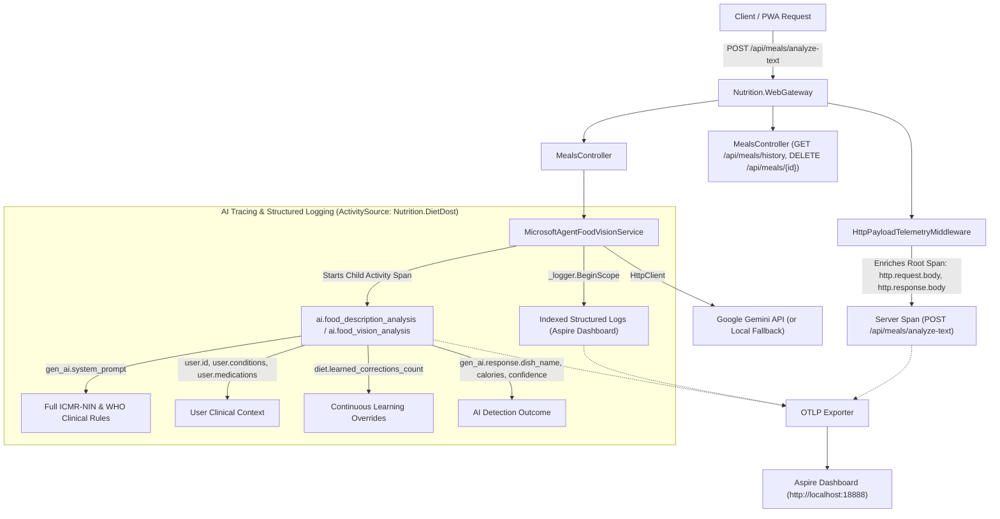
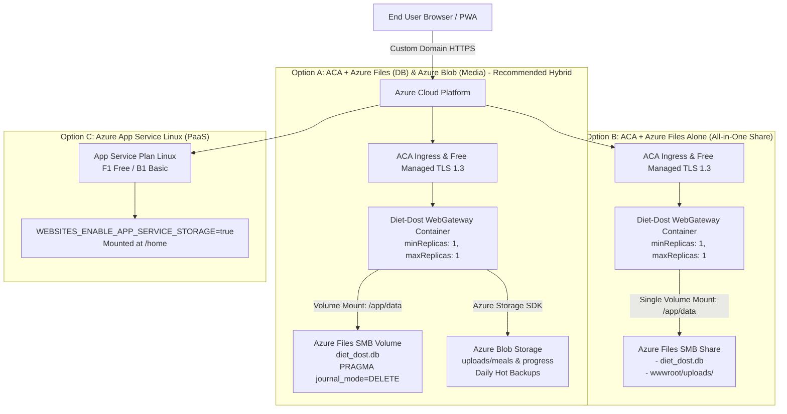
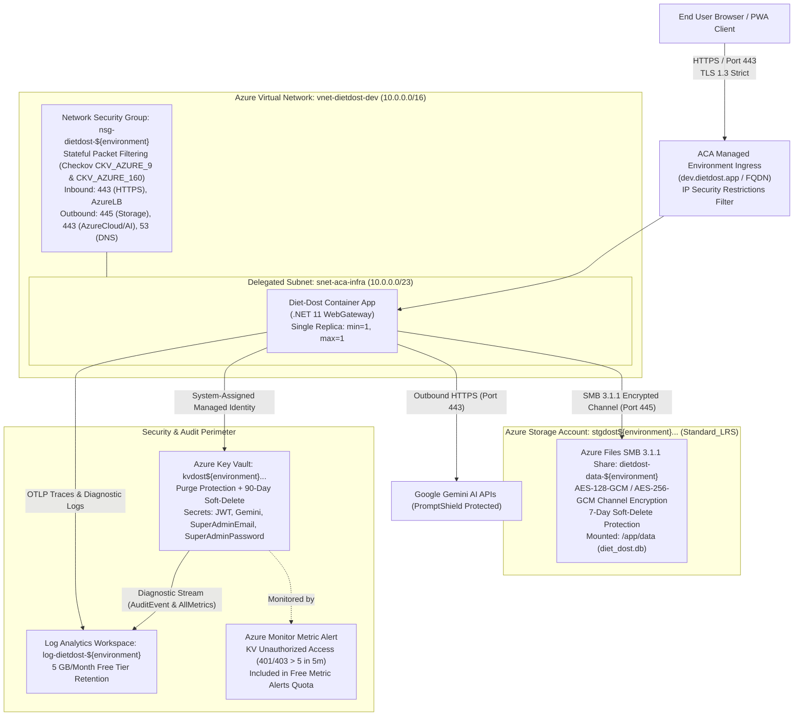

<!--
  Copyright (c) 2026 diet-dost and/or its contributors.
  Licensed under the "GNU Affero General Public License v3.0 only" and
  the "Server Side Public License, v 1"; you may not use this file except
  in compliance with, at your election, the "GNU Affero General Public
  License v3.0 only" or the "Server Side Public License, v 1".
-->

# DevOps, Infrastructure & Aspire Orchestration
> **Specification Version**: `v1.4.0 (Production & Living SDD)`  
> **Host Framework**: .NET Aspire 13.5.4 (`Aspire.Hosting.AppHost`) & Azure Container Apps  
> **Runtime**: .NET 11 (`net11.0`)  

---

## 1. Aspire AppHost Topology

```csharp
var builder = DistributedApplication.CreateBuilder(args);

// Web Gateway hosting the Linear.app PWA and microservice endpoints
builder.AddProject<Projects.Nutrition_WebGateway>("web-gateway")
       .WithHttpEndpoint(port: 5240, isProxied: false)
       .WithExternalHttpEndpoints()
       .WithEnvironment("Database__Provider", "Sqlite")
       .WithEnvironment("ConnectionStrings__DefaultConnection", "Data Source=diettracker.db");

builder.Build().Run();
```

### 1.1 Local Launch Configuration (`launchSettings.json`)
The AppHost uses deterministic HTTP bindings for local development and observability:
- **Aspire Dashboard**: `http://localhost:18888`
- **OTLP Ingestion Endpoint**: `http://localhost:18889` (HTTP) / `http://localhost:18890` (gRPC)
- **WebGateway Application**: `http://localhost:5240`
- **Unsecured Dev Transport**: Configured with `ASPIRE_ALLOW_UNSECURED_TRANSPORT=true` and `DOTNET_DASHBOARD_UNSECURED_ALLOW_ANONYMOUS=true` to eliminate browser cookie drops over HTTP during local development.

---

## 2. OpenTelemetry (OTel) Pipeline & Distributed Tracing

Diet Dost implements an end-to-end observability pipeline conforming to modern OpenTelemetry semantic conventions and .NET Aspire Dashboard tooling:



### 2.1 HTTP Request & Response Payload Telemetry
Implemented in `Nutrition.WebGateway.Middleware.HttpPayloadTelemetryMiddleware`:
- Inspects `/api/*` endpoints and calls `context.Request.EnableBuffering()` so request bodies can be read without consuming the stream for controllers.
- Captures JSON and URL-encoded request payloads (up to 64KB) as `http.request.body` on `Activity.Current`.
- Captures multipart image uploads as structured metadata (`[Multipart Form Upload: ... bytes, ContentType=...]`), avoiding multi-megabyte binary allocations.
- Intercepts the response body via a temporary `MemoryStream`, reads the response payload, sets `http.response.body` and `http.response.status_code` on the span, and copies the stream back to the client.

### 2.2 Dedicated AI ActivitySource (`Nutrition.DietDost`)
Implemented in `Nutrition.Application.Common.NutritionTelemetry`:
- Emits dedicated child activity spans for meal parsing:
  - `ai.food_description_analysis` (text description analysis)
  - `ai.food_vision_analysis` (photo analysis)
- Semantic attributes recorded on AI spans:
  - `gen_ai.system`: `"google_gemini"`
  - `gen_ai.system_prompt`: Full ICMR-NIN 2024 & WHO prompt + subzi recognition rules
  - `gen_ai.user_prompt`: Meal description or image metadata
  - `gen_ai.request.model` & `gen_ai.response.model`: Model attribution (e.g. `gemini-3-flash-preview` or `Local Clinical Engine (Offline)`)
  - `user.id`, `user.name`, `user.diagnosed_conditions`, `user.medications`, `user.dietary_preference`
  - `diet.learned_corrections_count` & `diet.learned_corrections_summary`
  - `gen_ai.response.dish_name`, `total_calories`, `total_protein_g`, `total_carbs_g`, `total_fat_g`, `confidence_score`, `items_summary`

### 2.3 Non-PII Diagnostic Logging
Implemented in `Nutrition.Infrastructure.Persistence.EfRepository<T>` and `EfUnitOfWork`:
- All CRUD and `SaveChangesAsync` calls catch exceptions and log operational diagnostics:
  - `Operation`: e.g. `AddAsync`, `GetByIdAsync`, `SaveChangesAsync`, `DeleteAsync`
  - `EntityType`: e.g. `UserProfile`, `MealLog`, `DailyCalorieLedger`
  - `RecordId` and `EntityState`: e.g. `user-default`, `Modified`, `Deleted`
  - `DbUpdateException`: Entries summary and SQLite error code
- **Strict PII Protection**: User personal names, phone numbers, medications, and clinical notes are NEVER logged.

---

## 3. Frontend Architecture & Modular Partial Pipeline

The frontend is served as a Single Page Application from `Nutrition.WebGateway/wwwroot` using modular HTML partials dynamically mounted into `#app`:

```
wwwroot/
├── assets/
│   ├── placeholder-meal.svg        # Obsidian Dark fallback for meals (48x48 fork & knife)
│   └── placeholder-progress.svg    # Obsidian Dark fallback for selfies (48x48 camera & silhouette)
├── css/
│   └── index.css                   # Obsidian Dark theme tokens, layout, and component styles
├── js/
│   ├── app.js                      # Root orchestrator & global error fallback interceptor
│   ├── state.js                    # Reactive application state
│   ├── api.js                      # REST client with UTC normalization & period filtering
│   └── ui/
│       ├── clinical-modal.js       # Clinical dietary setup & guidance
│       ├── dashboard.js            # Daily calorie & 6-macro gauges + period trends
│       ├── delete-meal-modal.js    # Custom modal for meal deletion with deficit recalculation
│       ├── face-progress-card.js   # Face progress comparison & baseline visualizer
│       ├── food-diary.js           # Card/Grid food diary with Excel export & period switcher
│       ├── header.js               # Header navigation & user status
│       ├── profile-modal.js        # User profile, body metrics & IANA timezone selector
│       ├── progress-gallery-modal.js # Full progress photo timeline
│       ├── progress-modal.js       # Progress photo capture & metadata entry
│       ├── quick-log.js            # Multimodal photo/text meal analyzer
│       └── review-modal.js         # Interactive meal verification & portion editor
└── partials/
    ├── clinical-modal.html
    ├── dashboard.html
    ├── delete-meal-modal.html      # Obsidian danger modal with 6-macro mini-pills
    ├── face-progress-card.html
    ├── food-diary.html             # Period filter, Card/Grid toggle, Export, and meal list
    ├── header.html
    ├── profile-modal.html          # Includes Timezone selector with auto-detect button
    ├── progress-gallery-modal.html
    ├── progress-modal.html
    ├── quick-log.html
    └── review-modal.html           # Includes quantity input, portion dropdown, 6-macro pills
```

### 3.1 Global SVG Fallback Pipeline
In `app.js`, a capturing-phase `error` event listener intercepts all `HTMLImageElement` load failures:
```javascript
window.addEventListener('error', (e) => {
    if (e.target && e.target.tagName === 'IMG') {
        const isProgress = e.target.classList.contains('progress-thumb') || 
                           e.target.closest('.progress-card');
        const fallback = isProgress ? '/assets/placeholder-progress.svg' : '/assets/placeholder-meal.svg';
        if (e.target.src !== window.location.origin + fallback) {
            e.target.src = fallback;
            e.target.classList.add('img-fallback-applied');
        }
    }
}, true);
```

---

## 4. Local Execution & Troubleshooting Runbook

```bash
# 1. Restore & Build Solution (0 Warnings, 0 Errors)
dotnet build src/Nutrition.WebGateway/Nutrition.WebGateway.csproj

# 2. Run Test Harness (100% Pass)
dotnet test

# 3. Launch App via Aspire AppHost (includes Dashboard + WebGateway)
dotnet run --project src/Nutrition.AppHost/Nutrition.AppHost.csproj --launch-profile http
```

### 4.1 Multi-Process / Orphan DCP Resolution
If `dotnet run` fails with port conflicts (`EADDRINUSE 18888`, `5240`) or temp kubeconfig lock errors:
```powershell
# Terminate lingering background orchestrators
Stop-Process -Name dcp, Nutrition.AppHost, Nutrition.WebGateway -Force -ErrorAction SilentlyContinue
```

### 4.2 Service Access URLs
- **Web Application**: `http://localhost:5240/?v=1.3.1`
- **Aspire Dashboard (Traces, Logs, Metrics)**: `http://localhost:18888/`

---

## 5. Git Branching & Pull Request Governance

To maintain production stability and adherence to the Zero Documentation Drift Mandate, the following source control policy is enforced:

### 5.1 Branching Strategy
- **Protected Trunk (`main`)**: Direct commits and direct pushes to `main` are strictly prohibited.
- **Dedicated Branching**: Every feature, bug fix, refactor, or documentation update must originate on an isolated branch:
  - Features: `feature/<feature-name>`
  - Bug fixes: `fix/<defect-name>`
  - Documentation: `docs/<topic-name>`

### 5.2 Pull Request (PR) Merge Mandate
- **PR-Only Integration**: All code and documentation changes must be integrated into `main` exclusively through Pull Requests.
- **Verification Gates Before PR Merge**:
  1. Build compiles with **0 warnings and 0 errors** on `.NET 11`.
  2. All automated tests in `tests/` pass with 100% success rate.
  3. Living documentation in `docs/sdd/*.md` is updated, including an entry in `docs/sdd/07_living_documentation_log.md`.

---

## 6. Azure Production Cloud Deployment Architectures (SQLite & Custom Domain)

### 6.1 Deployment Options Evaluation (No-VM Architecture Focus)



| Dimension | Option A: ACA + Azure Files (DB) & Blob (Media) (Recommended) | Option B: ACA + Azure Files Alone (All-in-One) | Option C: Azure App Service Linux (B1 Basic / F1 Free) |
| :--- | :--- | :--- | :--- |
| **Compute Model** | Serverless MicroVM (Azure Container Apps) | Serverless MicroVM (Azure Container Apps) | Managed Web App PaaS (App Service Plan) |
| **Database Storage** | Azure Files SMB Share mounted to `/app/data` | Azure Files SMB Share mounted to `/app/data` | Persistent `/home` (Azure Files backed) |
| **Media / Photo Storage** | Azure Blob Storage (`dietdost-media`) | Azure Files SMB Share (`/app/data/uploads`) | Persistent `/home/data/uploads` |
| **Cost Profile** | **Monthly Free Grant**: 180k vCPU-s + 360k GiB-s + 2M requests/mo free.<br/>Files + Blob: **<$0.50/mo**. | **Monthly Free Grant**: 180k vCPU-s + 360k GiB-s + 2M requests/mo free.<br/>Files: **<$0.30/mo**. | **F1 Tier**: 100% Free (60 CPU-min/day, sleeps, no custom SSL).<br/>**B1 Tier**: ~$13/mo (AlwaysOn, dedicated core). |
| **Zero Data Loss Guarantee** | **100% Guaranteed**: SQLite transactions commit synchronously to Azure Files. | **100% Guaranteed**: SQLite transactions commit synchronously to Azure Files. | **100% Guaranteed**: Data lives in persistent `/home` volume. |
| **SQLite Concurrency & Locking** | **Single Replica Mandate (`maxReplicas: 1`)**.<br/>`PRAGMA journal_mode = DELETE`. | **Single Replica Mandate (`maxReplicas: 1`)**.<br/>`PRAGMA journal_mode = DELETE`. | **Single Instance Mandate (`AlwaysOn = true`)**.<br/>`PRAGMA journal_mode = DELETE`. |
| **Custom Domain & SSL** | **100% Free Azure Managed Certificates** (`Microsoft.App/managedEnvironments/managedCertificates`) with auto-renewal. | **100% Free Azure Managed Certificates** with auto-renewal. | **Free Managed Cert on B1+**.<br/>F1 requires Cloudflare Free Proxy workaround. |
| **Security Posture** | Managed Identity, Azure Key Vault references, internal/external ingress, DDoS basic. | Managed Identity, Azure Key Vault references, internal/external ingress, DDoS basic. | Managed Identity, Key Vault references, HTTPS only, IP access restrictions. |
| **CI/CD Integration** | GitHub Actions / Azure DevOps (`azure/container-apps-deploy-action`). | GitHub Actions / Azure DevOps (`azure/container-apps-deploy-action`). | GitHub Actions / Azure DevOps (`azure/webapps-deploy`). |

### 6.2 SQLite Zero-Data-Loss Invariants on Azure
1. **The Single-Replica Invariant (`maxReplicas: 1`)**: Auto-scaling across multiple container instances accessing the same SQLite database file will corrupt the database. All container deployments must constrain scaling to exactly 1 replica.
2. **Rollback Journal Mode for Network SMB Mounts**: Because SMB/CIFS network storage does not support POSIX shared memory (`.shm` mapping) reliably, `PRAGMA journal_mode = DELETE;` (or `TRUNCATE`) must be used when deploying against Azure Files.
3. **Write-Ahead Logging (WAL) for Local SSD Mounts**: When deploying to a Linux VM (Option 3), native block storage allows `PRAGMA journal_mode = WAL;`, enabling concurrent reads without blocking writes.
4. **Volume Mount Separation**: Container images must mount external persistent storage to `/app/data`, with the connection string pointing to `/app/data/diet_dost.db` and static uploads directed to `/app/data/wwwroot/uploads`.
5. **EF Core Hardcoded WAL Bypass & Private Cache**: EF Core's built-in `RelationalDatabaseCreator.EnsureCreatedAsync()` hardcodes `PRAGMA journal_mode = 'wal'`, which causes `SQLite Error 5: database is locked` on CIFS SMB network mounts due to missing POSIX shared-memory `.shm` mmap support. Schema initialization must bypass `EnsureCreatedAsync()` and directly execute generated DDL under rollback journal mode (`DELETE`). In addition, connection strings must avoid deprecated `Cache=Shared` mode to eliminate table-level locking on SMB mounts (ADR-117).

---

## 7. Production Cloud Infrastructure Deployment Specification (Phase 1 Layer 9)

### 7.1 Two-Stage Automated CI/CD Workflows
Production deployment executes via two decoupled GitHub Actions workflows conditioned on a green pass of the 8-job security gate:
1. **Stage 1: Infrastructure Provisioning (`azure-infra-deploy.yml`)**:
   - Decomposed into three sequential, observable stages:
     - **Validate**: Aspire AppHost manifest evaluation, Pre-Deployment Gitleaks secret scan, Bicep compilation (`infra/${{ inputs.environment }}/infra.bicep` & `infra/${{ inputs.environment }}/app.bicep`), OIDC authentication with immutable repository IDs, and live ARM API validation (`az deployment group validate`).
     - **Preview**: Azure ARM What-If analysis (`az deployment group what-if`), publishing formatted planned resource mutation matrices to `$GITHUB_STEP_SUMMARY`.
     - **Provision**: Live Bicep infrastructure deployment (`Azure/arm-deploy@v2`), provisioning Resource Group (`rg-dietdost-${environment}`), Storage Account (`stgdost${environment}...`), Azure Files Share (`dietdost-data-${environment}`), Managed Environment (`cae-dietdost-${environment}`), Key Vault (`kvdost${environment}...`), Managed Identity, and ACR (`crdost${environment}...`). Includes automated pre-deployment idempotency guards scoped to environment-isolated Key Vault soft-delete recovery (`kvdost${environment}*`, ADR-102 & ADR-108) and ACA environment storage drift auto-remediation (ADR-105).
2. **Stage 2: Application Deployment (`azure-app-deploy.yml`)**:
   - Executes Stage 1 pre-deployment validation with fail-fast Container Base Image Vulnerability Scanning (`trivy image`, <15s) and NuGet dependency audit (OWASP A06).
   - Synchronizes application secrets to `kvdost${environment}...` using corrected Azure CLI network rule syntax (`--name`) and a 10-second firewall propagation guard.
   - Compiles container image targeting Linux x64 with patched .NET 11 runtime (`Containerfile`) and pushes to Azure Container Registry.
   - Deploys container to Azure Container Apps via `infra/${{ inputs.environment }}/app.bicep` (`app-dietdost-web-${environment}`) with decoupled custom domain ingress to eliminate ARM circular dependency errors (`RequireCustomHostnameInEnvironment`, ADR-109).
   - In Step 11b, verifies public DNS propagation for `${environment}.diet-dost.in`: automatically binds custom domain and issues free Azure Managed TLS certificate if DNS resolves, or outputs exact registrar CNAME instructions without failing the workload deployment.

### 7.2 Declarative Bicep Infrastructure as Code (IaC)
- [`infra/<env>/infra.bicep`](file:///c:/Users/nikunj.banker/source/repos/diet-dost/infra/dev/infra.bicep): Base infrastructure definition with Key Vault purge protection enabled (`enablePurgeProtection: true`), 90-day retention, Azure Files SMB share, storage mount definitions on the ACA Managed Environment, and conditional invocation of `sql.bicep` with `Microsoft.Sql` service endpoint binding.
- [`infra/<env>/sql.bicep`](file:///c:/Users/nikunj.banker/source/repos/diet-dost/infra/dev/sql.bicep): Dedicated Azure SQL Database Serverless Free Tier module (`GP_S_Gen5_1`, `useFreeLimit: true`, auto-pause 60m, 100k vCore-s monthly free), VNet Service Endpoint binding (`allow-aca-subnet`), and Key Vault secret generation with explicit `contentType` metadata (`sql-admin-password`, `azure-sql-connection-string`). See [`docs/sql-setup-guide.md`](file:///c:/Users/nikunj.banker/source/repos/diet-dost/docs/sql-setup-guide.md).
- [`infra/<env>/app.bicep`](file:///c:/Users/nikunj.banker/source/repos/diet-dost/infra/dev/app.bicep): Application definition configuring container volume mounts (`/app/data`), CPU (0.5 vCPU) and memory (1.0 Gi) limits, environment variables, managed identity role assignments (`acrPullRole`, `keyVaultSecretsUserRole`), Key Vault secret mapping for `ConnectionStrings__AzureSqlConnection`, and decoupled custom domain hostname bindings.
- [`infra/<env>/main.bicep`](file:///c:/Users/nikunj.banker/source/repos/diet-dost/infra/dev/main.bicep): Composite template orchestrating foundation, SQL Serverless, and workload modules for full end-to-end deployments.

### 7.3 Azure Files SMB Volume Mount & Zero-Data-Loss Configuration
The Container App mounts the Azure Files SMB share as a persistent volume:
- **Mount Path**: `/app/data`
- **Database File**: `/app/data/diet_dost.db`
- **Photos Directory**: `/app/data/photos`
- **SQLite Journal Pragma**: `PRAGMA journal_mode = DELETE;` configured at startup.
- **Replica Guarantee**: `minReplicas: 1, maxReplicas: 1` guarantees that only a single process holds file locks on the SMB network share, eliminating SQLite multi-instance file lock corruption.

### 7.4 Custom Domain & Managed TLS Certificate (Two-Phase Decoupled Lifecycle)
- **Host**: `dev.diet-dost.in`
- **Decoupled Lifecycle (ADR-109)**: Workload Bicep provisions the Container App on its default Azure FQDN first. Once public DNS CNAME points to the FQDN, pipeline Step 11b invokes `az containerapp hostname add` and `az containerapp hostname bind --validation-method CNAME`.
- **Validation**: Domain validation via CNAME (`dev.diet-dost.in` $\to$ `<app-fqdn>`) and TXT record (`asuid.dev.diet-dost.in` $\to$ domain verification ID).
### 7.5 Pre-Deployment PowerShell Configuration Runbook
For full step-by-step pre-deployment configuration, Azure Entra ID federated credentials creation, RBAC delegation, 256-bit cryptographic JWT key generation, and post-deployment smoke tests in native PowerShell (zero bash dependencies), refer to:
- **Authoritative Guide**: [`docs/AZURE_PRE_DEPLOYMENT_POWERSHELL_GUIDE.md`](file:///c:/Users/nikunj.banker/source/repos/diet-dost/docs/AZURE_PRE_DEPLOYMENT_POWERSHELL_GUIDE.md)
- **Pre-Flight Automation Script**: [`scripts/setup-azure-pre-deployment.ps1`](file:///c:/Users/nikunj.banker/source/repos/diet-dost/scripts/setup-azure-pre-deployment.ps1)

---

## 8. Zero-Trust Cloud Network & Security Infrastructure Architecture

Diet-Dost implements a defense-in-depth, Zero-Trust network and cloud security topology designed specifically for the dev-test free-tier environment ($0 incremental cost) while adhering to enterprise CIS Microsoft Azure Foundations Benchmark and Checkov IaC security standards:



### 8.1 Network Security Group (NSG) with Zero-Trust Subnet Isolation
- **Resource**: `Microsoft.Network/networkSecurityGroups` (`nsg-dietdost-${environment}`) attached directly to subnet `snet-aca-infra`.
- **Compliance**: Natively satisfies Checkov benchmark rule `CKV_AZURE_9` (*Ensure that Virtual Network subnets are associated with a Network Security Group*).
- **Rule Set**:
  - **Inbound**:
    - `Allow-HTTPS` (Port 443) from `Internet` to `VirtualNetwork` (satisfies `CKV_AZURE_160`: HTTP port 80 restricted).
    - `Allow-HTTPS-Inbound` (Priority 100, Port 443) from `*` to `VirtualNetwork`.
    - `Allow-AzureLoadBalancer-Inbound` (Priority 110) from `AzureLoadBalancer` health probes.
    - `Allow-VNet-Internal-Inbound` (Priority 120) between cluster pods and control plane.
    - `Deny-All-Other-Inbound` (Priority 4000, Explicit Catch-All Deny).
  - **Outbound**:
    - `Allow-Storage-SMB-Outbound` (Priority 100, Port 445) restricted strictly to `Storage` service tag for persistent SQLite mount.
    - `Allow-SQL-Outbound` (Priority 105, Ports `1433` and `11000-11999`) restricted to `Sql` service tag for direct Azure SQL Serverless connectivity via Azure SQL Redirect connection policy.
    - `Allow-AzureCloud-HTTPS-Outbound` (Priority 110, Port 443) restricted to `AzureCloud` service tag (Key Vault, ACR image pulls, Entra ID, Log Analytics).
    - `Allow-DNS-Outbound` (Priority 120, Port 53) for core name resolution.
    - `Allow-NTP-Outbound` (Priority 130, Port 123) for clock synchronization.
    - `Allow-Internet-HTTPS-Outbound` (Priority 140, Port 443) outbound to `Internet` for Google AI Gemini API REST calls.
    - `Allow-VNet-Internal-Outbound` (Priority 150) for intra-VNet cluster communication.
    - `Deny-All-Other-Outbound` (Priority 4000, Explicit Catch-All Deny to override Azure default AllowInternetOutBound).

### 8.2 Azure Files SMB 3.1.1 Cryptographic Channel Hardening
- **Protocol Encryption**: Enforces SMB 3.1.1 wire encryption with negotiated ciphers `AES-128-GCM` and `AES-256-GCM` across `fileServices` in `infra/<env>/infra.bicep` (e.g. `infra/dev/infra.bicep`).
- **Kerberos & NTLM Policy**: Enforces Kerberos ticket authentication and disables legacy NTLMv1 fallbacks.
- **Accidental Deletion Defense**: Configured 7-day share soft-delete retention policy, protecting the live SQLite database (`diet_dost.db`) and user meal photos against catastrophic accidental share deletion.

### 8.3 Azure Key Vault Audit Diagnostics & Metric Alerts
- **Audit Logging**: Configured `Microsoft.Insights/diagnosticSettings` (`diag-kv-dev`) streaming `AuditEvent` categories and all metrics directly into the existing Log Analytics Workspace (`log-dietdost-dev`) within the free 5 GB/month ingestion tier.
- **Automated Intrusion Alerting**: Deployed `Microsoft.Insights/metricAlerts` (`alert-kv-unauthorized-dev`) monitoring the Key Vault Service Api Hit metric with dimensions `StatusCode = 401, 403`. Fires automatically if unauthorized attempts exceed 5 in a 5-minute window, consuming 0 additional cost (within Azure's first 10 free platform metric alerts).

### 8.4 Direct ACA Ingress & ACR Image Pull Delivery Architecture
- **Direct ACA Managed Envoy Ingress**: External traffic from `${environment}.diet-dost.in` routes directly to the ACA Managed Environment's built-in Envoy proxy. Zero intermediate hops—**neither Azure Front Door nor Azure Application Gateway is provisioned or utilized**, eliminating unnecessary cost and latency. Free Azure Managed TLS 1.3 certificates terminate directly at the ACA Envoy layer.
- **Passwordless ACR Image Pull Mechanics**: Azure Container Registry (`crdost${environment}...`) runs with `adminUserEnabled: false` (zero static passwords). The Container App (`app-dietdost-web-${environment}`) pulls images securely via its assigned User-Assigned Managed Identity (`id-dietdost-${environment}`) which possesses the built-in `AcrPull` role (`7f951dda-4ed3-4680-a7ca-43fe172d538d`) scoped directly to the registry. CI/CD pushes images using ephemeral tokens generated via `az acr login --expose-token`.
- **IP Security Restrictions**: Added configurable `ipSecurityRestrictions` array to `infra/<env>/app.bicep`. Allows operators to enforce IP allowlisting/denylisting on the external ingress controller at 0 cost.

### 8.5 Architectural Visual Artifacts
The full architectural blueprint is codified in the following repository visual artifacts:
- **Mermaid Source Diagram**: [`docs/architecture/diagrams/azure_zero_trust_infra_architecture.mermaid`](file:///c:/Users/nikunj.banker/source/repos/diet-dost/docs/architecture/diagrams/azure_zero_trust_infra_architecture.mermaid)
- **High-Resolution Architecture Diagram**: [`docs/architecture/diagrams/azure_zero_trust_infra_architecture.jpg`](file:///c:/Users/nikunj.banker/source/repos/diet-dost/docs/architecture/diagrams/azure_zero_trust_infra_architecture.jpg)
- **Architectural Decision Records**:
  - [`docs/adr/security/ADR-20261010-088-azure-zero-trust-network-security-group-smb311-and-diagnostic-hardening.md`](file:///c:/Users/nikunj.banker/source/repos/diet-dost/docs/adr/security/ADR-20261010-088-azure-zero-trust-network-security-group-smb311-and-diagnostic-hardening.md)
  - [`docs/adr/architecture/ADR-20261011-090-zero-trust-nsg-outbound-rules-acr-pull-and-ingress-architecture.md`](file:///c:/Users/nikunj.banker/source/repos/diet-dost/docs/adr/architecture/ADR-20261011-090-zero-trust-nsg-outbound-rules-acr-pull-and-ingress-architecture.md)
  - [`docs/adr/devops/ADR-20261017-102-azure-key-vault-soft-delete-idempotency-and-parameterization.md`](file:///c:/Users/nikunj.banker/source/repos/diet-dost/docs/adr/devops/ADR-20261017-102-azure-key-vault-soft-delete-idempotency-and-parameterization.md)

### 8.6 Azure Key Vault Soft-Delete Idempotency & Cloud Lifecycle Governance
- **The Purge Protection Dilemma**: Because Key Vault mandates `enablePurgeProtection: true` for zero-loss secret governance, deleting a vault or resource group places the vault in soft-deleted state for 7 days without the ability to purge. Subsequent ARM deployments with the same vault name fail with `ConflictError: A vault with the same name already exists in deleted state`.
- **Automated CI/CD Idempotency Guard**: `.github/workflows/azure-infra-deploy.yml` implements steps `8b` (Stage 1) and `3b` (Stage 3): `Detect and Auto-Recover Soft-Deleted Key Vaults (Idempotency Guard)`. Before ARM validation or Bicep deployment executes, Azure CLI inspects `az keyvault list-deleted` and automatically triggers `az keyvault recover` for any soft-deleted vault in the subscription, ensuring zero human intervention and 100% deployment idempotency.
- **Dynamic Parameterization**: Bicep foundation templates (`infra/<env>/infra.bicep` and `infra/<env>/main.bicep`) support optional `keyVaultName`. When omitted, Bicep generates environment-isolated vaults (`kvdost${environment}${uniqueSuffix}`); when provided, operators can attach to pre-existing or recovered vaults seamlessly.

### 8.7 Workspace-Based Azure Application Insights with Local Authentication Disabled (Entra ID Only)
- **Zero Local Authentication Baseline (`DisableLocalAuth: true`)**:
  - The Application Insights component (`appi-dietdost-${environment}`) in `Microsoft.Insights/components@2020-02-02` is configured with `DisableLocalAuth: true`, strictly adhering to Checkov `CKV_AZURE_224` and CIS Microsoft Azure Foundations benchmarks.
  - Legacy API keys and unauthenticated `InstrumentationKey`-only ingestion are permanently disabled.
- **Workspace-Based Architecture**:
  - Bound directly to `logAnalytics.id` via `WorkspaceResourceId: logAnalytics.id`. All telemetry data is stored within the Azure Log Analytics Workspace (`log-dietdost-${environment}`) leveraging the 5 GB/month free ingestion tier.
- **Entra ID RBAC Telemetry Authorization**:
  - The User-Assigned Managed Identity (`id-dietdost-${environment}`) is granted the built-in **`Monitoring Metrics Publisher`** role (`3913510d-42f4-4e42-8a64-420c390055eb`) scoped to the Application Insights resource.
  - The application authenticates securely via `DefaultAzureCredential` configured with `ManagedIdentityClientId = AZURE_CLIENT_ID`.
- **Scoped Logs-Only Ingestion Standard**:
  - OpenTelemetry configuration in `Nutrition.WebGateway.Extensions.OpenTelemetryExtensions` binds `AddAzureMonitorLogExporter` strictly into `logging.AddOpenTelemetry(...)`.
  - Application distributed traces and custom metrics remain exclusively routed to the local Aspire OTLP collector (`OTEL_EXPORTER_OTLP_ENDPOINT`), ensuring that only structured application logs and unhandled exceptions are forwarded to Azure Monitor Application Insights.

  - While `minReplicas` is 0 during idle dev hours (0 writers = 100% safe), `maxReplicas` is hard-locked to 1 across all environments, strictly safeguarding the SQLite database (`diet_dost.db`) on Azure Files SMB from multi-writer file corruption.

### 8.9 Transaction-Wrapped Schema Generation & ACA Active Deployment Gating (ADR-118)
- **Problem**: When `EnsureDatabaseCreatedAndMigratedAsync` executed individual DDL statements without an encompassing transaction on Azure Files SMB mounts, each statement initiated an individual SMB network roundtrip (creating `diet_dost.db-journal`, writing 512 bytes, flushing, and deleting). Across 100+ DDL statements, cumulative network latency exceeded 120 seconds, causing Kubernetes to terminate the container due to `StartupProbe` timeout (`ProbeFailure`). Furthermore, ACA KEDA scale-to-zero (`minReplicas: 0`) deactivated inactive revisions before health probe completion.
- **Solution**:
  1. **Single Transaction DDL Batching**: Initial DDL statements were targeted to batch under explicit transactions.
  2. **Exponential Backoff SMB Lock Retry**: Added resilient retry handling with exponential backoff (`Math.Pow(2, attempt)`) for `SqliteException` (Error Code 5: `SQLITE_BUSY` / `database is locked`), gracefully yielding to outgoing revision replica shutdowns during rolling deployments.
  3. **Dev Active Revision Invariant (`minReplicas: 1`)**: Set `param minReplicas int = 1` in `infra/dev/app.bicep` to guarantee container replicas remain active and warm during ACA startup probe evaluations without premature KEDA scale-to-zero deactivation.
  4. **Probe Grace Period**: Startup probe configured with `initialDelaySeconds: 10`, `periodSeconds: 5`, and `failureThreshold: 30` (150-second progression deadline).

### 8.10 Local Temporary Storage Pristine SQLite Schema Bootstrapping (ADR-119)
- **The SMB CIFS POSIX Byte-Locking Dilemma**:
  - Azure Files SMB (CIFS) network mounts do not reliably emulate low-level POSIX byte-range locking and transactional synchronization (`fcntl` / `lockf`).
  - When `Microsoft.Data.Sqlite` attempts to `COMMIT` an explicit transaction or write to an uninitialized database file over an SMB CIFS mount, the SMB client returns sharing violation errors which SQLite surfaces as `SQLite Error 5: database is locked`.
  - Concurrently, Kubernetes rolling updates (`RollingUpdate` with `maxSurge: 1`) temporarily run two replicas against the same single-writer SMB volume, causing mutual lock starvation.
### 8.11 Local Ephemeral Active SQLite Cache & Cloud Storage Vault Sync (ADR-120)
- **Problem**:
  - While initial schema bootstrap succeeded via `/tmp` copying (ADR-119), subsequent EF Core write transactions (such as `SeedAppSecretsAsync` and normal runtime modifications) failed on `SaveChangesAsync` with `SQLite Error 5: database is locked`.
  - On Azure Files SMB (CIFS) mounts, SQLite write transactions cannot acquire or upgrade POSIX byte-range file locks, triggering a 30-second busy timeout failure on every transaction `Commit()`.
  - Furthermore, default ACA multi-revision configurations allowed previous revision replicas to remain active, creating concurrent read/write handles that blocked the new container.
- **Architectural Solution**:
  1. **Single Revision Mode Enforcement**: In `infra/dev/app.bicep`, configured `activeRevisionsMode: 'Single'`. Azure Container Apps terminates older revision replicas before bringing up the new revision, eliminating all concurrent SMB handle collisions.
  2. **Local Ephemeral Active SQLite Cache**: Active database read and write traffic is decoupled from network mounts and executed exclusively against local container NVMe storage (`/tmp/diet_dost.db`). SQLite runs in high-concurrency **WAL mode** (`PRAGMA journal_mode = WAL`) with native POSIX byte-locking and sub-millisecond execution (<1ms).
  3. **Bi-directional Startup Hydration**: If the durable vault file `/app/data/diet_dost.db` exists and is >0 bytes, `StorageInfrastructureExtensions` copies it down to `/tmp/diet_dost.db` at boot. If missing, it creates and seeds it locally on `/tmp` with zero lock contention.
  4. **Pristine Seed Synchronization**: On startup completion, `DatabaseInitializationExtensions` invokes `ISqliteStorageVaultSyncService.SyncActiveToVaultAsync()` to flush the fully seeded database up to `/app/data/diet_dost.db`.
  5. **Background & Graceful Vault Synchronization**: `SqliteStorageVaultSyncService` runs every 30 seconds to checkpoint active WAL pages (`PRAGMA wal_checkpoint(PASSIVE)`) and perform a safe file copy to `/app/data/diet_dost.db`. On container termination (`StopAsync` / SIGTERM), it performs a final graceful sync to ensure zero data loss.

### 8.12 Polly v8 Declarative Resilience Pipeline for SQLite Lock Contention (ADR-121)
- **Problem**: Database initialization and migration tasks on distributed filesystems or during replica recycling may encounter transient `Microsoft.Data.Sqlite.SqliteException` with error code 5 (`SQLITE_BUSY` / `database is locked`).
- **Resilience Architecture**:
  - Replaced manual `for` retry iterations with **Polly v8** declarative resilience pipeline (`ResiliencePipelineBuilder`).
  - Configured typed predicate handling `SqliteException` where `ex.SqliteErrorCode == 5`.
  - Configured exponential backoff delay starting at 2s up to 30s ceiling across 5 retry attempts (`BackoffType = DelayBackoffType.Exponential`).
  - Emits structured diagnostic warning logs on each retry attempt (`logger.LogWarning`) with attempt index and exact backoff duration in seconds.

### 8.13 Native Azure Key Vault Reference Secret Mounting in ACA (ADR-122)
- **Zero Plaintext Storage Standard**:
  - In `infra/dev/app.bicep`, replaced inline plaintext `Container Apps Secrets` with native Azure Key Vault references (`keyVaultUrl: '${keyVaultUri}secrets/<name>'` and `identity: managedIdentityId`).
  - ACA runtime pulls secrets into container memory directly using the User-Assigned Managed Identity (`id-dietdost-dev`) with `Key Vault Secrets User` RBAC permissions (`4633458b-17de-408a-b874-0445c86b69e6`).
  - Eliminates "Click to show value" portal exposure and prevents secret leakage in ARM deployment history.
  - Normalized secret keys across Key Vault and Container App: `gemini-api-key`, `jwt-key`, `superadmin-password`, and `app-insights-connection-string`.

### 8.14 Headless Chrome CDP Isolated User Data Directory & Port Allocation in CI Quality Gates (ADR-126)
- **Problem**: Sequential or background execution of Chrome DevTools Protocol (CDP) test scripts in Tier 3 System Tests (`test_dynamic_config_modes.mjs`, `verify_admin_tier_governance.mjs`, `verify_auth_gate_design.mjs`) on Ubuntu CI runners failed with `Error: Failed to connect to CDP port 9222`.
- **Architectural Solution**:
  1. **Isolated User Data Directory**: Appended `--user-data-dir=${(process.env.TEMP || process.env.TMPDIR || '/tmp')}/edge_cft_${Date.now()}` to all browser spawn processes, preventing Linux `SingletonLock` collision against `~/.config/google-chrome`.
  2. **Non-Colliding Default Port Allocation**: Allocated disjoint default CDP ports (`9224`, `9226`, `9228`, `9230`) across test scripts.
  3. **Guarded Process Lifecycle**: Wrapped browser sessions in defensive `try ... finally` blocks to guarantee child process cleanup and eliminate port exhaustion across test runs.

### 8.15 Azure SQL Serverless Free Tier Redirect Connectivity & Conditional Secret Wiring (ADR-130)
- **Problem**:
  1. **Azure SQL Redirect Connection Policy Timeout**: Inside Azure, Azure SQL defaults to the **Redirect connection policy** for reduced network latency. Initial connection connects to port 1433 gateway, which responds with a redirect packet instructing the client to connect directly to the database worker node on port range `11000-11999` (e.g. `worker.database.windows.net:11001`). Because NSG rule `Allow-SQL-Outbound` only allowed destination port `1433`, rule `Deny-All-Other-Outbound` (Priority 4000) dropped packets to port 11001, resulting in container startup timeout (`SqlException 0x80131904 / Win32Exception 258`).
  2. **ACA Secret Fetch Failure when Azure SQL Provisioning is Skipped**: When deploying with `databaseProvider: Sqlite` and `deployAzureSql: false`, Key Vault does not contain the `azure-sql-connection-string` secret. If `infra/dev/app.bicep` unconditionally declared a Key Vault secret reference for `azure-sql-connection-string`, ACA container provisioning failed with `unable to fetch secret 'azure-sql-connection-string' using Managed identity`.
  3. **Workflow Dispatch & Step Summary Parameter Gaps**: Deployed summaries lacked critical operational visibility into `databaseProvider`, `deployAzureSql`, `sqlAdminLogin`, and client IP allowlisting.
- **Architectural Solution**:
  1. **NSG Outbound Expansion**: In `infra/dev/infra.bicep`, updated `Allow-SQL-Outbound` (Priority 105) from `destinationPortRange: '1433'` to `destinationPortRanges: ['1433', '11000-11999']` targeting service tag `Sql`.
  2. **Conditional Key Vault Secret Binding**: In `infra/dev/app.bicep`, wrapped `azure-sql-connection-string` secret reference in an inline conditional check `(databaseProvider == 'AzureSql' ? [{ name: 'azure-sql-connection-string', keyVaultUrl: '${keyVaultUri}secrets/azure-sql-connection-string', identity: managedIdentityId }] : [])`. Similarly, container environment variable `ConnectionStrings__AzureSqlConnection` references the secret only when `databaseProvider == 'AzureSql'`, defaulting to empty string otherwise.
  3. **Step Summary Transparency**: Updated `.github/workflows/azure-app-deploy.yml` and `azure-infra-deploy.yml` to display full parameter tables in `$GITHUB_STEP_SUMMARY` across dispatch, validation, what-if, and stage completion.

### 8.16 Default Persistence Alignment to Azure SQL Serverless & App Deployment Workflow Modernization (ADR-134)
- **Problem**:
  1. **Deployment Workflow Drift**: `.github/workflows/azure-app-deploy.yml` and `infra/dev/main.bicep` defaulted `databaseProvider` to `Sqlite` and `deployAzureSql` to `false`. When triggering an application deployment via GitHub Actions without manually overriding inputs, the workflow defaulted to SQLite rather than the production-ready Azure SQL Serverless architecture.
  2. **Infrastructure Template Default Divergence**: In `infra/dev/main.bicep` and `infra/dev/infra.bicep`, `deployAzureSql` defaulted to `false`, necessitating explicit flags during Bicep orchestration.
  3. **CI/CD Quality Gate Runner Network Isolation**: When `Database:Provider` defaults to `AzureSql` in `appsettings.json`, headless GitHub Actions runners (`ubuntu-latest`) executing Tier 3 System Tests and Tier 4 E2E Tests in `quality-test-gate.yml` cannot connect to Azure SQL Serverless because runner dynamic IPs are not permitted in Azure SQL firewall and runners lack Azure AD/secret credentials, leading to test startup timeouts.
- **Architectural Solution**:
  1. **Application Deployment Workflow Alignment**: In `.github/workflows/azure-app-deploy.yml`, updated workflow dispatch inputs, validation what-if, ARM foundation infrastructure deployment, and ACA application deployment to default `databaseProvider` to `AzureSql`. Foundation deployment dynamically computes `deployAzureSql=${{ (inputs.databaseProvider || 'AzureSql') == 'AzureSql' }}`.
  2. **Infrastructure Deployment Workflow Alignment**: In `.github/workflows/azure-infra-deploy.yml`, updated default input and execution parameters so that `deployAzureSql` defaults to `true`.
  3. **Bicep Template Parameter Convergence**: Updated `infra/dev/main.bicep` and `infra/dev/infra.bicep` to default `databaseProvider string = 'AzureSql'` and `deployAzureSql bool = true`, aligning Infrastructure as Code with the application's default persistence configuration.
  4. **CI Test Runner Isolation**: In `.github/workflows/quality-test-gate.yml`, injected `Database__Provider: Sqlite` into the runner environment variables for Job 3 (`system-tests`) and Job 4 (`e2e-tests`). Similarly, updated `scripts/verify-quality-test-gates.ps1` to explicitly append `--Database:Provider Sqlite` to the local WebGateway startup command. This ensures fast, hermetic, 100% offline-isolated test execution on CI runners without requiring Azure SQL firewall traversal or credentials.
