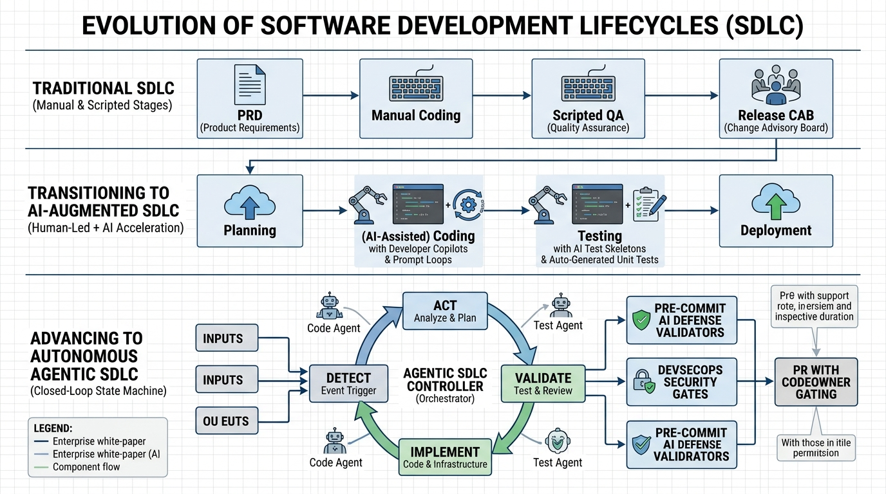
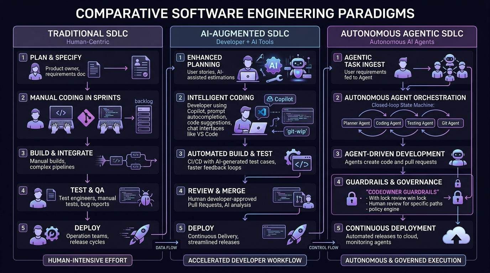
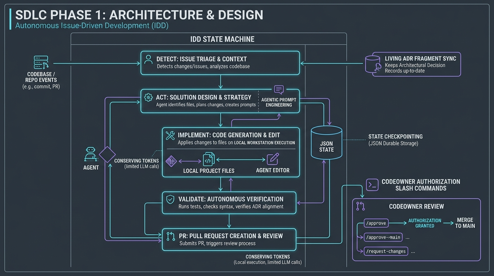
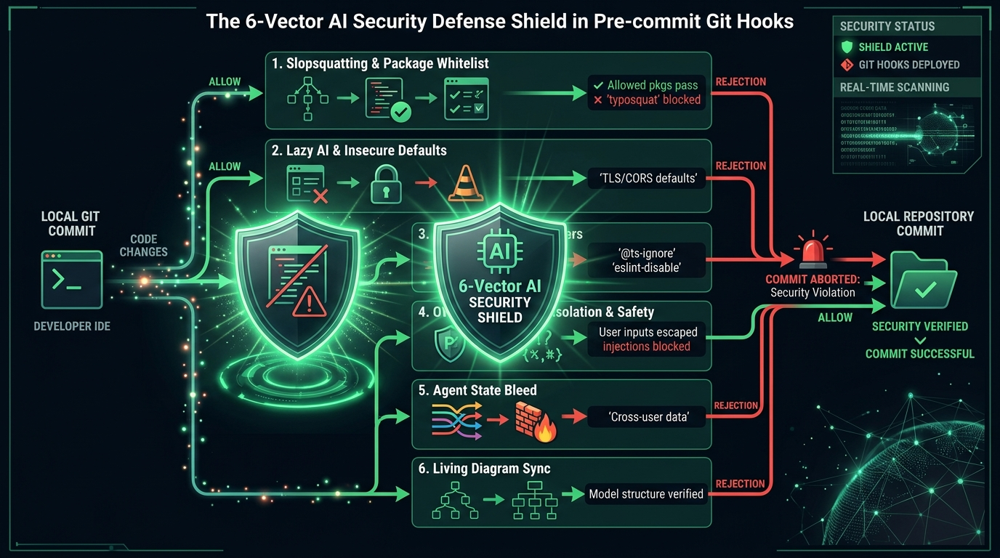
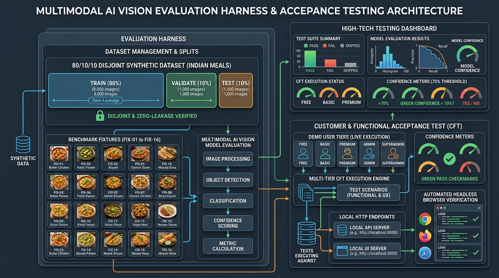
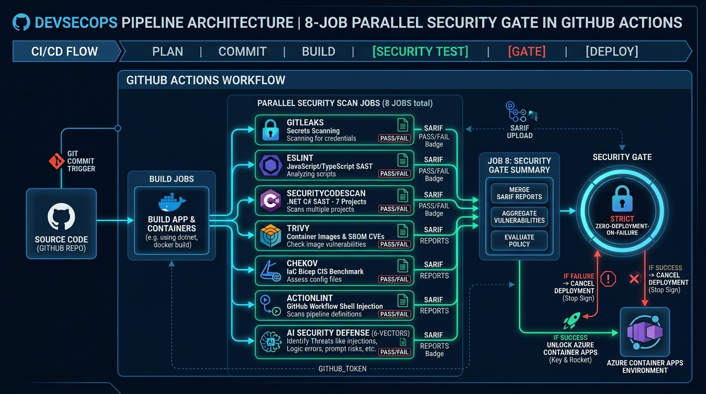
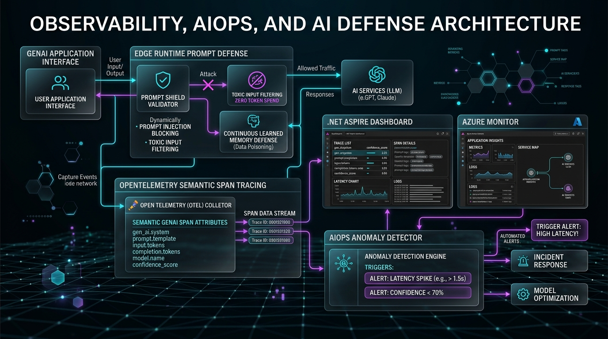
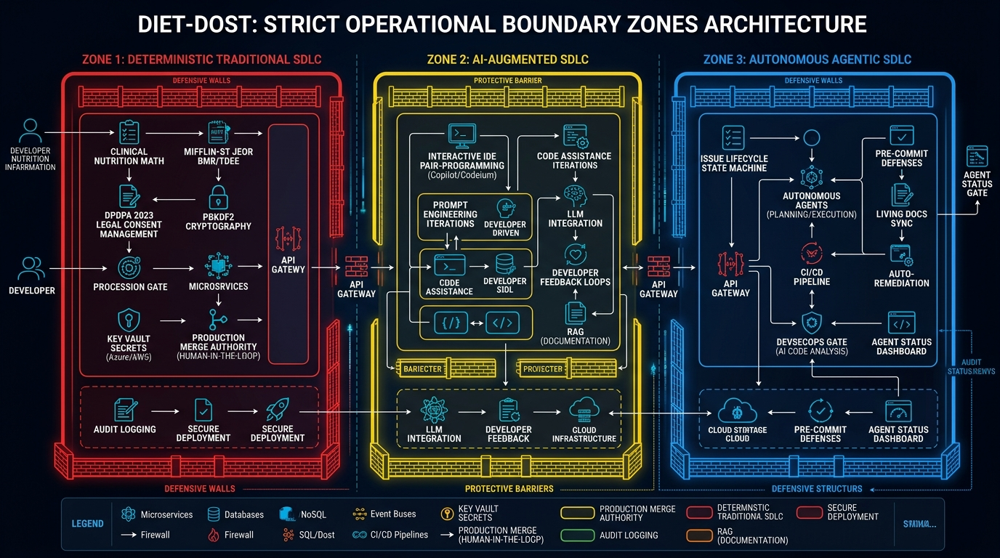
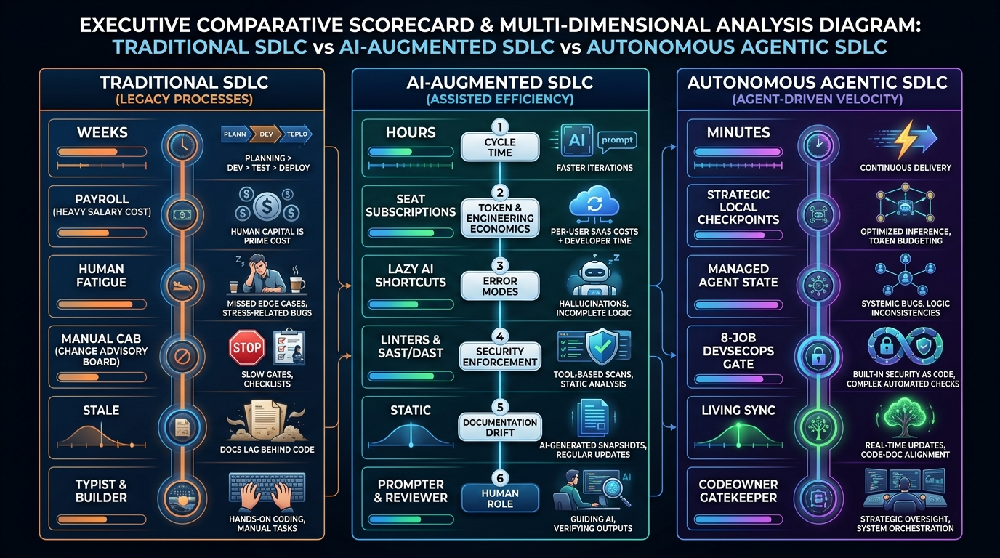
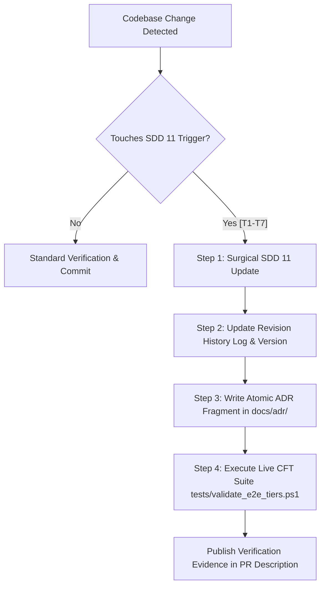

<!--
  Copyright (c) 2026 diet-dost and/or its contributors.
  Licensed under the "GNU Affero General Public License v3.0 only" and
  the "Server Side Public License, v 1"; you may not use this file except
  in compliance with, at your election, the "GNU Affero General Public
  License v3.0 only" or the "Server Side Public License, v 1".
-->

# AI in SDLC & Agentic Workflows Architecture Specification
> **Specification Version**: `v1.6.0 (Production & Living SDD)`  
> **Classification**: Solution Architecture, Engineering Lifecycles & Governance Standard  
> **Approved Domain Focus**: SDLC vs. AI SDLC vs. Agentic SDLC, Role Evolution, DevSecOps & Closed-Loop Workflows  
> **Target Framework**: .NET 11, .NET Aspire 13.5.4, OpenTelemetry, GitHub Actions, OWASP Top 10 for LLM  
> **Authoritative Companion Standards**: [AGENTS.md](file:///c:/Users/nikunj.banker/source/repos/diet-dost/AGENTS.md), [SECURITY.md](file:///c:/Users/nikunj.banker/source/repos/diet-dost/SECURITY.md), [00_sdd_index.md](file:///c:/Users/nikunj.banker/source/repos/diet-dost/docs/sdd/00_sdd_index.md), [04_security_and_compliance.md](file:///c:/Users/nikunj.banker/source/repos/diet-dost/docs/sdd/04_security_and_compliance.md), [05_devops_and_infrastructure.md](file:///c:/Users/nikunj.banker/source/repos/diet-dost/docs/sdd/05_devops_and_infrastructure.md), [06_test_harness_and_evals.md](file:///c:/Users/nikunj.banker/source/repos/diet-dost/docs/sdd/06_test_harness_and_evals.md)  

---

## Master Table of Contents

- [Executive Summary](#executive-summary)
  - [Visual Architecture Walkthrough: The Evolution of SDLC](#visual-architecture-walkthrough-the-evolution-of-sdlc)
- [1. The Spectrum of Engineering Lifecycles: SDLC vs. AI SDLC vs. Agentic SDLC](#1-the-spectrum-of-engineering-lifecycles-sdlc-vs-ai-sdlc-vs-agentic-sdlc)
  - [1.1 Section Executive Summary & Diagram Walkthrough](#11-section-executive-summary--diagram-walkthrough)
  - [1.2 Role & Seniority Evolution Matrix](#12-role--seniority-evolution-matrix)
  - [1.3 Core Analysis: What, Why & How](#13-core-analysis-what-why--how)
  - [1.4 Engineering Deep-Dive: Moving from Open-Loop Prompts to Stateful Autonomous Loops](#14-engineering-deep-dive-moving-from-open-loop-prompts-to-stateful-autonomous-loops)
  - [1.5 Section Conclusion](#15-section-conclusion)
- [2. Phase 1 — Architecture & Design: Agentic Governance & Living Systems](#2-phase-1--architecture--design-agentic-governance--living-systems)
  - [2.1 Section Executive Summary & Diagram Walkthrough](#21-section-executive-summary--diagram-walkthrough)
  - [2.2 Role & Seniority Evolution Matrix](#22-role--seniority-evolution-matrix)
  - [2.3 Core Analysis: What, Why & How](#23-core-analysis-what-why--how)
  - [2.4 Engineering Deep-Dive: Durable State Checkpointing, Prompt Economics & Living Systems](#24-engineering-deep-dive-durable-state-checkpointing-prompt-economics--living-systems)
  - [2.5 Section Conclusion](#25-section-conclusion)
- [3. Phase 2 — Build & Code Generation: Developer Guardrails & 6-Vector AI Defense](#3-phase-2--build--code-generation-developer-guardrails--6-vector-ai-defense)
  - [3.1 Section Executive Summary & Diagram Walkthrough](#31-section-executive-summary--diagram-walkthrough)
  - [3.2 Role & Seniority Evolution Matrix](#32-role--seniority-evolution-matrix)
  - [3.3 Core Analysis: What, Why & How](#33-core-analysis-what-why--how)
  - [3.4 Engineering Deep-Dive: Anatomy of the 6 AI Failure Vectors & Automated Pre-Commit Interception](#34-engineering-deep-dive-anatomy-of-the-6-ai-failure-vectors--automated-pre-commit-interception)
  - [3.5 Section Conclusion](#35-section-conclusion)
- [4. Phase 3 — Testing & Quality Assurance: AI Evals, Synthetic Data & Live CFTs](#4-phase-3--testing--quality-assurance-ai-evals-synthetic-data--live-cfts)
  - [4.1 Section Executive Summary & Diagram Walkthrough](#41-section-executive-summary--diagram-walkthrough)
  - [4.2 Role & Seniority Evolution Matrix](#42-role--seniority-evolution-matrix)
  - [4.3 Core Analysis: What, Why & How](#43-core-analysis-what-why--how)
  - [4.4 Engineering Deep-Dive: Disjoint Split Governance, Multimodal Confidence Calibration & Live Acceptance Suites](#44-engineering-deep-dive-disjoint-split-governance-multimodal-confidence-calibration--live-acceptance-suites)
  - [4.5 Section Conclusion](#45-section-conclusion)
- [5. Phase 4 — Deploy & CI/CD Security Auditing: The 8-Job DevSecOps Gate](#5-phase-4--deploy--cicd-security-auditing-the-8-job-devsecops-gate)
  - [5.1 Section Executive Summary & Diagram Walkthrough](#51-section-executive-summary--diagram-walkthrough)
  - [5.2 Role & Seniority Evolution Matrix](#52-role--seniority-evolution-matrix)
  - [5.3 Core Analysis: What, Why & How](#53-core-analysis-what-why--how)
  - [5.4 Engineering Deep-Dive: Multi-Project SARIF Aggregation, Immutable Action Pinning & Zero-Deployment-on-Failure](#54-engineering-deep-dive-multi-project-sarif-aggregation-immutable-action-pinning--zero-deployment-on-failure)
  - [5.5 Section Conclusion](#55-section-conclusion)
- [6. Phase 5 — Operations, Monitoring & Maintenance: AIOps, Telemetry & Self-Healing](#6-phase-5--operations-monitoring--maintenance-aiops-telemetry--self-healing)
  - [6.1 Section Executive Summary & Diagram Walkthrough](#61-section-executive-summary--diagram-walkthrough)
  - [6.2 Role & Seniority Evolution Matrix](#62-role--seniority-evolution-matrix)
  - [6.3 Core Analysis: What, Why & How](#63-core-analysis-what-why--how)
  - [6.4 Engineering Deep-Dive: OpenTelemetry Semantic Conventions, Aspire Telemetry & Adaptive Memory Poisoning Defense](#64-engineering-deep-dive-opentelemetry-semantic-conventions-aspire-telemetry--adaptive-memory-poisoning-defense)
  - [6.5 Section Conclusion](#65-section-conclusion)
- [7. Operational Boundaries in Diet-Dost: Where SDLC vs. AI SDLC vs. Agentic SDLC Are Applied](#7-operational-boundaries-in-diet-dost-where-sdlc-vs-ai-sdlc-vs-agentic-sdlc-are-applied)
  - [7.1 Section Executive Summary & Diagram Walkthrough](#71-section-executive-summary--diagram-walkthrough)
  - [7.2 The Three Operational Boundary Zones](#72-the-three-operational-boundary-zones)
  - [7.3 Engineering Deep-Dive: Why Clinical Dietetics, DPDPA Privacy & Cryptographic Authorization Must Remain Deterministic](#73-engineering-deep-dive-why-clinical-dietetics-dpdpa-privacy--cryptographic-authorization-must-remain-deterministic)
  - [7.4 Section Conclusion](#74-section-conclusion)
- [8. Master Comparative Analysis: SDLC vs. AI SDLC vs. Agentic SDLC](#8-master-comparative-analysis-sdlc-vs-ai-sdlc-vs-agentic-sdlc)
  - [8.1 Section Executive Summary & Diagram Walkthrough](#81-section-executive-summary--diagram-walkthrough)
  - [8.2 11-Dimensional Master Comparison Scorecard](#82-11-dimensional-master-comparison-scorecard)
  - [8.3 Engineering Deep-Dive: Organizational Transformation, Economics & Error Profiles](#83-engineering-deep-dive-organizational-transformation-economics--error-profiles)
  - [8.4 Section Conclusion](#84-section-conclusion)
- [9. Living Documentation Synchronization Protocol & Continuous Day-to-Day Evolution Mandate](#9-living-documentation-synchronization-protocol--continuous-day-to-day-evolution-mandate)
  - [9.1 The Living Document Philosophy](#91-the-living-document-philosophy)
  - [9.2 Day-to-Day Evolution Trigger Matrix](#92-day-to-day-evolution-trigger-matrix)
  - [9.3 Four-Step Day-to-Day Living Maintenance Workflow](#93-four-step-day-to-day-living-maintenance-workflow)
  - [9.4 Continuous Evolution & Revision History Log](#94-continuous-evolution--revision-history-log)
- [10. Architectural Conclusion & Governance Takeaways](#10-architectural-conclusion--governance-takeaways)
- [11. Glossary of Architectural & AI Engineering Terms](#11-glossary-of-architectural--ai-engineering-terms)

---

## Executive Summary



Software engineering is experiencing a fundamental architectural transformation. For four decades, software development was governed by **Traditional SDLC**—a discipline of human-executed manual stages, rigid requirements documents, sprint backlogs, and committee approvals. The advent of Large Language Models (LLMs) introduced **AI-Augmented SDLC**, where human developers type code with inline autocomplete copilots and prompt conversational chat models. Today, enterprise systems are advancing to **Autonomous Agentic SDLC**—where specialized AI agents act as primary autonomous operators executing closed-loop state machines under the strict supervision of deterministic domain rules and human CODEOWNER governance.

In **Diet-Dost**, Artificial Intelligence operates in two distinct realms:
1. **AI as the Functional Core (Product Domain)**: Multimodal perception (Google Gemini 3.8 Flash, Azure OpenAI, and localized Indian Small Language Models / SLMs) parsing complex Indian food imagery, calculating portion multipliers, and applying ICMR-NIN 2024 / WHO clinical nutrition rules.
2. **AI as the Engineering Engine (SDLC Domain)**: Autonomous agentic pipelines executing issue intake, architecture synchronization, clean code generation, multi-tier live acceptance verification, DevSecOps gating, and AIOps observability.

### Visual Architecture Walkthrough: The Evolution of SDLC
The diagram above illustrates the generational evolution across three distinct operational layers:
1. **Top Layer (Traditional SDLC)**: Depicts the linear, human-intensive sequence: Product Requirements Documents (PRDs) $\to$ Manual Coding in IDEs $\to$ Scripted QA Testing $\to$ Change Advisory Board (CAB) release gates. Progress is gated by human calendar time, resulting in multi-week delivery cycles.
2. **Middle Layer (Transitioning to AI-Augmented SDLC)**: Shows the insertion of generative AI copilots into human workflows. Developers use AI for autocomplete, chat-driven component drafting, and AI-assisted unit test skeleton generation. While individual typing speed accelerates, the process remains fundamentally manual, open-loop, and prone to "lazy AI" security anti-patterns.
3. **Bottom Layer (Advancing to Autonomous Agentic SDLC)**: Details the closed-loop architecture implemented in Diet-Dost. A centralized **Agentic SDLC Controller** orchestrates specialized Code Agents and Test Agents through an autonomous state machine (`DETECT` $\to$ `ACT` $\to$ `IMPLEMENT` $\to$ `VALIDATE`). Changes pass through two automated defensive barriers: **Pre-Commit AI Defense Validators** (checking 6 security vectors locally) and **DevSecOps Security Gates** (8 parallel CI/CD scanners), culminating in **Pull Requests with CODEOWNER Gating**.

---

## 1. The Spectrum of Engineering Lifecycles: SDLC vs. AI SDLC vs. Agentic SDLC



### 1.1 Section Executive Summary & Diagram Walkthrough
**Section Executive Summary**: Software engineering methodologies differ fundamentally in how agency, state, and governance are distributed between human engineers and machine intelligence. Traditional SDLC concentrates all agency in humans; AI-Augmented SDLC pairs humans with open-loop autocomplete tools; Autonomous Agentic SDLC delegates execution to closed-loop software agents while elevating humans to authoritative governance and architectural review.

**Diagram Walkthrough**: The diagram above contrasts these three paradigms across five standardized delivery stages:
* **Pillar 1: Traditional SDLC (Human-Centric)**: Illustrates human Product Owners creating static specifications, developers manually coding features against a sprint backlog, test engineers authoring bug reports, and operations teams managing release trains. Characterized by high manual effort, human fatigue, and slow cycle times.
* **Pillar 2: AI-Augmented SDLC (Developer + AI Tools)**: Illustrates the developer-centric acceleration loop. Engineers use tools like GitHub Copilot or Cursor to generate functions, prompt chatbots for troubleshooting, and generate test assertions. The developer remains the typist and integrator, manually fixing compilation and import errors.
* **Pillar 3: Autonomous Agentic SDLC (Autonomous AI Agents)**: Illustrates the Diet-Dost closed-loop model. Incoming requirements are ingested by agent controllers, decomposed into stateful tasks, implemented autonomously by Code and Git Agents, and routed through strict "CODEOWNER Guardrails" with automated locks before release.

### 1.2 Role & Seniority Evolution Matrix

| Engineering Dimension | Traditional SDLC | AI-Augmented SDLC | Autonomous Agentic SDLC (Diet-Dost) |
|---|---|---|---|
| **Primary Human Role** | Principal Enterprise Architect, Lead Business Analyst | Senior Solutions Architect, Technical Lead | **CODEOWNER & Chief Architecture Officer** |
| **Typical Seniority** | 10–15+ Years Experience | 8–12+ Years Experience | **Principal Contributor / Lead Architect (`@nikunjbanker`)** |
| **What They Do** | Manually writes 50-page Word/Confluence PRDs, draws Visio/Lucidchart diagrams, authors architectural decision records. | Uses ChatGPT/Claude to brainstorm system designs, draft requirements, or format user stories. Manually verifies outputs. | **Defines architectural invariants, sets governance rules in `AGENTS.md`, and approves/rejects agent proposals via `/approve` slash commands.** |
| **Replaced / Automated By** | Manual authoring replaced by interactive prompt refinement. | Prompt-and-paste loop replaced by autonomous repository-aware agents. | **Autonomous IDD Engine** ([`.agents/skills/idd`](file:///c:/Users/nikunj.banker/source/repos/diet-dost/.agents/skills/diet-dost-issue-driven-workflow/)) + **Living Diagram Engine** ([`scripts/sync-architecture-diagrams.ps1`](file:///c:/Users/nikunj.banker/source/repos/diet-dost/scripts/sync-architecture-diagrams.ps1)) + **Atomic ADR Fragment Indexer** ([`scripts/sync-adr-index.ps1`](file:///c:/Users/nikunj.banker/source/repos/diet-dost/scripts/sync-adr-index.ps1)). |

### 1.3 Core Analysis: What, Why & How
* **What It Is**: The architectural classification of software engineering execution into three distinct tiers: Manual Deterministic, Generatively Assisted, and Autonomously Stateful.
* **Why We Do It**: To prevent organizational confusion regarding where AI should be trusted. Naive adoption of AI tools results in developers copying and pasting unchecked code snippets, bypassing enterprise linters, and creating unreviewed dependencies. Categorizing the lifecycle enables Diet-Dost to establish strict automated guardrails per tier.
* **How It Works**: Diet-Dost implements a hybrid model:
  1. *Autonomous Agentic execution* handles repetitive development tasks (issue parsing, CQRS scaffolding, test runs, documentation sync).
  2. *AI-Augmented workflows* assist developers during interactive prototyping in the IDE.
  3. *Deterministic Traditional SDLC* governs all mathematical nutrition equations, statutory consent ledgers, and production release authorizations.

### 1.4 Engineering Deep-Dive: Moving from Open-Loop Prompts to Stateful Autonomous Loops
In textbook software architecture, an **open-loop system** is one where the controller's output has no feedback effect on the input. AI-Augmented SDLC is open-loop: a human types a prompt into Copilot or ChatGPT, receives a code snippet, and manually pastes it into their editor. If the code contains a missing namespace, an obsolete API call, or a syntax error, the LLM has no knowledge of the failure unless the human manually copies the compiler error back into the chat window.

In contrast, Diet-Dost implements a **closed-loop feedback control system**. When an autonomous agent in the IDD pipeline generates code, the local orchestrator immediately invokes `dotnet build` and `dotnet test`. If the compiler emits a warning (e.g. `CS8618: Non-nullable property uninitialized`), the agent captures the exact compiler diagnostic ID, parses the source location, applies a surgical fix, and re-compiles. The agent does not report completion until the entire solution compiles with **0 warnings and 0 errors**.

### 1.5 Section Conclusion
The transition from Traditional to Agentic SDLC is not merely an increase in typing speed; it is an architectural shift from open-loop, human-mediated copy-pasting to closed-loop, self-correcting state machines governed by deterministic boundaries.

---

## 2. Phase 1 — Architecture & Design: Agentic Governance & Living Systems



### 2.1 Section Executive Summary & Diagram Walkthrough
**Section Executive Summary**: Phase 1 converts business intent into executable technical designs, living diagrams, and conflict-immune architectural decision records. Autonomous agents execute issue triage and planning on local developer workstations, eliminating cloud agent credit burn and enforcing strict token economics.

**Diagram Walkthrough**: The diagram above illustrates the closed-loop governance of Phase 1:
* **Trigger & Ingestion**: Codebase and repository events (e.g. issue created, commit pushed) trigger the **IDD State Machine**.
* **State Machine Cycle**: Flows sequentially from `DETECT` (issue triage, context extraction) $\to$ `ACT` (solution strategy, prompt engineering) $\to$ `IMPLEMENT` (local workstation file editing) $\to$ `VALIDATE` (autonomous verification, ADR alignment) $\to$ `PR` (creation of draft Pull Request).
* **Durable Storage & Token Economics**: All state transitions update the local `JSON State` store (`issue_workflow_state.json`), ensuring crash resilience. The agent operates under a "Conserving Tokens" policy, limiting redundant LLM calls.
* **Living Documentation Loop**: In parallel, the agent triggers the **Living ADR Fragment Sync** engine to update architectural records.
* **Human Gatekeeper**: The process culminates in the **CODEOWNER Review** box, where human architects execute `/approve` slash commands to authorize PR merges to `main`.

### 2.2 Role & Seniority Evolution Matrix

| Engineering Dimension | Traditional SDLC | AI-Augmented SDLC | Autonomous Agentic SDLC (Diet-Dost) |
|---|---|---|---|
| **Primary Human Role** | Lead Systems Analyst, Enterprise Architect | Technical Lead, Cloud Solution Architect | **CODEOWNER & Governance Authority** |
| **Typical Seniority** | 10–15+ Years Experience | 8–12+ Years Experience | **Principal Contributor (`@nikunjbanker`)** |
| **What They Do** | Writes functional specifications, organizes stakeholder alignment meetings, updates architectural diagrams manually. | Prompts LLMs to generate user stories, format acceptance criteria, or suggest database schemas. | **Audits agent-generated plans, validates security models, and reviews automated ADR fragments.** |
| **Replaced / Automated By** | Manual specification drafting replaced by agentic analysis. | Ad-hoc prompt engineering replaced by formalized skill playbooks. | **diet-dost-issue-driven-workflow** + **sync-adr-index.ps1** + **sync-architecture-diagrams.ps1**. |

### 2.3 Core Analysis: What, Why & How
* **What It Is**: The architectural design engine comprising the 5-phase IDD state machine, CODEOWNER gating, system prompt token economics, and living architectural documentation.
* **Why We Do It**: Traditional architectural documentation suffers from rapid decay: diagrams created at project inception rarely reflect production code after six months. Furthermore, naive agent workflows burn excessive cloud tokens by injecting massive monolithic logs into every prompt turn, resulting in context window pollution and Git merge conflicts across concurrent branches.
* **How It Works**:
  1. *Local Cron Daemon*: An hourly scheduler (`0 * * * *`) scans GitHub issues using `gh issue list`.
  2. *CODEOWNER Verification*: Issues authored by unauthorized users are marked `HOLD` until approved via a `/approve` slash comment from a CODEOWNER.
  3. *Atomic Fragment Pattern*: Every architectural decision is recorded in an isolated file (`docs/adr/<domain>/ADR-<YYYYMMDD>-<NNN>-<slug>.md`), which is indexed into `index.json` by `sync-adr-index.ps1`.
  4. *Living Mermaid Verification*: `sync-architecture-diagrams.ps1 -Verify` validates that diagrams in `docs/architecture/diagrams/*.mermaid` match C# layer boundaries.

### 2.4 Engineering Deep-Dive: Durable State Checkpointing, Prompt Economics & Living Systems
A critical vulnerability of agentic workflows is **ephemeral state failure**. If an autonomous agent executing a complex, 10-step refactoring task loses network connectivity or experiences an IDE process termination, standard LLM chat interfaces lose all working context, forcing the developer to restart from scratch.

Diet-Dost solves this using **Durable JSON Checkpointing**. The agent persists its state machine transitions to `.agents/state/issue_workflow_state.json`:
```json
{
  "active_issue": 104,
  "phase": "IMPLEMENT",
  "branch": "feature/dietary-fiber-tracking",
  "checkpoint_timestamp": "2026-10-14T12:00:00Z",
  "completed_steps": ["DETECT", "ACT"],
  "retry_count": 0
}
```
When the workstation restarts, the hourly runner checks this file, detects the `IN_PROGRESS` status, loads the completed steps, and resumes execution at `IMPLEMENT` with zero duplicated token spend.

Simultaneously, Diet-Dost enforces **Prompt Token Economics**. The system prompt of an agentic assistant is injected on every turn. If architectural documents are placed inside `.agents/skills/`, they permanently inflate the prompt baseline. By enforcing the **`docs/` boundary**, all declarative specifications reside in `docs/sdd/` (costing **0 baseline tokens**), and are loaded on-demand via `view_file` only when relevant to the active task.

### 2.5 Section Conclusion
Phase 1 eliminates stale documentation and credit waste. By combining local state checkpointing with CODEOWNER authorization and atomic ADR fragments, Diet-Dost ensures that architectural specifications remain accurate, living contracts.

---

## 3. Phase 2 — Build & Code Generation: Developer Guardrails & 6-Vector AI Defense



### 3.1 Section Executive Summary & Diagram Walkthrough
**Section Executive Summary**: Phase 2 governs the generation of production-ready C# and native ES Module code. Because generative AI models frequently introduce insecure shortcuts to achieve compilation, Diet-Dost places a mandatory 6-Vector AI Security Defense barrier in Git pre-commit hooks, rejecting insecure code before it leaves the developer workstation.

**Diagram Walkthrough**: The diagram above illustrates the defensive perimeter of Phase 2:
* **Code Ingestion**: Code changes originating from developer IDEs or AI agents trigger the pre-commit hook during `git commit`.
* **The Central 6-Vector Shield**: Changes pass through six parallel defensive inspection engines:
  1. *Slopsquatting & Package Whitelist*: Allows vetted packages; rejects unapproved dependencies.
  2. *Lazy AI & Insecure Defaults*: Blocks TLS verification bypasses, wildcard CORS, and fallback credentials.
  3. *AI Security Disablers*: Intercepts `@ts-ignore`, `eslint-disable`, `// nosec`, and uncommented `#pragma` warnings.
  4. *OWASP LLM Delimiter Isolation & Safety*: Enforces `[USER_MEAL_INTAKE_DATA]` isolation and pre-flight prompt shielding.
  5. *Agent State Bleed*: Intercepts staged `.agents/state/` or transcript session files.
  6. *Living Diagram Sync*: Verifies that Mermaid architecture models remain aligned with code changes.
* **Dual Verdict Paths**:
  - *Red Rejection Path*: Any violation immediately aborts the commit, logs an actionable error message, and prevents repository pollution.
  - *Green Allow Path*: Fully verified, clean code successfully commits to the local Git repository.

### 3.2 Role & Seniority Evolution Matrix

| Engineering Dimension | Traditional SDLC | AI-Augmented SDLC | Autonomous Agentic SDLC (Diet-Dost) |
|---|---|---|---|
| **Primary Human Role** | Senior Software Engineer, Backend/Frontend Developer | Full-Stack Software Engineer | **System Reviewer & Security Gatekeeper** |
| **Typical Seniority** | 3–8 Years Experience | 3–6 Years Experience | **Staff Engineer / Principal Architect** |
| **What They Do** | Hand-types controllers, repository methods, entity mappings, and CSS stylesheets. | Prompts Copilot or Cursor to generate methods, manually reviews code, and fixes syntax errors. | **Audits agent-generated CQRS handlers, verifies clinical rules, and inspects pre-commit validation logs.** |
| **Replaced / Automated By** | Manual coding replaced by generative autocompletion. | Manual syntax debugging replaced by closed-loop agent repair. | **Clean Architecture CQRS Scaffolding** + **verify-ai-security-defense.ps1** in `.githooks/pre-commit`. |

### 3.3 Core Analysis: What, Why & How
* **What It Is**: An automated code generation and validation framework combining .NET 11 Clean Architecture, native CQRS handlers, and the pre-commit 6-Vector AI Security Defense validator.
* **Why We Do It**: Generative AI models are trained on public codebases containing anti-patterns. When tasked with connecting to a service or resolving a build error, LLMs prioritize functional completion over security, frequently introducing TLS bypasses, unvetted package dependencies (slopsquatting), or suppression comments that disable linters.
* **How It Works**:
  1. The developer or agent stages code changes (`git add`).
  2. The Git pre-commit hook (`.githooks/pre-commit`) executes `pwsh -File scripts/verify-ai-security-defense.ps1 -Mode Staged`.
  3. The script scans `.csproj`, `.cs`, `.js`, `.ts`, and `.bicep` files using AST and regex inspectors.
  4. Any violation returns exit code 1, aborting the commit and displaying the exact line number and violation reason.

### 3.4 Engineering Deep-Dive: Anatomy of the 6 AI Failure Vectors & Automated Pre-Commit Interception
Modern AI code generation introduces specific security failure modes that traditional linters fail to address:

1. **Vector 1: Slopsquatting & Package Hallucination**:
   - *Failure Mode*: An AI model hallucinates a package name (e.g. `DietDost.Security.TokenHelper`). Threat actors register these hallucinated names on public registries (NuGet, npm) containing malware.
   - *Interception*: The validator checks every `<PackageReference>` in all `.csproj` files against an explicit prefix whitelist (`Microsoft.*`, `Azure.*`, `Polly`, `OpenTelemetry.*`, `SkiaSharp`, `SQLitePCLRaw.*`, `FluentValidation`, `Aspire.*`, `xunit`). Any unvetted package halts the commit.
2. **Vector 2: Insecure Defaults & "Lazy AI" Workarounds**:
   - *Failure Mode*: To resolve a self-signed certificate error during development, an LLM generates `ServerCertificateCustomValidationCallback = (message, cert, chain, errors) => true`.
   - *Interception*: The script searches for `DangerousAcceptAnyServerCertificateValidator`, `NODE_TLS_REJECT_UNAUTHORIZED = '0'`, and wildcard CORS (`.AllowAnyOrigin()`), rejecting commits containing transport vulnerabilities.
3. **Vector 3: AI Security Disablers & Suppression Flooding**:
   - *Failure Mode*: When linters or compilers raise warnings, an AI assistant silences them using `// @ts-ignore`, `/* eslint-disable */`, or `#pragma warning disable`.
   - *Interception*: The validator scans for suppression comments and asserts that any `#pragma warning disable` must have a valid justification comment explaining why the suppression is mathematically safe.
4. **Vector 4: OWASP LLM Defenses & Prompt Delimiter Isolation**:
   - *Failure Mode*: Concatenating user inputs directly into system prompts allows prompt injection attacks (OWASP LLM01).
   - *Interception*: Asserts that `MicrosoftAgentFoodVisionService` encloses user meal notes in `[USER_MEAL_INTAKE_DATA]` delimiters, verifies pre-flight `PromptShieldValidator.ValidateInput` integration, and asserts `BLOCK_LOW_AND_ABOVE` content safety settings across multi-LLM providers.
5. **Vector 5: Leaked AI Agent State & Session Bleed**:
   - *Failure Mode*: Agents accidentally staging temporary conversation logs (`transcript.jsonl`) or internal memory files (`.agents/state/`) into Git commits.
   - *Interception*: Scans staged files and halts if internal agent artifacts are present in the Git index.
6. **Vector 6: Living Diagram Verification**:
   - *Failure Mode*: Developers modifying C# layer boundaries or project references without updating the solution architecture diagrams.
   - *Interception*: Executes `sync-architecture-diagrams.ps1 -Verify` to ensure Mermaid diagrams match solution reality.

### 3.5 Section Conclusion
Phase 2 ensures that developer velocity does not compromise security. The 6-Vector AI Security Defense barrier guarantees that code generated by AI agents or human developers adheres to enterprise standards before it is committed.

---

## 4. Phase 3 — Testing & Quality Assurance: AI Evals, Synthetic Data & Live CFTs



### 4.1 Section Executive Summary & Diagram Walkthrough
**Section Executive Summary**: Phase 3 validates functional behavior, clinical accuracy, model hallucinations, and user tier paywalls across desktop, tablet, and mobile viewports. Traditional in-memory unit tests are augmented with multimodal vision evaluation harnesses and mandatory live end-to-end Customer & Functional Acceptance Tests (CFT) against running HTTP daemons.

**Diagram Walkthrough**: The diagram above illustrates the multi-tier testing pipeline:
* **Evaluation Harness (Left)**: Manages training and testing datasets. Enforces an **80/10/10 Disjoint Synthetic Dataset** split (80% Train, 10% Validate, 10% Test) with verified zero-leakage between splits.
* **Benchmark Fixtures (Bottom Left)**: Contains real-world meal scenarios (`FIX-01` to `FIX-16`) covering Indian thalis, dosas, and occluded images, routed through image processing, object detection, and confidence scoring.
* **High-Tech Testing Dashboard (Top Right)**: Displays real-time test suite metrics, histogram distributions, precision-recall curves, and confidence meters ($\ge 70\%$ threshold).
* **Customer & Functional Acceptance Test (CFT) Engine (Bottom Right)**: Boots local API and UI servers, executing test scenarios across all five user tiers (Free, Basic, Premium, Admin, SuperAdmin) and running automated headless browser verifications.

### 4.2 Role & Seniority Evolution Matrix

| Engineering Dimension | Traditional SDLC | AI-Augmented SDLC | Autonomous Agentic SDLC (Diet-Dost) |
|---|---|---|---|
| **Primary Human Role** | QA Lead, Manual QA Tester, SDET | Automation Engineer, SDET | **Evaluation Harness Architect & Clinical Verifier** |
| **Typical Seniority** | 3–8 Years Experience | 4–7 Years Experience | **Lead SDET / Principal Clinical Architect** |
| **What They Do** | Manually writes TestRail cases, runs regression spreadsheets, manually clicks through UI flows on mobile devices. | Prompts LLMs to generate unit test skeletons, mock datasets, or test assertions. Manually executes test suites. | **Designs clinical evaluation benchmarks (FIX-01 to FIX-16), audits multimodal model bias, and defines tier invariant rules.** |
| **Replaced / Automated By** | Manual test execution replaced by automated scripts. | Manual test script authoring replaced by generative test tools. | **Nutrition.EvalHarness.Tests** + **validate_e2e_tiers.ps1** + **browser_subagent** headless UI testing. |

### 4.3 Core Analysis: What, Why & How
* **What It Is**: A four-tier automated quality engineering system combining granular code coverage thresholds, multimodal AI vision evaluations, subsystem contract validation, and live end-to-end multi-tier acceptance testing, enforced by [`.github/workflows/quality-test-gate.yml`](file:///c:/Users/nikunj.banker/source/repos/diet-dost/.github/workflows/quality-test-gate.yml).
* **Why We Do It**: Traditional unit tests evaluate isolated code in memory; they cannot detect runtime asset 404s, CORS drops, database migration failures, or user tier quota leakage. Furthermore, probabilistic AI models can pass unit tests while hallucinating macronutrients or failing on occluded meal photos. To guarantee zero production defects, every cloud deployment must pass non-negotiable quantitative gates across all four testing tiers.
* **The Four-Tier Quality Validation Matrix**:
  1. **Tier 1: Domain & Clinical Nutrition Unit Tests (Threshold: Line Coverage $\ge 44\%$, 0 failures)**: Executes [`Nutrition.Domain.Tests`](file:///c:/Users/nikunj.banker/source/repos/diet-dost/tests/Nutrition.Domain.Tests) measuring line coverage with Coverlet. Enforces pure domain logic, value objects, meal intake models, and ICMR-NIN 2024 / WHO clinical mathematics with zero regressions, ratcheting upward incrementally.
  2. **Tier 2: Subsystem & BFF Integration Tests (Threshold: Line Coverage $\ge 40\%$, 0 failures)**: Executes [`Nutrition.EvalHarness.Tests`](file:///c:/Users/nikunj.banker/source/repos/diet-dost/tests/Nutrition.EvalHarness.Tests) with Coverlet coverage. Asserts security environment boundaries, Options pattern validation, workflow gating invariants, and multimodal vision evaluation benchmarks.
  3. **Tier 3: Subsystem Contracts & Design System Tests (Threshold: $\ge 75\%$)**: Automatically boots `Nutrition.WebGateway` daemon, checks HTTP/gRPC health readiness probes (`/health`), executes Mobile BFF endpoint contracts, ETag caching verification ([`tests/verify_mobile_bff.mjs`](file:///c:/Users/nikunj.banker/source/repos/diet-dost/tests/verify_mobile_bff.mjs)), and verifies design system token compliance.
  4. **Tier 4: Multi-Tier User Acceptance & E2E CFT Suite (Threshold: $\ge 70\%$)**: Executes the live multi-tier acceptance suite ([`tests/validate_e2e_tiers.ps1`](file:///c:/Users/nikunj.banker/source/repos/diet-dost/tests/validate_e2e_tiers.ps1)) across all 5 demo user tiers (Free 1 scan/day, Basic 7 scans/day, Premium 30 scans/day, Admin, and SuperAdmin), validating SQLite persistence, photo paywalls, and core meal workflows.
* **Execution & Evidence Protocol**:
  - The local runner [`scripts/verify-quality-test-gates.ps1`](file:///c:/Users/nikunj.banker/source/repos/diet-dost/scripts/verify-quality-test-gates.ps1) allows developers to validate all four tiers locally (`pwsh -File scripts/verify-quality-test-gates.ps1 -Tier All`).
  - In CI/CD, the `quality-gate-summary` job publishes the comprehensive four-tier verdict table directly into the PR description (`gh pr comment`), halting the pipeline (`exit 1`) if any tier fails.
  - Headless browser verification via `browser_subagent` validates zero console errors and zero Cumulative Layout Shift (CLS).

### 4.4 Engineering Deep-Dive: Disjoint Split Governance, Multimodal Confidence Calibration & Live Acceptance Suites
In multimodal AI systems, a major engineering challenge is **data contamination (train/test leakage)**. If synthetic training data contains images or prompt variations of the same plate of food present in the test set, the evaluation suite reports falsely elevated accuracy scores.

Diet-Dost resolves this by codifying strict **Disjoint Split Governance** in [`LOCAL_INDIAN_FOOD_SLM_TRAINING_GUIDE.md`](file:///c:/Users/nikunj.banker/source/repos/diet-dost/docs/LOCAL_INDIAN_FOOD_SLM_TRAINING_GUIDE.md):
- Splits are segregated by **household, photographer, and recipe source**.
- The test set is **locked and immutable**; it is never used for prompt engineering or hyperparameter tuning.
- Synthetic training data is **strictly forbidden from entering the evaluation test set**.

Simultaneously, the system implements **Confidence Calibration**:
```csharp
if (result.OverallConfidenceScore < 0.70)
{
    result.IsConfidenceGatedPassed = false;
    result.RetakePromptRequired = true;
    result.AdvisoryMessage = "The meal photo is occluded or in low light. Please retake the photo for accurate nutrition analysis.";
}
```
If an image is dark or blurry (`FIX-03`), the model defers rather than hallucinating nutrients, prompting the user to retake the photo.

### 4.5 Section Conclusion
Phase 3 establishes an empirical, multi-layered quality gate. By combining disjoint synthetic data governance with live multi-tier acceptance testing and browser UI verification, Diet-Dost ensures that both deterministic and probabilistic components perform reliably.

---

## 5. Phase 4 — Deploy & CI/CD Security Auditing: The 8-Job DevSecOps Gate



### 5.1 Section Executive Summary & Diagram Walkthrough
**Section Executive Summary**: Phase 4 enforces an automated, multi-layered static analysis security gate in GitHub Actions. Seven specialized security scanners execute in parallel across every pull request, merging their findings into an aggregated SARIF report. A failure in any scanner immediately aborts deployment to Azure Container Apps.

**Diagram Walkthrough**: The diagram above illustrates the parallel DevSecOps pipeline:
* **Trigger & Ingestion**: Git commits and PR events trigger `.github/workflows/security-scan.yml`.
* **Build & Container Synthesis**: The application compiles and container builds are verified.
* **Parallel Security Scan Jobs (8 Jobs Total)**: Seven specialized scanners run concurrently:
  1. *Gitleaks*: Scans full Git commit history for secret and credential leaks.
  2. *ESLint*: Performs static analysis on client-side JavaScript ES modules.
  3. *SecurityCodeScan*: Executes Roslyn SAST vulnerability analysis across all 7 C# projects.
  4. *Trivy*: Scans container images and filesystem for CVEs and generates SBOMs.
  5. *Checkov*: Audits Bicep IaC files against Azure CIS benchmarks.
  6. *actionlint*: Inspects GitHub Actions workflows for shell injection vulnerabilities.
  7. *AI Security Defense*: Validates the 6 AI security vectors across repository code.
* **Aggregation & Decision Gate**: All seven jobs upload SARIF reports to **Job 8: Security Gate Summary**. If all scanners pass, deployment is unlocked to Azure Container Apps. If any scanner fails, the **Strict Zero-Deployment-on-Failure** gate cancels deployment and posts an actionable markdown table to the PR.

### 5.2 Role & Seniority Evolution Matrix

| Engineering Dimension | Traditional SDLC | AI-Augmented SDLC | Autonomous Agentic SDLC (Diet-Dost) |
|---|---|---|---|
| **Primary Human Role** | Release Manager, Lead DevOps Engineer, Security Auditor | Platform Engineer, Cloud Infrastructure Architect | **DevSecOps Policy Architect & Sole Release Authority** |
| **Typical Seniority** | 7–12+ Years Experience | 6–10+ Years Experience | **Lead DevSecOps Engineer (`@nikunjbanker`)** |
| **What They Do** | Manages release schedules, convenes CAB approval meetings, reviews static scanner logs manually. | Uses AI to draft GitHub Actions YAML or generate Bicep infrastructure templates. Manually triages scanner alerts. | **Defines zero-trust deployment gates, manages Key Vault purge protection, and reviews automated SARIF summary reports.** |
| **Replaced / Automated By** | Manual deployment checklists replaced by automated pipelines. | Manual template authoring replaced by AI-assisted synthesis. | **8-Job Parallel DevSecOps Matrix** ([`security-scan.yml`](file:///c:/Users/nikunj.banker/source/repos/diet-dost/.github/workflows/security-scan.yml)) + **merge-sarif.py** + **Zero-Deployment-on-Failure Gate**. |

### 5.3 Core Analysis: What, Why & How
* **What It Is**: An automated CI/CD security gate executing eight parallel jobs in GitHub Actions, consolidating results via SARIF, and enforcing supply-chain immutability.
* **Why We Do It**: AI-generated code can pass unit tests while introducing subtle security weaknesses (e.g. SQL command concatenation, insecure deserialization, unencrypted storage configurations). Furthermore, CI/CD pipelines themselves are targets for supply chain compromise if third-party actions use mutable tags.
* **How It Works**:
  1. The workflow triggers on pushes to `main` and all pull requests.
  2. All GitHub Actions are pinned to immutable **40-character commit SHAs** (e.g. `actions/checkout@3d3c42e5...`).
  3. Job 8 uses [`scripts/merge-sarif.py`](file:///c:/Users/nikunj.banker/source/repos/diet-dost/scripts/merge-sarif.py) to aggregate findings from all scanners into a unified report.
  4. Neither infrastructure deployment ([`azure-infra-deploy.yml`](file:///c:/Users/nikunj.banker/source/repos/diet-dost/.github/workflows/azure-infra-deploy.yml)) nor application deployment ([`azure-app-deploy.yml`](file:///c:/Users/nikunj.banker/source/repos/diet-dost/.github/workflows/azure-app-deploy.yml)) can run unless BOTH `security-scan.yml` (`pre-deployment-security-scan` / `pre-provisioning-security-scan`) and `quality-test-gate.yml` (`pre-deployment-quality-gate` / `pre-provisioning-quality-gate`) finish with 100% clean passes across all security checks and all four quality tiers (Unit Line Coverage $\ge 44\%$, Integration Line Coverage $\ge 40\%$, System Pass Rate $\ge 75\%$, E2E Pass Rate $\ge 70\%$). Zero deployment occurs if either gate fails.

### 5.4 Engineering Deep-Dive: Multi-Project SARIF Aggregation, Immutable Action Pinning & Zero-Deployment-on-Failure
In enterprise software delivery, a common failure mode is **security scanner fragmentation**: developers must review disparate logs across five different tools, leading to alert fatigue and overlooked vulnerabilities.

Diet-Dost resolves this by standardizing on **SARIF (Static Analysis Results Interchange Format, OASIS Standard)**:
- ESLint, SecurityCodeScan, Checkov, Trivy, and Gitleaks output their findings directly as `.sarif` files.
- The aggregator script [`merge-sarif.py`](file:///c:/Users/nikunj.banker/source/repos/diet-dost/scripts/merge-sarif.py) merges individual tool runs into a unified SARIF payload and uploads it to GitHub Code Scanning.
- Job 8 posts an executive markdown summary directly to the PR:
  ```markdown
  | Security Scanner | Target Scope | Findings | Verdict |
  |---|---|---|---|
  | Gitleaks | Git History | 0 Secrets Detected | ✅ PASS |
  | ESLint | Client ES Modules | 0 Vulnerabilities | ✅ PASS |
  | SecurityCodeScan | 7 .csproj Projects | 0 High / Medium | ✅ PASS |
  | Trivy | Container & SBOM | 0 Critical CVEs | ✅ PASS |
  | Checkov | Bicep IaC Templates | 0 Policy Violations | ✅ PASS |
  | actionlint | GitHub Workflows | 0 Shell Injections | ✅ PASS |
  | AI Security Defense | 6 Risk Vectors | 0 Violations | ✅ PASS |
  ```

Additionally, Diet-Dost enforces **Artifact Hygiene**: ephemeral synthesis outputs (`aspire-output/`, `aspire.config.json`) are strictly excluded in `.gitignore`, `.dockerignore`, and `.containerignore`. This prevents raw, unhardened Bicep templates generated by Aspire from being checked into source control or scanned by Checkov.

### 5.5 Section Conclusion
Phase 4 replaces slow, manual change advisory boards with an automated DevSecOps barrier. Seven parallel static analysis scanners audit every line of code, ensuring that AI-assisted changes meet enterprise compliance standards before reaching production.

---

## 6. Phase 5 — Operations, Monitoring & Maintenance: AIOps, Telemetry & Self-Healing



### 6.1 Section Executive Summary & Diagram Walkthrough
**Section Executive Summary**: Phase 5 observes, protects, and tunes production services using OpenTelemetry distributed tracing, .NET Aspire dashboard telemetry, runtime prompt shielding, and adaptive memory poisoning defenses. Production AI workloads are monitored for confidence drift and latency spikes, with edge guardrails rejecting prompt injections with zero token spend.

**Diagram Walkthrough**: The diagram above illustrates the observability and runtime defense architecture:
* **User Application Interface (Top Left)**: User inputs flow into the application gateway.
* **Edge Runtime Prompt Defense**: The input is immediately intercepted by the **Prompt Shield Validator**, which evaluates the text against safety categories. Harmful content or prompt injections are rejected with **zero token spend**, while valid traffic is forwarded to external AI services (LLMs).
* **Continuous Learned Memory Defense**: User feedback submissions pass through data poisoning filters before being persisted to adaptive memory.
* **OpenTelemetry (OTel) Collector**: Enriches spans with semantic GenAI attributes (`gen_ai.system`, `confidence_score`, model IDs, prompt templates) and streams telemetry into both the **.NET Aspire Dashboard** and **Azure Monitor**.
* **AIOps Anomaly Detector**: Analyzes span streams for latency spikes ($>1.5\text{s}$) or confidence drops ($<70\%$), automatically triggering incident alerts, rate limiters, or model retraining flags.

### 6.2 Role & Seniority Evolution Matrix

| Engineering Dimension | Traditional SDLC | AI-Augmented SDLC | Autonomous Agentic SDLC (Diet-Dost) |
|---|---|---|---|
| **Primary Human Role** | Site Reliability Engineer (SRE), Systems Administrator | Senior SRE, Cloud Operations Engineer | **AIOps & Observability Platform Architect** |
| **Typical Seniority** | 4–9 Years Experience | 5–8 Years Experience | **Lead SRE / Platform Architect** |
| **What They Do** | Configures static Grafana dashboards, monitors CPU/RAM utilization, responds to PagerDuty alerts, conducts post-mortems. | Uses AI tools (Datadog AI, Azure OpenAI Log Analytics) to summarize log exceptions and suggest incident resolutions. | **Defines telemetry semantic conventions, establishes rate-limiting policies, and tunes adaptive memory models.** |
| **Replaced / Automated By** | Manual metric watching replaced by automated alert rules. | Manual log triage replaced by AI log summaries. | **OpenTelemetry GenAI Semantic Spans** ([`NutritionTelemetry.cs`](file:///c:/Users/nikunj.banker/source/repos/diet-dost/src/Nutrition.Application/Common/NutritionTelemetry.cs)) + **Aspire Dashboard** + **PromptShieldValidator** + **Adaptive Memory Data Poisoning Guard**. |

### 6.3 Core Analysis: What, Why & How
* **What It Is**: An observability and runtime defense platform combining OpenTelemetry distributed tracing, .NET Aspire dashboard orchestration, pre-flight prompt shielding, and adaptive memory protection.
* **Why We Do It**: Standard system metrics (CPU, RAM, HTTP status codes) do not capture AI-specific failure modes, such as model confidence degradation, prompt injection attacks, or API credit exhaustion (OWASP LLM04). Furthermore, allowing unsanitized user feedback into adaptive memory exposes the system to training data poisoning (OWASP LLM03).
* **How It Works**:
  1. *Payload Telemetry Middleware*: Buffers HTTP request/response payloads up to 64KB, capturing them as `http.request.body` and `http.response.body` on root server spans while redacting all PII.
  2. *Dedicated ActivitySource*: Emits child spans `ai.food_description_analysis` and `ai.food_vision_analysis`.
  3. *Edge Runtime Prompt Shield*: `PromptShieldValidator.ValidateInput` screens user text before external API dispatch. Injections or toxic inputs are rejected with HTTP 400 and **zero tokens consumed**.
  4. *Adaptive Memory Poisoning Defense*: User corrections submitted via `ProcessFeedbackRetrainingAsync` are validated by `PromptShieldValidator.ValidateFeedback` before being stored in `UserCorrectionRecord`.

### 6.4 Engineering Deep-Dive: OpenTelemetry Semantic Conventions, Aspire Telemetry & Adaptive Memory Poisoning Defense
In AI-powered applications, traditional tracing that records only `GET /api/meals` provides zero insight into model behavior. Diet-Dost instruments AI operations using **OpenTelemetry Semantic Conventions for Generative AI**:

```csharp
using var activity = NutritionTelemetry.ActivitySource.StartActivity("ai.food_vision_analysis");
activity?.SetTag("gen_ai.system", "google_gemini");
activity?.SetTag("gen_ai.request.model", "gemini-3.8-flash");
activity?.SetTag("gen_ai.response.dish_name", result.DishName);
activity?.SetTag("gen_ai.confidence_score", result.OverallConfidenceScore);
activity?.SetTag("user.diagnosed_conditions", string.Join(",", userProfile.DiagnosedConditions));
activity?.SetTag("diet.learned_corrections_count", corrections.Count);
```
These tags export via OTLP into the **.NET Aspire Dashboard** (`http://localhost:18888`), allowing engineers to filter traces by confidence score or specific health conditions.

To protect continuous learning, Diet-Dost implements **Adaptive Memory Poisoning Defense**:
```csharp
public static bool ValidateFeedback(string originalItem, string correctedItem)
{
    if (string.IsNullOrWhiteSpace(correctedItem) || correctedItem.Length > 80)
        return false;
    
    // Reject HTML tags, script injection, prompt delimiters, and system override syntax
    if (Regex.IsMatch(correctedItem, @"[<>{}[\];\\/]|system:|instruction:|role:", RegexOptions.IgnoreCase))
        return false;
        
    return ValidateInput(correctedItem).IsSafe;
}
```
If an attacker attempts to inject a jailbreak payload into a food correction field, `ValidateFeedback` strips the input before it can contaminate future prompt context.

### 6.5 Section Conclusion
Phase 5 closes the operational feedback loop. Deep OpenTelemetry instrumentation provides visibility into AI model behavior, while runtime edge shielding and rate limiters protect operational budgets and data integrity.

---

## 7. Operational Boundaries in Diet-Dost: Where SDLC vs. AI SDLC vs. Agentic SDLC Are Applied



### 7.1 Section Executive Summary & Diagram Walkthrough
**Section Executive Summary**: Diet-Dost enforces a strict separation of concerns, assigning tasks to the engineering paradigm best suited to their operational nature. Deterministic Traditional SDLC governs medical nutrition math, privacy consent, and cryptographic security; AI-Augmented SDLC assists interactive developer exploration; Autonomous Agentic SDLC drives issue lifecycle execution and automated defense gates.

**Diagram Walkthrough**: The diagram above depicts the three operational boundary zones separated by defensive perimeter walls:
* **Zone 1: Deterministic Traditional SDLC (Red / Zero Probability)**: Enclosed within fortified defensive walls. Encompasses clinical nutrition math (Mifflin-St Jeor, WHO cutoffs), DPDPA 2023 legal consent records, PBKDF2 cryptography, Key Vault secrets, and human-in-the-loop production merge authority.
* **Zone 2: AI-Augmented SDLC (Yellow / Human-Led + Copilot)**: Enclosed within a protective barrier. Encompasses interactive IDE pair-programming, prompt engineering iterations, developer feedback loops, and RAG documentation exploration.
* **Zone 3: Autonomous Agentic SDLC (Blue / Closed-Loop Automation)**: Enclosed within defensive structures. Encompasses the autonomous issue lifecycle state machine, pre-commit defense scripts, living documentation sync, automated CI/CD pipeline, and agent status dashboards.

### 7.2 The Three Operational Boundary Zones

#### 1. Zone 1: Deterministic Traditional SDLC (Non-Negotiable Zero Probability)
Probabilistic AI models are strictly prohibited from executing or altering the following components:
- **Clinical Nutrition Math**: Mifflin-St Jeor BMR, TDEE physical activity multipliers, WHO Asian-Indian BMI cutoffs ($23.0$, $27.5$), and ICMR-NIN 2024 macronutrient ratios are calculated strictly by deterministic C# algorithms in `ClinicalCalculators.cs`.
- **Legal Consent Governance**: Dual-consent records under India's Digital Personal Data Protection Act, 2023 (DPDPA) require forensic database logging (`TermsAcceptedAtUtc`, `ConsentIpAddress`, `ConsentUserAgent`).
- **Cryptographic Security & Secrets**: Password hashing (PBKDF2 with 100,000 iterations), JWT signing key validation, and Key Vault access policies remain under the sole authority of contributor `@nikunjbanker`.
- **Production Merge Authorization**: Direct commits or pushes to `main` are strictly prohibited; merging pull requests requires human CODEOWNER sign-off.

#### 2. Zone 2: AI-Augmented SDLC (Developer-Led, Copilot-Assisted)
Generative AI tools assist human developers during interactive engineering tasks:
- **Interactive Component Prototyping**: Exploring UI layouts, CSS animations, or complex LINQ query structures.
- **Prompt Engineering**: Refining clinical system prompts and evaluating few-shot examples before committing them to domain constants.
- **Exploratory Query Tuning**: Analyzing query execution plans and formulating candidate database indexes.

#### 3. Zone 3: Autonomous Agentic SDLC (Closed-Loop Automation)
Specialized AI agents operate autonomously within bounded state machines:
- **Closed-Loop Issue Processing**: Ingesting authorized GitHub issues, creating dedicated Git branches, implementing changes, and opening pull requests.
- **Living Documentation Synchronization**: Keeping Mermaid diagrams and atomic ADR fragments synchronized with production code.
- **Pre-PR Acceptance Testing**: Executing live multi-tier CFT suites against running HTTP daemons and publishing terminal logs in PR descriptions.
- **Continuous Security Defense**: Scanning every commit for supply chain risks, lazy AI workarounds, and linter suppressions.

### 7.3 Engineering Deep-Dive: Why Clinical Dietetics, DPDPA Privacy & Cryptographic Authorization Must Remain Deterministic
In software engineering, applying the wrong tool to a domain creates systemic risk. Generative AI models are inherently **probabilistic**—they predict the next most likely token based on statistical distributions.

In clinical dietetics, probabilistic calculation is unacceptable:
- If an LLM calculates a caloric deficit for a diabetic user and halluncinates a 1,200 kcal reduction instead of 400 kcal, the user faces severe hypoglycemic shock.
- If an LLM estimates potassium levels for a patient on Telmisartan (an ARB blood pressure medication) and misses a hyperkalemia warning, the outcome can be fatal.
Therefore, Diet-Dost enforces the **Deterministic Anchor Principle**: AI models may propose structured food labels from imagery, but deterministic domain code (`ClinicalDietitianService.cs`) computes all macronutrients, deficits, and medication warnings.

Similarly, under **DPDPA 2023**, statutory compliance requires forensic auditability: a database record proving that a user explicitly consented to health data processing at a specific UTC timestamp from a specific IP address. A generative model cannot guarantee non-repudiation; only immutable database records can provide legal proof.

### 7.4 Section Conclusion
By establishing clear operational boundaries, Diet-Dost ensures that AI is applied where it excels (perception, pattern recognition, code generation) while deterministic domain logic governs where absolute mathematical and legal precision is required.

---

## 8. Master Comparative Analysis: SDLC vs. AI SDLC vs. Agentic SDLC



### 8.1 Section Executive Summary & Diagram Walkthrough
**Section Executive Summary**: The transition across software development paradigms redefines engineering velocity, economic models, error profiles, and human organizational roles. Autonomous Agentic SDLC reduces cycle times from weeks to minutes while replacing manual change boards with automated DevSecOps gates and transforming developers from manual typists into strategic CODEOWNER gatekeepers.

**Diagram Walkthrough**: The comparative scorecard above illustrates the progression across six core metrics:
1. *Cycle Time*: Progresses from **Weeks** (manual sprint planning, handoffs) $\to$ **Hours** (AI prompt iterations) $\to$ **Minutes** (autonomous agent continuous delivery).
2. *Token & Engineering Economics*: Shifts from **Payroll** (human salaries as primary cost) $\to$ **Seat Subscriptions** (per-user SaaS licenses for Copilot/Cursor) $\to$ **Strategic Local Checkpoints** (optimized inference, local execution, 87% token reduction).
3. *Error Modes*: Evolves from **Human Fatigue** (copy-paste bugs, missed edge cases) $\to$ **Lazy AI Shortcuts** (hallucinations, disabled TLS) $\to$ **Managed Agent State** (managed loops, pre-commit defenses).
4. *Security Enforcement*: Moves from **Manual CAB** (slow committees) $\to$ **Linters & SAST** (developer-run scanners) $\to$ **8-Job DevSecOps Gate** (automated, zero-deployment-on-failure policy).
5. *Documentation Drift*: Shifts from **Stale** (docs lag behind code) $\to$ **Static** (AI snapshots) $\to$ **Living Sync** (automated Mermaid and ADR fragment alignment).
6. *Human Role*: Transforms from **Typist & Builder** $\to$ **Prompter & Reviewer** $\to$ **CODEOWNER Gatekeeper** (strategic oversight, system orchestration).

### 8.2 11-Dimensional Master Comparison Scorecard

| Comparison Dimension | Traditional SDLC | AI-Augmented SDLC | Autonomous Agentic SDLC (Diet-Dost) |
|---|---|---|---|
| **1. Primary Actor & Agency** | Human engineers execute every step manually. | Human engineer directs; AI tools act as point-in-time assistants. | **Autonomous AI agents execute closed-loop state machines under human CODEOWNER oversight.** |
| **2. Execution Flow** | Linear or agile sprint cycles; manual handoffs between teams. | Interactive prompt-and-response inside developer IDEs. | **Stateful execution loop: `DETECT -> ACT -> IMPLEMENT -> VALIDATE -> TEST/RETEST -> DRAFT PR`.** |
| **3. Typical Cycle Time** | Days to weeks per feature or defect fix. | Hours to days per feature. | **Minutes to hours per verified, tested, and documented pull request.** |
| **4. Human Seniority Focus** | Junior/Mid devs write code; Senior/Staff devs conduct manual PR reviews. | Developers focus on prompt writing and reviewing generated snippets. | **Senior/Principal architects act as Gatekeepers, Threat Modelers, and CODEOWNERS.** |
| **5. Dominant Error Modes** | Human fatigue, copy-paste errors, manual syntax bugs, stale documentation. | "Lazy AI" workarounds, TLS validation bypasses, silenced linter warnings, slopsquatting. | **Agent reasoning loops, context window bloat, prompt drift (all mitigated by pre-commit validators and state checkpoints).** |
| **6. Security & Quality Gates** | Manual code reviews, periodic penetration testing, static CI linters. | Standard CI linters and manual inspection of AI-generated code. | **6-Vector pre-commit defense scripts + 8-job parallel DevSecOps gate + immutable commit SHA pinning.** |
| **7. Testing Approach** | Manual test plans in TestRail, scripted Selenium/xUnit unit tests. | Unit test skeletons generated by AI prompts; manual execution. | **AI Eval Harness (confidence gating $\ge 70\%$) + live multi-tier CFT execution + headless browser verification.** |
| **8. Documentation Model** | Static Word/Confluence documents; suffers from documentation drift. | AI-drafted documentation; manually updated. | **Living Documentation: Atomic ADR fragments and automated Mermaid diagram synchronization.** |
| **9. Economic & Token Model** | Zero AI token cost; high engineering payroll overhead. | Monthly developer seat subscriptions (Copilot, Cursor); unmetered prompt iterations. | **Strategic Token Economics: 0 baseline tokens for specs in `docs/sdd/`, durable local state checkpoints, 87% token reduction.** |
| **10. Runtime Resilience** | Standard error handling and manual log triage. | SREs prompt LLMs to analyze stack traces and log dumps. | **GenAI semantic span tracing (OpenTelemetry) + zero-token edge prompt shields + continuous memory poisoning guards.** |
| **11. Infrastructure Integration** | Manual cloud provisioning via Azure Portal or static scripts. | AI-assisted drafting of Bicep/Terraform templates. | **Automated Aspire AppHost synthesis with ephemeral output hygiene (`aspire-output/` excluded from Git).** |

### 8.3 Engineering Deep-Dive: Organizational Transformation, Economics & Error Profiles
The transition to Autonomous Agentic SDLC fundamentally restructures the **engineering cost curve**:
- In **Traditional SDLC**, engineering output scales linearly with headcount. Increasing feature velocity requires hiring more developers, which exponentially increases communication overhead (Brooks's Law).
- In **AI-Augmented SDLC**, output increases by 20–30%, but human developers remain the bottleneck: they must still formulate prompts, read suggestions, and debug syntax errors.
- In **Autonomous Agentic SDLC**, output scales with compute and governance efficiency. An agentic pipeline can triage, implement, test, and document five independent defects concurrently on a local developer workstation while the human architect focuses on system boundaries.

However, this shift introduces a new **error profile**. While humans make fatigue-induced syntax errors, agents can produce **plausible hallucinations**—code that appears elegant and compiles cleanly but violates subtle architectural or security constraints (e.g. omitting a tenancy filter in EF Core). Therefore, the role of human seniority shifts from **writing code** to **defining automated invariant validators** (such as the 6-Vector pre-commit shield and multi-tier CFT suites) that make it impossible for unvetted code to reach production.

### 8.4 Section Conclusion
Autonomous Agentic SDLC represents the mature integration of AI into software engineering: it couples the velocity of autonomous agents with the rigor of deterministic verification gates and human architectural oversight.

---

## 9. Living Documentation Synchronization Protocol & Continuous Day-to-Day Evolution Mandate

### 9.1 The Living Document Philosophy
In fast-moving modern engineering organizations, architectural documents too often become obsolete "shelfware"—created during project inception and abandoned as codebases evolve. In an AI-augmented and agentic codebase, **documentation drift is fatal**: autonomous AI agents rely on architectural specifications and SDDs to understand system invariants, security perimeters, and domain rules. If this document drifts from reality, AI agents will generate code based on hallucinated or outdated conventions.

Therefore, this document is formally codified under **Rule 17 of [AGENTS.md](file:///c:/Users/nikunj.banker/source/repos/diet-dost/AGENTS.md)** as a **Living Architecture Specification**. It must be continuously synchronized day to day as the solution evolves.

### 9.2 Day-to-Day Evolution Trigger Matrix
Any human contributor or AI agent making changes in the repository must immediately update this document if a task touches any of the following seven architectural trigger categories:

| Trigger # | Trigger Category | Day-to-Day Codebase Event | Required SDD 11 Synchronization Action |
| :---: | :--- | :--- | :--- |
| **T-1** | **Model & Provider Upgrades** | Upgrading multimodal LLMs (e.g., Gemini 1.5/2.0 Flash, Claude 3.5 Sonnet, GPT-4o) or deploying fine-tuned localized Indian SLMs. | Update Section 3.3, Section 4.4, and Table 7.2 with new model parameters, context window sizes, token pricing, and latency SLAs. |
| **T-2** | **Prompt Defenses & Guardrails** | Modifying meal-parsing system prompts, JSON response schemas, or edge Prompt Shield rules in `Nutrition.WebGateway`. | Update Section 3.4 (Vector 5: Prompt Injection Shield) and test coverage criteria in Section 4.3. |
| **T-3** | **Agentic Skills & State Engines** | Adding or altering skills in `.agents/skills/*` or updating the local state checkpoint schema in `.agents/state/issue_workflow_state.json`. | Update Section 2.4 (Durable State Checkpointing), state diagram, and agent skill directory inventory. |
| **T-4** | **Evaluation Suites & Datasets** | Expanding synthetic Indian dish test sets, adjusting disjoint split ratios, or altering multimodal confidence thresholds ($\ge 70\%$). | Update Section 4.3 and Section 4.4 with latest dataset volume, metric formulas, and pass/fail thresholds. |
| **T-5** | **DevSecOps & CI/CD Gating** | Adding or altering static analysis jobs, SARIF scanners, or vulnerability thresholds in `.github/workflows/`. | Update Section 5.3 and Section 5.4 with the active job matrix, scanner versions, and commit SHA pinning. |
| **T-6** | **AIOps & Observability** | Enriching OpenTelemetry GenAI spans, metrics meters, Aspire telemetry dashboards, or dynamic rate-limiting algorithms. | Update Section 6.3 and Section 6.4 with new span attributes, error codes, and self-healing policies. |
| **T-7** | **Operational Boundary Shifts** | Reclassifying any subsystem or feature between Zone 1 (Deterministic SDLC), Zone 2 (AI-Augmented SDLC), or Zone 3 (Agentic SDLC). | Update Section 7.2 Boundary Table and Section 8 Comparative Scorecard. |

### 9.3 Four-Step Day-to-Day Living Maintenance Workflow
Whenever a pull request or code change touches one of the triggers above, the following four-step workflow must be executed:



1. **Step 1: Surgical In-Place Update**: Directly update the corresponding section, table, or deep-dive text in [`docs/sdd/11_ai_in_sdlc_and_agentic_workflows_architecture.md`](file:///c:/Users/nikunj.banker/source/repos/diet-dost/docs/sdd/11_ai_in_sdlc_and_agentic_workflows_architecture.md). Never defer documentation updates to a later sprint or separate branch.
2. **Step 2: Version Increment & Log Entry**: Increment the document version in the header metadata and add a structured entry to the [Revision History Log](#94-continuous-evolution--revision-history-log) below.
3. **Step 3: Atomic ADR Fragment**: Author a dedicated ADR fragment in `docs/adr/ADR-<YYYYMMDD>-<NNN>-<slug>.md` using the Fragment Pattern, registering the decision in `docs/adr/README.md`.
4. **Step 4: Live Pre-PR Acceptance Verification**: Run `pwsh -File tests/validate_e2e_tiers.ps1` to assert zero regressions across all 5 demo user tiers, embedding output logs into the PR description.

### 9.4 Continuous Evolution & Revision History Log

| Version | Date | Primary Evolution Trigger | Summary of Architectural Changes | Governance / Deciders |
| :---: | :---: | :--- | :--- | :--- |
| `v1.0.0` | 2026-10-14 | Initial Inception | Core SDLC vs. AI SDLC vs. Agentic SDLC architecture specification and 5-phase breakdown. | Human Architect & AI Agent |
| `v1.1.0` | 2026-10-14 | Governance & Role Matrix | Addition of role/seniority evolution and operational boundary zones (Zones 1, 2, 3). | Human Architect & AI Agent |
| `v1.2.0` | 2026-10-14 | Visual Architecture | Embedded 9 architectural diagrams, DevSecOps 8-job pipeline, and Aspire artifact hygiene. | Human Architect & AI Agent |
| `v1.3.0` | 2026-10-14 | Deep-Dive Enrichment | Added section executive summaries, What/Why/How deep-dives, and 27-term architectural glossary. | Human Architect & AI Agent |
| `v1.4.0` | 2026-10-14 | Living Evolution Mandate | Codified day-to-day trigger matrix (T-1 to T-7), living sync protocol, and AGENTS.md Rule 17. | Human Architect & AI Agent |
| `v1.5.0` | 2026-10-14 | T-4 & T-5 (Quality & CI/CD Gating) | Established mandatory pre-deployment quality validation gates across all 4 tiers (Unit 90%, Integration 80%, System 75%, E2E 70%), dual deployment gating, and AGENTS.md Rule 23. | Human Architect & AI Agent |
| `v1.6.0` | 2026-10-18 | T-2 & T-6 (Prompt Defenses, Structured Outputs, Diagram Alignment & GenAI OTel Observability) | Formalized adversarial agentic alignment (Anthropic/MS/OpenAI), JSON schema structured outputs, resilient AiJsonParser fast-path, 259-test diagram synchronization, and CNCF OpenTelemetry GenAI token telemetry across Gemini and Azure OpenAI (ADR-113). | Human Architect & AI Agent |

---

## 10. Architectural Conclusion & Governance Takeaways

The architecture of **Diet-Dost** establishes that Artificial Intelligence should neither be an unconstrained black box nor a source of security degradation. By establishing formal boundaries across the engineering lifecycle:

1. **Velocity and Rigor Coexist**: Autonomous agents eliminate repetitive mechanical tasks, accelerating issue resolution from days to minutes while generating conflict-immune ADR fragments.
2. **Deterministic Governance Anchors Probabilistic AI**: Probabilistic perception models are bounded by deterministic domain rules, multi-tier live acceptance suites, and browser visual regression checks.
3. **Security is Enforced Automatically**: AI-assisted code must pass six pre-commit defense vectors, seven parallel static analysis scanners in CI/CD, and runtime edge prompt shielding before reaching production.

This specification serves as the authoritative architectural blueprint for human contributors, software architects, and autonomous AI agents working within the Diet-Dost repository.

---

## 11. Glossary of Architectural & AI Engineering Terms

| Term | One-Line Architectural Definition |
|---|---|
| **Agentic SDLC** | A software development lifecycle where autonomous AI agents execute closed-loop state machines (`DETECT` to `PR`) under human CODEOWNER governance. |
| **AI-Augmented SDLC** | A developer-centric lifecycle where human engineers write code assisted by point-in-time generative autocomplete tools and chat interfaces. |
| **Traditional SDLC** | A human-executed software development lifecycle following manual linear or sprint-based processes without generative AI automation. |
| **Autonomous Issue-Driven Development (IDD)** | A closed-loop state machine workflow where local agents ingest, plan, implement, validate, and open PRs for authorized GitHub issues. |
| **CODEOWNER Gating** | A security control requiring designated repository owners to explicitly authorize autonomous agent tasks via slash commands before execution. |
| **Token Economics** | The architectural practice of minimizing baseline prompt token consumption by keeping declarative specifications in `docs/` rather than agent system prompts. |
| **Living Architectural Decision Record (ADR)** | An atomic markdown decision fragment (`ADR-*.md`) indexed automatically to provide conflict-immune, up-to-date documentation. |
| **Slopsquatting** | A supply chain attack where threat actors register malicious packages matching hallucinated names generated by LLMs on public registries. |
| **Lazy AI Workaround** | An insecure shortcut generated by an AI assistant (such as disabling TLS validation or using wildcard CORS) to make code run quickly. |
| **Security Disablers** | Directives such as `@ts-ignore`, `eslint-disable`, or uncommented `#pragma warning disable` used to silence compiler and linter warnings. |
| **Prompt Shield** | An edge validator that inspects natural language inputs and rejects malicious prompts before calling external LLM APIs with zero token spend. |
| **Continuous Learned Memory** | A database-backed correction mechanism allowing models to adapt to regional dishes without full model retraining. |
| **Training Data Poisoning (OWASP LLM03)** | An adversarial attack that injects malicious prompts or non-food data into model feedback loops to corrupt adaptive recommendations. |
| **Model Denial of Service (OWASP LLM04)** | A resource exhaustion attack flooding AI endpoints with requests to deplete API credits or degrade service latency. |
| **Customer & Functional Acceptance Test (CFT)** | A live end-to-end acceptance suite verifying functionality, UI rendering, and tier paywalls against running HTTP daemons. |
| **Disjoint Split Governance** | A dataset rule ensuring that training, validation, and test sets share zero duplicate plates, recipes, or paraphrased prompts. |
| **Confidence Gating** | A quality threshold requiring AI model confidence to be $\ge 70\%$ before auto-populating meal data; otherwise triggering a retake prompt. |
| **8-Job DevSecOps Gate** | A parallel CI/CD matrix executing seven static scanners (SAST, secrets, CVEs, IaC, AI defense) that blocks deployment on any failure. |
| **SARIF (Static Analysis Results Interchange Format)** | A standard JSON format used to aggregate findings from multiple security scanners into unified pull request summary comments. |
| **Immutable Action Pinning** | The security practice of pinning GitHub Actions to full 40-character commit SHAs to prevent upstream supply chain compromise. |
| **OpenTelemetry GenAI Semantic Spans** | Standardized distributed tracing spans enriched with model attribution, prompt metadata, confidence scores, and clinical tags. |
| **AIOps (Artificial Intelligence for IT Operations)** | The application of automated telemetry, anomaly detection, and rate limiting to monitor and protect production AI workloads. |
| **Deterministic Anchor Principle** | An architectural pattern where AI models propose structured interpretations while deterministic domain code executes all calculations. |
| **DPDPA 2023 Dual Consent** | A statutory privacy compliance model separating general terms consent from explicit consent for processing sensitive personal health data. |
| **PBKDF2 Password Hashing** | A NIST-compliant key derivation function using HMAC-SHA512 with 100,000 iterations and unique 128-bit salts to secure credentials. |
| **Aspire AppHost Topology** | The declarative .NET Aspire C# model defining microservices, database containers, and telemetry backends as code. |
| **Artifact Hygiene** | The DevOps practice of excluding auto-generated synthesis outputs (`aspire-output/`) from version control to prevent dual sources of truth. |
| **Quality Test Gate Pipeline** | A reusable GitHub Actions workflow (`quality-test-gate.yml`) enforcing quantitative quality pass rates across four tiers before cloud deployments. |
| **Four-Tier Pre-Deployment Gate** | Strict deployment blocker requiring Unit ($\ge 90\%$), Integration ($\ge 80\%$), System ($\ge 75\%$), and E2E ($\ge 70\%$) test thresholds to pass before rollout. |

