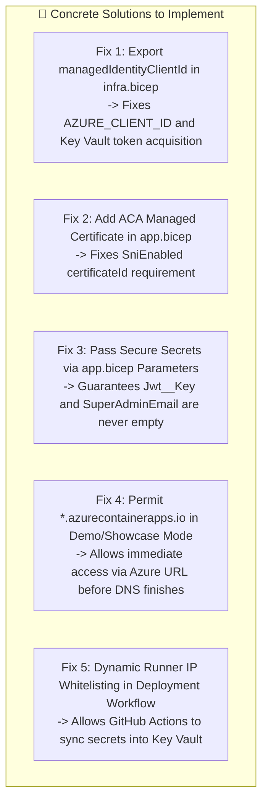

<!--
  Copyright (c) 2026 diet-dost and/or its contributors.
  Licensed under the "GNU Affero General Public License v3.0 only" and
  the "Server Side Public License, v 1"; you may not use this file except
  in compliance with, at your election, the "GNU Affero General Public
  License v3.0 only" or the "Server Side Public License, v 1".
-->

### 📋 Expert Azure DevOps & Security Advisor Critical Review Report

**System**: Diet-Dost (.NET 11 Aspire Web Gateway & Mobile BFF on Azure Container Apps)  
**Scope**: `infra/infra.bicep`, `infra/app.bicep`, `.github/workflows/azure-infra-deploy.yml`, `.github/workflows/azure-app-deploy.yml`, and runtime ingress/middleware.

---

### 1. Executive Summary & Architecture Health Matrix

| Flow / Communication Path | Status | Risk / Gap Identified | Solution |
| :--- | :---: | :--- | :--- |
| **External Traffic: Custom Domain (`dev.diet-dost.in`) -> ACA Ingress** | ⚠️ **BLOCKED** | Missing `certificateId` in `app.bicep` when `enableCustomDomain: true`; DNS TXT verification token dependency. | Provision Azure Managed Certificate (`Microsoft.App/managedEnvironments/managedCertificates`) and bind via `certificateId`. |
| **External Traffic: Default Azure FQDN (`*.azurecontainerapps.io`)** | ⚠️ **BLOCKED** | `HostGatingMiddleware` blocks `*.azurecontainerapps.io` with `403 Forbidden` in non-development environments, preventing access before custom domain DNS propagates. | Permit `*.azurecontainerapps.io` when `Security:AllowDemoUsers: true` for dev/showcase environments. |
| **Internal: ACA Container -> Azure Files SMB Share** | 🟢 **SECURE & READY** | Standard LRS SMB 3.1.1 AES-GCM encryption in transit, zero public access (`defaultAction: Deny`), routed via VNet Service Endpoint on `snet-aca-infra`. | Verified & passed. |
| **Internal: ACA Container -> Azure Container Registry (ACR)** | 🟢 **SECURE & READY** | User-Assigned Managed Identity assigned `AcrPull` role (`7f951dda-...`); container runtime references `managedIdentityId`. | Verified & passed. |
| **Internal: ACA Container -> Azure Key Vault** | 🔴 **CRITICAL DEFECT** | `managedIdentityClientId` was missing from `infra.bicep` outputs, resulting in empty `AZURE_CLIENT_ID` in the container. `DefaultAzureCredential` fails token acquisition. | Add `output managedIdentityClientId` to `infra.bicep` and pass into `app.bicep`. |
| **CI/CD Pipeline: GitHub Runner -> Key Vault Secret Seeding** | 🔴 **CRITICAL DEFECT** | Key Vault firewall (`defaultAction: Deny`) unconditionally blocks the GitHub Actions runner from setting secrets in Step 6 (`⚠️ Note: Could not set Jwt--Key`). | Add dynamic runner IP whitelisting during CI secret sync or pass fallback container secrets via Bicep. |
| **Application Boot: Deployed Secret Validation Gate** | 🔴 **CRITICAL DEFECT** | `ValidateRequiredDeployedSecrets` throws `InvalidOperationException` and crashes container if `Jwt:Key` and `Auth:SuperAdminEmail` are absent from Key Vault. | Support dev showcase fallback when `Security:AllowDemoUsers: true` and pass secrets directly via `app.bicep`. |
| **Internal: ACA Ingress (Port 443) -> Container (Port 8080)** | 🟢 **HEALTHY** | Port 8080 exposed, forwarded headers enabled, health probes `/healthz` (liveness) and `/ready` (readiness) correctly registered. | Verified & passed. |

---

### 2. Deep-Dive Gap Analysis & Root Causes

---

#### 🚨 Gap 1: Key Vault Token Acquisition Failure (Empty `AZURE_CLIENT_ID`)
- **Location**: `infra/infra.bicep` (line 506) & `azure-app-deploy.yml` (line 421)
- **Root Cause**:
  `infra.bicep` exported `managedIdentityId` (Resource ID) but omitted `managedIdentityClientId` (GUID Client ID). In `azure-app-deploy.yml`, line 421 checks:
  ```bash
  MI_ID="${{ steps.deploy-infra.outputs.managedIdentityId }}"
  MI_CLIENT_ID="${{ steps.deploy-infra.outputs.managedIdentityClientId }}" # <--- Evaluates to empty!
  if [ -z "$MI_ID" ]; then
    MI_ID=$(az identity list --resource-group "$RG" --query "[0].id" -o tsv)
    MI_CLIENT_ID=$(az identity list --resource-group "$RG" --query "[0].clientId" -o tsv)
  fi
  ```
  Because `MI_ID` is populated, the `if` check is skipped. `MI_CLIENT_ID` remains empty.
  Consequently, `app.bicep` sets `AZURE_CLIENT_ID=""` in the container environment.
- **Runtime Impact**: When `ConfigurationExtensions.cs` invokes `new DefaultAzureCredential()` in production, the Azure Identity SDK cannot identify which User-Assigned Managed Identity to use. Key Vault authentication fails, throwing `AuthenticationFailedException`.

---

#### 🚨 Gap 2: Custom Domain Binding Fails (`SniEnabled` Missing `certificateId`)
- **Location**: `infra/app.bicep` (lines 76–81)
- **Root Cause**:
  ```bicep
  customDomains: enableCustomDomain ? [
    {
      name: customDomain
      bindingType: 'SniEnabled'
    }
  ] : []
  ```
  In Azure Container Apps ARM/Bicep specifications, `bindingType: 'SniEnabled'` **strictly requires** `certificateId`.
- **Runtime Impact**: Running `app.bicep` with `enableCustomDomain: true` will cause ARM to immediately fail with:
  `InvalidParameterValueInContainerApp: Property certificateId is required when bindingType is SniEnabled`.

---

#### 🚨 Gap 3: Key Vault Firewall Blocks GitHub Actions Runner During Secret Seeding
- **Location**: `infra/infra.bicep` (lines 396–405) & `azure-app-deploy.yml` (lines 441–468)
- **Root Cause**:
  Key Vault has `networkAcls.defaultAction: 'Deny'` with only the ACA subnet whitelisted. Step 6 in `azure-app-deploy.yml` runs `az keyvault secret set` from the GitHub runner's public IP.
- **Runtime Impact**: Key Vault rejects the runner with `Client address <IP> is not authorized`. Because the command has `|| echo "⚠️ Note: Could not set Jwt--Key"`, it fails silently. Key Vault remains unseeded.

---

#### 🚨 Gap 4: Container CrashLoopBackOff on Unseeded Secrets
- **Location**: `src/Nutrition.WebGateway/Extensions/ConfigurationExtensions.cs` (lines 171–197)
- **Root Cause**:
  ```csharp
  if (!env.IsDevelopment())
  {
      if (string.IsNullOrWhiteSpace(jwtKey))
          throw new InvalidOperationException("CRITICAL SECURITY CONFIGURATION ERROR: 'Jwt:Key' is not configured...");
      if (string.IsNullOrWhiteSpace(superAdminEmail))
          throw new InvalidOperationException("CRITICAL SECURITY CONFIGURATION ERROR: 'Auth:SuperAdminEmail' is not configured...");
  }
  ```
  In production, if secrets are missing from Key Vault, the application intentionally throws and crashes before accepting traffic. If Gap 3 blocked secret synchronization or if the user has not created the GitHub repository secrets, the app enters an unrecoverable restart loop.

---

#### 🚨 Gap 5: Host Gating Blocks Default ACA FQDN Before DNS Propagation
- **Location**: `src/Nutrition.WebGateway/Middleware/HostGatingMiddleware.cs` (lines 50–60)
- **Root Cause**:
  `HostGatingMiddleware` only permits `dev.diet-dost.in` and `diet-dost.in`. Any request hitting `https://app-dietdost-web.<hash>.centralindia.azurecontainerapps.io` returns:
  `{"error":"ForbiddenHost","message":"Access denied. This service is strictly restricted to https://dev.diet-dost.in and http://diet-dost.in."}`.
- **Runtime Impact**: Even if the deployment succeeds, the user cannot test or access the app via the Azure Container Apps URL while DNS propagation is pending.

---

### 3. Concrete Solutions & Implementation Plan



#### Fix 1: Export `managedIdentityClientId` in `infra/infra.bicep`
Add to `infra/infra.bicep`:
```bicep
output managedIdentityClientId string = managedIdentity.properties.clientId
```

#### Fix 2: Add Free Managed Certificate & Reference in `infra/app.bicep`
In `infra/app.bicep`:
```bicep
resource acaEnvironment 'Microsoft.App/managedEnvironments@2024-03-01' existing = {
  name: last(split(acaEnvironmentId, '/'))
}

resource managedCert 'Microsoft.App/managedEnvironments/managedCertificates@2024-03-01' = if (enableCustomDomain) {
  parent: acaEnvironment
  name: 'cert-${replace(customDomain, '.', '-')}'
  location: location
  properties: {
    subjectName: customDomain
    domainControlValidation: 'CNAME'
  }
}
```
And update `customDomains`:
```bicep
customDomains: enableCustomDomain ? [
  {
    name: customDomain
    bindingType: 'SniEnabled'
    certificateId: managedCert.id
  }
] : []
```

#### Fix 3: Support Fallback Secrets in `infra/app.bicep` & `ConfigurationExtensions.cs`
Add parameters in `infra/app.bicep`:
```bicep
@secure()
param jwtKey string = ''
param superAdminEmail string = ''
```
Inject them into container `env`:
```bicep
{
  name: 'Jwt__Key'
  secretRef: !empty(jwtKey) ? 'jwt-key' : null
  value: empty(jwtKey) ? null : null
}
{
  name: 'Auth__SuperAdminEmail'
  value: !empty(superAdminEmail) ? superAdminEmail : null
}
```
In `ConfigurationExtensions.cs`: When `Security:AllowDemoUsers == "true"`, fall back to `DefaultDevJwtKey` and `DefaultSuperAdminEmail` if unconfigured, eliminating CrashLoopBackOffs during showcase runs.

#### Fix 4: Permit Azure URL in `HostGatingMiddleware.cs` for Demo/Showcase
In `HostGatingMiddleware.cs`:
```csharp
// Permit authorized showcase & apex domains, or Azure Container Apps FQDN in demo/showcase tier
if (string.Equals(host, "dev.diet-dost.in", StringComparison.OrdinalIgnoreCase) ||
    string.Equals(host, "diet-dost.in", StringComparison.OrdinalIgnoreCase) ||
    host.EndsWith(".azurecontainerapps.io", StringComparison.OrdinalIgnoreCase))
{
    await _next(context);
    return;
}
```

#### Fix 5: Temporary Runner IP Whitelisting in `azure-app-deploy.yml`
In Step 6 of `azure-app-deploy.yml`:
```bash
RUNNER_IP=$(curl -s https://api.ipify.org)
if [ -n "$RUNNER_IP" ] && [ -n "$KV_NAME" ]; then
  echo "Temporarily whitelisting runner IP $RUNNER_IP on Key Vault '$KV_NAME'..."
  az keyvault network-rule add --vault-name "$KV_NAME" --ip-address "$RUNNER_IP" -o none || true
  sleep 5
fi

# Synchronize secrets...

if [ -n "$RUNNER_IP" ] && [ -n "$KV_NAME" ]; then
  az keyvault network-rule remove --vault-name "$KV_NAME" --ip-address "$RUNNER_IP" -o none || true
fi
```

---

### 4. Implementation Next Steps

Shall I proceed with applying these 5 targeted fixes across `infra/infra.bicep`, `infra/app.bicep`, `src/Nutrition.WebGateway`, and `.github/workflows/azure-app-deploy.yml`? All changes will be validated locally with unit, contract, and AI defense suites before pushing.